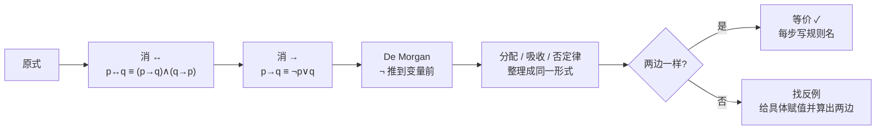

## 1.1 六个联结词真值表（slides 1.1 p39）

| $p$ | $q$ | $\neg p$ | $p\land q$ | $p\lor q$ | $p\oplus q$ | $p\to q$ | $p\leftrightarrow q$ |
|---|---|---|---|---|---|---|---|
| T | T | F | T | T | F | T | T |
| T | F | F | F | T | T | ==F== | F |
| F | T | T | F | T | T | T | F |
| F | F | T | F | F | F | T | T |

**记忆要点（第一性原理）：**

- $\land$ 只有全 T 才 T；$\lor$ 只有全 F 才 F。
- ==$p\to q$ 只有 "p 真 q 假" 这一行是 F==。前提假时整句自动为真（"空话也算对"）。这是整章最重要的一行，第 1 题 ii) iii) 的陷阱、第 2 题 c) 的化简、第 5 题选逆否法，全部来源于此。
- $p\leftrightarrow q$：两边真值相同就 T。
- $\oplus$：恰好一个 T。

## 1.2 运算优先级（slides 1.1 p41；1.3 p23）

$$
1.\ \neg \qquad 2.\ \land \qquad 3.\ \lor,\ \oplus \qquad 4.\ \to \qquad 5.\ \leftrightarrow
$$

量词 $\forall x$、$\exists x$ 的优先级比所有命题联结词都高：$\forall x\,P(x)\land Q(x)$ 读作 $(\forall x\,P(x))\land Q(x)$。考试写答案==宁可多加括号==，不要依赖优先级。

## 1.3 条件语句 $p\to q$ 的所有英文说法（slides 1.1 p31）—— 翻译题的核心

以下全部等于 $p \to q$：

- If p, then q ／ If p, q ／ p implies q
- ==q if p==（if 后面的是前提！）
- ==p only if q==（only if 后面的是结论！）
- q whenever p ／ q follows from p
- ==p is sufficient for q==（充分条件 = 前件）
- ==q is necessary for p==（必要条件 = 后件）

| 关系 | 公式 | 和原式等价吗 |
|---|---|---|
| 原式 | $p\to q$ | — |
| 逆命题 Converse | $q\to p$ | ✗ |
| 否命题 Inverse | $\neg p\to\neg q$ | ✗ |
| ==逆否命题 Contrapositive== | $\neg q\to\neg p$ | ==✓ 等价== |

逆命题 ≡ 否命题（它们互为逆否）。$p\leftrightarrow q$ 读作 "p if and only if q"、"p iff q"、"p is necessary and sufficient for q"。

## 1.4 等价律总表（slides 1.2 p82 原表 + p83 / p86 蕴含、双条件）

### A. 基本十律（原表）

| 名称 | $\land$ 版本 | $\lor$ 版本 |
|---|---|---|
| Identity 同一律 | $p\land \mathbf{T}\equiv p$ | $p\lor \mathbf{F}\equiv p$ |
| Domination 支配律 | $p\land \mathbf{F}\equiv \mathbf{F}$ | $p\lor \mathbf{T}\equiv \mathbf{T}$ |
| Idempotent 幂等律 | $p\land p\equiv p$ | $p\lor p\equiv p$ |
| Double Negation 双重否定 | $\neg(\neg p)\equiv p$ | |
| Negation 否定律 | $p\land\neg p\equiv \mathbf{F}$ | $p\lor\neg p\equiv \mathbf{T}$ |
| Commutative 交换律 | $p\land q\equiv q\land p$ | $p\lor q\equiv q\lor p$ |
| Associative 结合律 | $(p\land q)\land r\equiv p\land(q\land r)$ | $(p\lor q)\lor r\equiv p\lor(q\lor r)$ |
| ==Distributive 分配律== | $p\land(q\lor r)\equiv(p\land q)\lor(p\land r)$ | $p\lor(q\land r)\equiv(p\lor q)\land(p\lor r)$ |
| Absorption 吸收律 | $p\land(p\lor q)\equiv p$ | $p\lor(p\land q)\equiv p$ |
| ==De Morgan== | $\neg(p\land q)\equiv\neg p\lor\neg q$ | $\neg(p\lor q)\equiv\neg p\land\neg q$ |

### B. 蕴含相关（slides p83，老师说"只需背第一条"，其余可推）

$$
\begin{aligned}
\bigstar\quad p\to q &\equiv \neg p\lor q &&\text{（蕴含消去——所有题目第一步都是它）}\\
p\to q &\equiv \neg q\to\neg p &&\text{（逆否）}\\
p\lor q &\equiv \neg p\to q\\
p\land q &\equiv \neg(p\to\neg q)\\
\neg(p\to q) &\equiv p\land\neg q &&\text{（蕴含的否定：前件真且后件假）}\\
(p\to q)\land(p\to r) &\equiv p\to(q\land r)\\
(p\to r)\land(q\to r) &\equiv (p\lor q)\to r &&\text{（分情况证明的依据）}\\
(p\to q)\lor(p\to r) &\equiv p\to(q\lor r)\\
(p\to r)\lor(q\to r) &\equiv (p\land q)\to r\\
p\to(q\to r) &\equiv (p\land q)\to r &&\text{（Exportation，第 2 题 b）}
\end{aligned}
$$

### C. 双条件相关（slides p86，只需背第一条）

$$
\begin{aligned}
\bigstar\quad p\leftrightarrow q &\equiv (p\to q)\land(q\to p)\\
p\leftrightarrow q &\equiv (p\land q)\lor(\neg p\land\neg q)\\
p\leftrightarrow q &\equiv \neg p\leftrightarrow\neg q\\
\neg(p\leftrightarrow q) &\equiv p\leftrightarrow\neg q
\end{aligned}
$$

### D. 用等价律做题的固定套路

1. ==先消 ↔==（换成两个 $\to$ 的 $\land$），==再消 →==（$p\to q\equiv\neg p\lor q$）。
2. ==用 De Morgan 把 ¬ 推到最里面==，只留在单个变量前。
3. ==用分配律 / 吸收律整理==，目标是把两边化成同样的"∧ 里套 ∨"或"∨ 里套 ∧"。
4. 每一步右边**写规则名**（De Morgan's Laws / Distributive Laws …），tutorial 答案就是这个格式。

## 1.5 谓词与量词（slides 1.3 / 1.4）

### A. 四个要素 + 真假判定（p13, p22）

一个量化语句必须说清：==量词、变量、谓词、域（domain）==。

| 语句 | 何时为真 | 何时为假 |
|---|---|---|
| $\forall x\,P(x)$ | 每个 $x$ 都使 $P(x)$ 真 | 存在一个 $x$ 使 $P(x)$ 假（==反例 counterexample==） |
| $\exists x\,P(x)$ | 存在一个 $x$ 使 $P(x)$ 真（==举例==） | 每个 $x$ 都使 $P(x)$ 假 |

### B. 为什么 ∀ 配 →、∃ 配 ∧（p43、p45）—— 翻译题最大陷阱

- "Every student in this class is lazy"，域 = 所有人：$\forall x\,(S(x)\to L(x))$ ✓
  - 若写成 $\forall x\,(S(x)\land L(x))$：意思变成"所有人都是本班学生而且都懒" ✗
- "Some student in this class is lazy"：$\exists x\,(S(x)\land L(x))$ ✓
  - 若写成 $\exists x\,(S(x)\to L(x))$：只要域里有一个不是本班学生的人，前件假、整句就真了，毫无意义 ✗

> **第一性原理**：∀ 是一串 ∧，我们只想"管"满足 $S$ 的那些元素，对不满足 $S$ 的元素要"放行"，而 → 在前件假时恰好自动为 T（放行）。∃ 是一串 ∨，我们需要"真的找到一个既 $S$ 又 $L$ 的"，所以必须 ∧。

### C. 量词的 De Morgan（p37–38）

$$
\neg\forall x\,P(x)\equiv\exists x\,\neg P(x)\qquad\text{"不是所有都…" = "存在一个不…"}
$$

$$
\neg\exists x\,P(x)\equiv\forall x\,\neg P(x)\qquad\text{"不存在一个…" = "所有都不…"}
$$

嵌套时逐层往里推，每穿过一个量词就翻转一次：$\neg\forall x\exists y\,P\equiv\exists x\forall y\,\neg P$。

### D. 量词分配律（p35）—— 哪些是等价、哪些只是单向

$$
\begin{aligned}
\forall x\,(P(x)\land Q(x)) &\equiv \forall x\,P(x)\land\forall x\,Q(x) &&\checkmark\ \text{等价}\\
\exists x\,(P(x)\lor Q(x)) &\equiv \exists x\,P(x)\lor\exists x\,Q(x) &&\checkmark\ \text{等价}\\
\forall x\,P(x)\lor\forall x\,Q(x) &\Rightarrow \forall x\,(P(x)\lor Q(x)) &&\text{只能单向}\\
\exists x\,(P(x)\land Q(x)) &\Rightarrow \exists x\,P(x)\land\exists x\,Q(x) &&\text{只能单向}
\end{aligned}
$$

反例：$P$ = 偶数，$Q$ = 奇数，域 = 整数：$\forall x(P\lor Q)$ 真，但 $\forall xP\lor\forall xQ$ 假。

### E. 量词与"不含 x 的命题 A"的互动（p36，域非空）

$$
\begin{aligned}
\forall x\,(A\land P(x)) &\equiv A\land\forall x\,P(x) & \exists x\,(A\land P(x)) &\equiv A\land\exists x\,P(x)\\
\forall x\,(A\lor P(x)) &\equiv A\lor\forall x\,P(x) & \exists x\,(A\lor P(x)) &\equiv A\lor\exists x\,P(x)\\
\forall x\,(A\to P(x)) &\equiv A\to\forall x\,P(x) & \exists x\,(A\to P(x)) &\equiv A\to\exists x\,P(x)\\
\forall x\,(P(x)\to A) &\equiv \exists x\,P(x)\to A\ \bigstar & \exists x\,(P(x)\to A) &\equiv \forall x\,P(x)\to A\ \bigstar\\
\forall x\,A &\equiv A & \exists x\,A &\equiv A\quad\text{（第 2 题 c 用到）}
\end{aligned}
$$

带 ★ 的两条会"翻转"，原因：$P(x)\to A\equiv\neg P(x)\lor A$，$\forall x$ 穿过 $\neg$ 时变 $\exists$。

### F. 嵌套量词顺序（p55–57）

- 同类型可以换顺序：$\forall x\forall y\equiv\forall y\forall x$，$\exists x\exists y\equiv\exists y\exists x$。
- ==不同类型不能换==：$\forall x\exists y\,P(x,y)$（每个 $x$ 都能找到自己的 $y$，$y$ 可随 $x$ 变）**≠** $\exists y\forall x\,P(x,y)$（有一个万能的 $y$ 对所有 $x$ 都行）。
- 单向成立：$\exists y\forall x\,P(x,y)\Rightarrow\forall x\exists y\,P(x,y)$（有万能的当然每人都有）。
- ==博弈读法（最直观）==：从左往右读，∀ 是"对手随便选"，∃ 是"我来选"。我后选就可以看着对手的牌出，我先选就要一手牌应付对手所有出法。

### G. "恰好一个 / 恰好两个"的写法（p66–79）

$$
\begin{aligned}
\text{恰好一个：}&\ \exists x\,\big(P(x)\land\forall z\,(P(z)\to z=x)\big)\ \text{或}\ \exists x\,\big(P(x)\land\forall z\,(z\neq x\to\neg P(z))\big)\\
\text{恰好两个：}&\ \exists x\exists y\,\big(P(x)\land P(y)\land x\neq y\land\forall z\,(P(z)\to(z=x\lor z=y))\big)\\
\text{至少一个：}&\ \exists x\,P(x)\qquad \text{至多一个：}\ \forall x\forall y\,(P(x)\land P(y)\to x=y)
\end{aligned}
$$

### H. 受限域缩写（p50）

$$
\forall x>10\,(x^2>100)\equiv\forall x\,(x>10\to x^2>100)\qquad\forall\text{ 展开用 }\to
$$

$$
\exists x>0\,(x^2=2)\equiv\exists x\,(x>0\land x^2=2)\qquad\exists\text{ 展开用 }\land
$$

## 1.6 推理规则（slides 1.5 p13、p25、p34）

### A. 命题推理规则八条

| 名称 | 形式 | 口诀 |
|---|---|---|
| ==Modus Ponens== 肯定前件 | $p,\ p\to q\ \therefore q$ | 有因必有果 |
| ==Modus Tollens== 否定后件 | $\neg q,\ p\to q\ \therefore\neg p$ | 无果必无因 |
| Hypothetical Syllogism 假言三段论 | $p\to q,\ q\to r\ \therefore p\to r$ | 链式传递 |
| Disjunctive Syllogism 析取三段论 | $p\lor q,\ \neg p\ \therefore q$ | 二选一排除 |
| Addition 附加 | $p\ \therefore p\lor q$ | 真的东西或上任何都还真 |
| Simplification 化简 | $p\land q\ \therefore p$ | 且里面拆一个出来 |
| Conjunction 合取 | $p,\ q\ \therefore p\land q$ | 两个真合起来 |
| Resolution 消解 | $p\lor q,\ \neg p\lor r\ \therefore q\lor r$ | 对消 $p$ |

### B. 量词推理规则四条

| 名称 | 形式 | 使用条件 |
|---|---|---|
| ==Universal Instantiation (UI)== | $\forall x\,P(x)\ \therefore P(c)$ | $c$ 是域中任意**指定**元素（如 Bob） |
| Universal Generalization (UG) | $P(c)$，$c$ 任意 $\therefore\forall x\,P(x)$ | $c$ 必须是"任取的"，不能是某个特定的 |
| ==Existential Instantiation (EI)== | $\exists x\,P(x)\ \therefore P(c)$，某个 $c$ | $c$ 是新名字，只知道它存在 |
| ==Existential Generalization (EG)== | $P(c)\ \therefore\exists x\,P(x)$ | 有一个例子就能说存在 |

**组合规则（p34）**：Universal Modus Ponens：$\forall x(P(x)\to Q(x)),\ P(a)\ \therefore Q(a)$；Universal Modus Tollens：$\forall x(P(x)\to Q(x)),\ \neg Q(a)\ \therefore\neg P(a)$。

### C. 两个经典谬误（p24）—— 第 1 题 ii) iii) 考的就是它

| 谬误 | 形式 | 为什么错 |
|---|---|---|
| ==Fallacy of affirming the conclusion== 肯定后件 | $p\to q,\ q\ \therefore p$ ✗ | $q$ 真时 $p$ 可真可假（真值表第 3 行） |
| ==Fallacy of denying the hypothesis== 否定前件 | $p\to q,\ \neg p\ \therefore\neg q$ ✗ | $p$ 假时 $q$ 可真可假（真值表第 3、4 行） |

记法：$p\to q$ 只告诉你"p 真那一半世界"发生了什么，对"p 假的世界"==什么都没说==。

### D. 一个推理有效的判定（p6）

论证 $p_1,p_2,\dots,p_n\ \therefore q$ 有效 $\iff (p_1\land p_2\land\cdots\land p_n)\to q$ 是永真式。要说明==无效==：给出一组真值（或一个具体场景 / 模型），让所有前提为 T 而 $q$ 为 F。

## 1.7 证明方法总表（slides 1.6 p40–81）

| 要证的形式 | 方法 | 做法 | 什么时候用 |
|---|---|---|---|
| $p\to q$ | ==直接证明 Direct== | 假设 $p$，推出 $q$ | 从 $p$ 能自然算出 $q$ 时 |
| $p\to q$ | ==逆否证明 Contraposition== | 假设 $\neg q$，推出 $\neg p$（因为 $p\to q\equiv\neg q\to\neg p$） | 从 $p$ 出发要开根号 / 除法算不动，但从 $\neg q$ 出发能代公式时（**第 5 题**） |
| 任意 $p$（含 $p\to q$） | ==反证法 Contradiction== | 假设 $\neg p$，推出矛盾 $(r\land\neg r)$ 或 F | 结论是"不存在 / 无理数 / 不可能"类 |
| $p\leftrightarrow q$ | 双向证明 | 分别证 $p\to q$ 和 $q\to p$ | 题目含 iff |
| $p_1\leftrightarrow\cdots\leftrightarrow p_n$ | 环形链 | $p_1\to p_2\to\cdots\to p_n\to p_1$ | 多个命题等价 |
| $(p_1\lor p_2\lor\cdots)\to q$ | 分情况 Cases | 每种情况各证一次 | 含绝对值、奇偶、正负、min/max |
| 有限个对象 | 穷举 Exhaustive | 全部代入检查 | $n\le 4$ 之类 |
| $\exists x\,P(x)$ | 存在性 Existence | 给出一个具体例子 | 题目说 "there exists" |
| $\exists!x\,P(x)$ | ==唯一性 Uniqueness== | ①存在：给例子 ②唯一：设另有 $y$ 满足，推出 $y=x$ | 题目说 "unique / exactly one"（**第 6 题**） |

**反证法的第一性原理**：要证 $p$，证 $\neg p\to\mathbf{F}$。因为 $\neg p\to\mathbf{F}\equiv\neg(\neg p)\lor\mathbf{F}\equiv p$。对 $p\to q$ 用反证：假设 $\neg(p\to q)\equiv p\land\neg q$，然后推矛盾。

**常用定义（证明题必须写出来才算推理严密）：**

- $n$ 是偶数 $\iff\exists k\in\Z,\ n=2k$；$n$ 是奇数 $\iff\exists k\in\Z,\ n=2k+1$
- $r$ 是有理数 $\iff\exists p,q\in\Z,\ q\neq 0,\ r=p/q$（通常再加"$p$、$q$ 互质 / 最简"）
- $a$ 是完全平方数 $\iff\exists b\in\Z,\ a=b^2$
- $n$ 整除 $m$（$n\mid m$）$\iff\exists k\in\Z,\ m=nk$
- 两个整数的和、差、积仍是整数（证明里写"因为 $2k^2+2k$ 是整数"就是在用这条）
