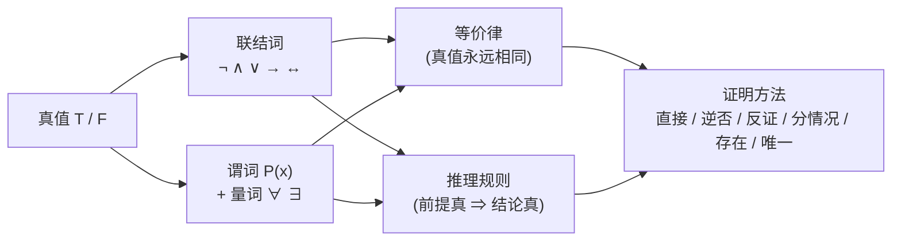

## 0.1 整个 Logic 只有一个底层事实：真值只有 T 和 F

- 一个==命题==就是一个"非真即假"的句子。所有联结词 $\neg,\ \land,\ \lor,\ \to,\ \leftrightarrow$ 都只是==对 T/F 做运算的函数==，就像 $+\ -\ \times\ \div$ 对数字做运算一样。
- 所以任何逻辑问题，追到底都是在问：**"在每一种 T/F 组合下，这个式子算出来是什么？"**
- 真值表 = 把所有组合一个个算一遍。考试禁止用真值表，是逼你用"代数定律"（等价律）来做，但==定律全部是从真值表里验证出来的==，背不住时可以在草稿纸上用真值表偷偷验证。

## 0.2 三个核心概念，全都用"真值"定义

| 概念 | 一句话定义 | 怎么证明它成立 | 怎么证明它不成立 |
|---|---|---|---|
| ==等价== $P \equiv Q$ | 任何情况下 $P$ 和 $Q$ 真值都相同（$P \leftrightarrow Q$ 是永真式） | 用等价律把一边变形成另一边 | 找**一组赋值**让两边真值不同（反例） |
| ==推理有效== | 前提全真的时候，结论**必定**真 | 用推理规则一步步从前提推到结论 | 造**一个场景**：前提全真、结论假 |
| ==命题为真== | 在给定的 domain 下算出来是 T | $\forall$：对所有元素逐一说明；$\exists$：举一个例子 | $\forall$：举一个反例；$\exists$：对所有元素说明都不行 |

> 第 1 题 b)、第 2 题、第 4 题 全部是这三行的直接应用。

## 0.3 谓词逻辑只是在命题逻辑上加了"对象"和"范围"

- 命题逻辑：$p$ = "Bob 通过了课程"，$p$ 是一个整体，拆不开。
- 谓词逻辑：$P(x)$ = "$x$ 通过了课程"，把"主语 $x$"抠出来变成变量。$P(\text{Bob})$ 才是一个命题。
- 量词：$\forall x\,P(x)$ = "域里==每一个== $x$ 代进去都为真"；$\exists x\,P(x)$ = "域里==至少一个== $x$ 代进去为真"。
- ==有限域的本质==（slides 1.3 p17 / p19）：

$$
\forall x\,P(x) \;\equiv\; P(x_1)\land P(x_2)\land\cdots\land P(x_n)\qquad\text{（}\forall\text{ 就是一长串 }\land\text{）}
$$

$$
\exists x\,P(x) \;\equiv\; P(x_1)\lor P(x_2)\lor\cdots\lor P(x_n)\qquad\text{（}\exists\text{ 就是一长串 }\lor\text{）}
$$

记住这一条，量词的所有定律（De Morgan、分配律、为什么 $\forall$ 配 $\to$、$\exists$ 配 $\land$）都能自己推出来。

## 0.4 证明 = 把"推理有效"写成人能读的文字

- 形式证明（第 1 题那种）：每一步写规则名。
- 非形式证明（第 5、6 题那种）：用自然语言，但每一步仍然是"由前提 + 定义 + 已知事实 ⇒ 下一句"。
- 所有证明方法（直接、逆否、反证、分情况、存在性、唯一性）都只是==把目标命题换一个等价的形式==再去证。

