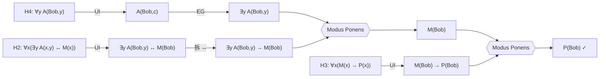

### 题目回顾

$$
\begin{aligned}
A(x,y)&:\ x\text{ attends lecture }y & M(x)&:\ x\text{ understands the material}\\
P(x)&:\ x\text{ passes the course} & R(x)&:\ x\text{ is respected}
\end{aligned}
$$

$x\in$ students in the class，$y\in$ lectures of the course。

### 1a）翻译 Hypotheses 1–3（9 分）

**解题前先做三件事（翻译题 SOP）：**

1. 找量词词：every / all / any / each → $\forall$；some / a / there is / at least one → $\exists$；"a student … iff …" 这种泛指的"a"实际是 ==every==（$\forall$）。
2. 找联结词：if…then / only if / iff / and / or / not。
3. 看哪个变量被哪个量词管：这题 $x$ 管学生，$y$ 管讲座，==两个都要加量词==。

Hypothesis 1：Every student who attends all lectures is respected.

$$
\forall x\,\big(\forall y\,A(x,y)\to R(x)\big)
$$

- "Every student" → 最外层 $\forall x$
- "who attends all lectures" → 对这个 $x$，==所有== $y$ 都 $A(x,y)$：$\forall y\,A(x,y)$。这是一个关于 $x$ 的"条件"
- "is respected" → $R(x)$
- "Every … who [条件] is [结果]" 是 $\forall$ + $\to$（见公式表 1.5 B）

常见错误（第一性原理地说明为什么错）

- ✗ $\forall x\forall y\,(A(x,y)\to R(x))$：这等价于 $\forall x\,(\exists y\,A(x,y)\to R(x))$（公式表 1.5 E 的"翻转"条），意思变成"只要上过==任一节==课就被尊重"。$y$ 的 $\forall$ 必须留在前件==里面==。
- ✗ $\forall x\forall y\,A(x,y)\to R(x)$：$R(x)$ 里的 $x$ 跑到量词作用域外面成了自由变量，不是命题。
- ✗ 用 $\land$ 代替 $\to$。

Hypothesis 2：A student attends some lectures if and only if the student understands the material.

$$
\forall x\,\big(\exists y\,A(x,y)\leftrightarrow M(x)\big)
$$

"A student" 泛指任何学生 → $\forall x$；"attends some lectures" → $\exists y\,A(x,y)$；"if and only if" → $\leftrightarrow$。

Hypothesis 3：If a student understands the material, then the student passes the course.

$$
\forall x\,\big(M(x)\to P(x)\big)
$$

卷面手写只写了 $M(x)\to P(x)$，==漏了 ∀x==，这很可能就是 −3 的来源之一。没有量词的 $x$ 是自由变量，整句不是命题，不能当前提用。

**Hypotheses 4–6（题目没要求翻，但 b) 要用，一定写出来）：**

$$
H_4:\ \forall y\,A(\text{Bob},y)\qquad H_5:\ \neg P(\text{Noah})\qquad H_6:\ \neg M(\text{Jessica})
$$

### 1b）判断三个结论能否推出（15 分）

**判定原则（总纲 0.2 表第二行）**：

- 能推出 → 写 Step / Reason 表格形式证明（slides 1.5 p18、p32 的格式）。
- 不能推出 → ==不是写"不知道"就完事==，要说明是哪种谬误，并给出一个"所有前提为真、结论为假"的具体场景。

#### 结论 i) Bob passes the course —— ==可以推出== ✓

思路（倒推）：要 $P(\text{Bob})$ ← 由 $H_3$ 需 $M(\text{Bob})$ ← 由 $H_2$ 需 $\exists y\,A(\text{Bob},y)$ ← 由 $H_4$ "Bob 上所有课"当然"上过某节课"。

| Step | 语句 | Reason |
|---|---|---|
| 1 | $\forall y\,A(\text{Bob},y)$ | Premise ($H_4$) |
| 2 | $A(\text{Bob},c)$，$c$ 为某一节具体的讲座 | Universal Instantiation from (1) |
| 3 | $\exists y\,A(\text{Bob},y)$ | Existential Generalization from (2) |
| 4 | $\forall x\,(\exists y\,A(x,y)\leftrightarrow M(x))$ | Premise ($H_2$) |
| 5 | $\exists y\,A(\text{Bob},y)\leftrightarrow M(\text{Bob})$ | Universal Instantiation from (4) |
| 6 | $\exists y\,A(\text{Bob},y)\to M(\text{Bob})$ | $p\leftrightarrow q\equiv(p\to q)\land(q\to p)$，再 Simplification from (5) |
| 7 | $M(\text{Bob})$ | Modus Ponens from (3),(6) |
| 8 | $\forall x\,(M(x)\to P(x))$ | Premise ($H_3$) |
| 9 | $M(\text{Bob})\to P(\text{Bob})$ | Universal Instantiation from (8) |
| 10 | $P(\text{Bob})$ | Modus Ponens from (7),(9) |

∴ Bob passes the course.（步骤 2→3 隐含"课程至少有一节讲座"，即 $y$ 的域非空，这是默认的。）

#### 结论 ii) Noah is not respected —— ==不能推出== ✗

先看能推到哪：

| Step | 语句 | Reason |
|---|---|---|
| 1 | $\neg P(\text{Noah})$ | Premise ($H_5$) |
| 2 | $M(\text{Noah})\to P(\text{Noah})$ | UI from $H_3$ |
| 3 | $\neg M(\text{Noah})$ | Modus Tollens (1),(2) |
| 4 | $\exists y\,A(\text{Noah},y)\leftrightarrow M(\text{Noah})$ | UI from $H_2$ |
| 5 | $M(\text{Noah})\to\exists y\,A(\text{Noah},y)$ | 拆 $\leftrightarrow$，Simplification |
| 6 | $\neg\exists y\,A(\text{Noah},y)$ | Modus Tollens (3),(5) |
| 7 | $\forall y\,\neg A(\text{Noah},y)$ | De Morgan for quantifiers |
| 8 | $\forall y\,A(\text{Noah},y)\to R(\text{Noah})$ | UI from $H_1$ |

现在我们手里有：Noah ==一节课都没上==（第 7 行，所以 $\forall y\,A(\text{Noah},y)$ 为**假**），以及 $H_1$ "如果上了所有课 → 被尊重"。这是 $p\to q$ 且 $\neg p$，想推 $\neg q$ —— 正是 ==Fallacy of denying the hypothesis（否定前件谬误）==。$H_1$ 只保证"上全课的人被尊重"，对"没上全课的人"是否被尊重**什么都没说**。

反例场景（必写，这是分数所在）

设班上只有 Noah，课程只有一节课 $L$。令 $A(\text{Noah},L)=\mathbf F$，$M(\text{Noah})=\mathbf F$，$P(\text{Noah})=\mathbf F$，==R(Noah) = T==。

- $H_1$：$\forall y\,A(\text{Noah},y)$ 为 F，F → 任何 = T ✓
- $H_2$：$\exists y\,A(\text{Noah},y)=\mathbf F$，$M(\text{Noah})=\mathbf F$，F ↔ F = T ✓
- $H_3$：$M(\text{Noah})=\mathbf F$，F → F = T ✓
- $H_5$：$\neg P(\text{Noah})=\mathbf T$ ✓（$H_4$、$H_6$ 关于别人，可同理满足）
- 结论 $\neg R(\text{Noah})=\mathbf F$

所有前提真、结论假 ⇒ 论证无效，结论 ii) 不能推出。

#### 结论 iii) Jessica does not pass the course —— ==不能推出== ✗

手里只有 $H_6$：$\neg M(\text{Jessica})$，$H_3$ 给 $M(\text{Jessica})\to P(\text{Jessica})$。又是 $p\to q$ 且 $\neg p$ 想推 $\neg q$：==否定前件谬误==。"懂了就过"不等于"不懂就不过"（也许靠别的方式过了）。

反例场景

令 $M(\text{Jessica})=\mathbf F$，==P(Jessica) = T==，$A(\text{Jessica},y)=\mathbf F$ 对所有 $y$，$R$ 任意。

- $H_1$：前件 F → T ✓　$H_2$：F ↔ F = T ✓　$H_3$：F → T = T ✓　$H_6$：$\neg M=\mathbf T$ ✓
- 结论 $\neg P(\text{Jessica})=\mathbf F$ ⇒ 不能推出。

**卷面 −5 的可能原因**：把 ii) 或 iii) 写成"可以推出"；或者写了"不能"但没有说明谬误类型 / 没有给反例场景。

> **这类题的第一性原理**：每个 → 只约束"前件为真"的那一半世界。有效推理只能沿着箭头==顺着走（MP）==或者从==箭头尾部的否定倒着走（MT）==。拿到 ¬前件 或 后件 就想推东西，一定是谬误。一句话自检：**"我现在手里的是前件还是后件？是肯定还是否定？"** 只有 "肯定前件" 和 "否定后件" 两种组合能动。
