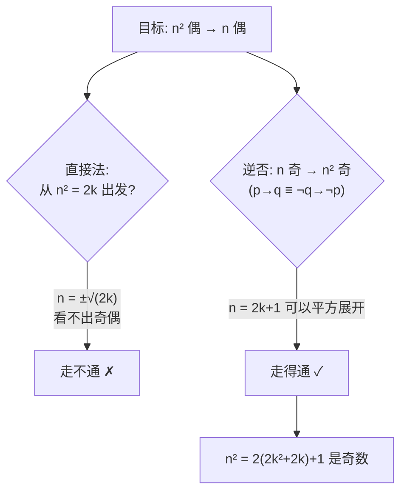

### 怎么选方法

- 要证的是 $\forall n\,(\text{Even}(n^2)\to\text{Even}(n))$，形式是 $p\to q$。
- **直接法试一下**：设 $n^2=2k$，要推 $n$ 是偶数，只能 $n=\pm\sqrt{2k}$，开根号后看不出奇偶 —— ==走不通==（slides 1.6 p54 原话 "may not be useful"）。
- **换逆否**：$\neg q\to\neg p$，即 ==n 是奇数 ⇒ n² 是奇数==。从 "$n$ 奇" 出发可以写 $n=2k+1$，直接平方展开，能算 —— 走得通。
- 这就是选逆否法的唯一标准：==哪一头能代公式、能做代数，就从哪一头出发==。

**Proof (by contraposition).**

We prove the contrapositive: if $n$ is odd, then $n^2$ is odd.

Assume $n$ is odd. By definition, $n=2k+1$ for some integer $k$.

Then

$$
n^2=(2k+1)^2=4k^2+4k+1=2(2k^2+2k)+1.
$$

Since $2k^2+2k$ is an integer, $n^2=2m+1$ with $m=2k^2+2k\in\Z$, so $n^2$ is odd by definition.

Hence "$n$ odd ⇒ $n^2$ odd" holds, and since $p\to q\equiv\neg q\to\neg p$, the original statement "if $n^2$ is even then $n$ is even" is true. ∎

### 用反证法写也可以（tutorial 3 Q8b 的格式）

Assume, for contradiction, that $n^2$ is even **and** $n$ is odd（即 $\neg(p\to q)\equiv p\land\neg q$）. Then $n=2k+1$, $n^2=2(2k^2+2k)+1$ is odd, contradicting "$n^2$ is even". ∴ the statement holds. ∎

### 写证明题必须出现的四样东西（阅卷点）

1. 写明==方法名==（by contraposition / by contradiction / direct）。
2. 写明==假设什么==（Assume …）。
3. 用==定义==展开（$n=2k+1$，where $k$ is an integer）。
4. 结论处==回到定义==（"$2k^2+2k$ is an integer, so $n^2$ is odd"）—— 不写"是整数"这一句会被扣。

### 相关同类公式（奇偶性全家桶，期末可能换着考）

- 奇 + 奇 = 偶，偶 + 偶 = 偶，奇 + 偶 = 奇
- 奇 × 奇 = 奇，有一个偶因子积就是偶
- $n$ 与 $n^2$ 奇偶性相同；$n$ 与 $n^3$ 奇偶性相同；$n$ 偶 $\iff 3n+1$ 奇（tutorial 3 Q9）
- 全部用 $n=2k$ 或 $2k+1$ 代入展开证明。
