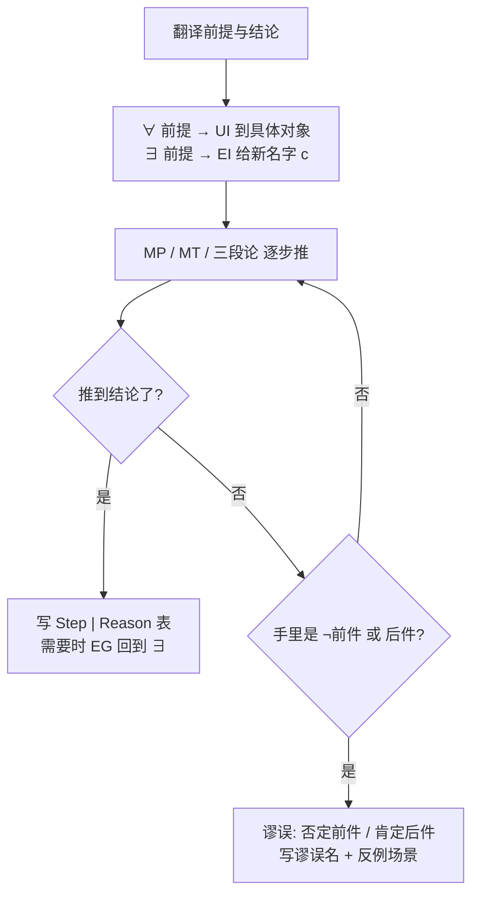
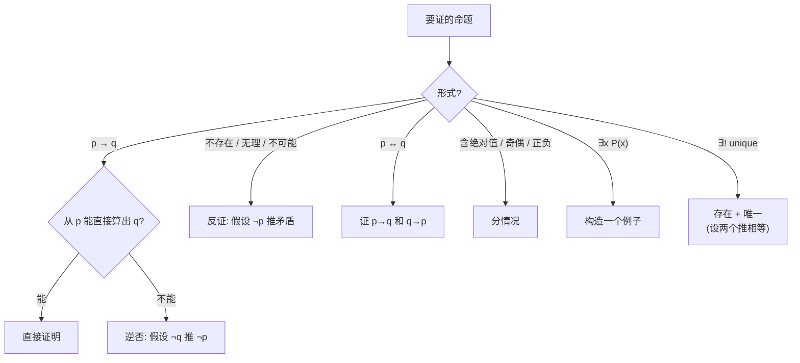

## 模板 A：英文 → 逻辑式（1a 型，tutorial 2 Q6 / Q7）

1. 列出谓词和各变量的域。
2. 圈出量词词：every / all / any / each / no one → $\forall$；some / a / there is / at least one → $\exists$；exactly one → $\exists$ + $\forall$ 组合。
3. 圈出联结词：if-then / only if / iff / and / or / not / unless（= if not）。
4. ==∀ 配 →，∃ 配 ∧==。
5. 每个变量都要有量词；注意量词作用域，"attends all lectures" 这种限定要放在前件里面。
6. 检查：把式子直译回英文读一遍，和原句意思是否一致？

## 模板 B：逻辑式 → 英文（tutorial 2 Q3 / Q4 / Q5）

从左到右读量词（$\forall$ "每个"，$\exists$ "有一个"），然后把谓词套回去，最后润色成自然句子。嵌套不同类型量词时，注意谁依赖谁。

## 模板 C：判断等价（第 2 题，tutorial 1 Q3）

消 ↔ → 消 → → De Morgan → 分配 / 吸收 → 两边对齐；不行就给具体赋值反例并算出两边值。每步写规则名。

## 模板 D：形式推理 / 论证是否有效（1b，tutorial 3 Q1 / Q2）

1. 翻译所有前提和结论。
2. 对带 $\forall$ 的前提先 ==UI== 到具体对象；带 $\exists$ 的先 ==EI==（给新名字 $c$）。
3. 用 MP / MT / 三段论等一步步推；需要时 ==EG== 回到 $\exists$。
4. 写成 Step | Reason 表。
5. 推不出来时：检查是不是"肯定后件"或"否定前件"；写出谬误名，并给一个前提全真结论假的场景。

## 模板 E：量词语句真假（第 4 题，tutorial 2 Q1 / Q2）

从左读到右；$\forall$ 真给通用论证 / 假给反例；$\exists$ 真给例子 / 假用反证说明全都不行；盯紧域。

## 模板 F：量词式否定（tutorial 2 Q8）

$\neg$ 逐层往里推，每穿过一个量词翻转一次（$\forall\leftrightarrow\exists$），到谓词前停下。遇到 $\to$ 先改成 $\neg p\lor q$ 再 De Morgan：$\neg(p\to q)\equiv p\land\neg q$；$\neg(p\leftrightarrow q)\equiv p\leftrightarrow\neg q$。

## 模板 G：证明题（第 5、6 题，tutorial 3 Q4–Q13）

| 看到 | 用 |
|---|---|
| if p then q，从 p 能算 | 直接证明 |
| if p then q，从 p 算不动（开根号、"n² 是偶数"） | ==逆否== |
| "是无理数"、"没有整数解"、"不可能" | ==反证== |
| iff | 两个方向各证一次 |
| 绝对值、奇偶、正负、min/max | 分情况 |
| n ≤ 某个小数 | 穷举 |
| there exists | 举例 |
| unique / exactly one | ==存在 + 唯一==（设两个推相等） |

证明四件套：==方法名、Assume、定义展开、回到定义收尾==。

