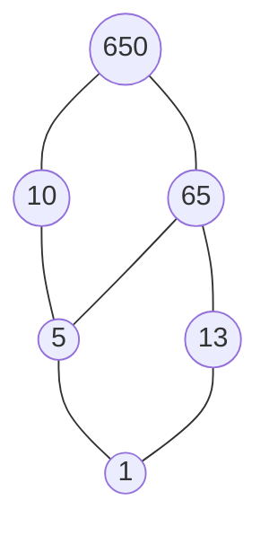

# 集合、函数与二元关系 · 怎么把对象配成对、连成网、分好类、排出上下级？

> 不用把集合、函数、关系矩阵、等价类和偏序格当成五门互不相干的字典来背。直接以 Midterm Test 02（76 分）的五道大题为路标，顺着“给机器动手术 → 在 0-1 表上算中转 → 给关系做体检 → 把整除画成层级网”一路打穿。
> 配套在线交互版路径：`/Relation/`（含交互实验教具、原卷双语抽屉、术语点击速查与本机笔记保存）。

---

## 开篇 · 把真题摊在桌上

翻开这门课第二阶段的课件，目录跨度大得吓人：先是第 2 章的集合与函数，猛地跳到第 9 章的二元关系、0-1 矩阵、Warshall 算法，接着又是等价类、偏序集、哈斯图和格（Lattice）。如果照着字典背名词，不出半小时就会彻底迷路。

我们还是用老办法：不看课本目录，直接把这一模块对应的真实考卷 **Midterm Test 02（满分 76 分，共 5 道大题）** 摊在面前，看看要拿满这 76 分，考官到底让你动手做哪五件事：

1. **摆弄三台实数加工机**（第 1 题，12 分）：把两台机器串起来算复合、加起来算和，找出绝对值机器 $h(x)=|x/2|$ 能吐出哪些数，再给它的入口和出口动两刀小手术，让它变成能原路倒推回去的“一一对应”。
2. **在两张 $3 \times 3$ 的 0-1 方格表上做六次推演**（第 2 题，24 分，占了近三分之一张卷子！）：把箭头掉头、黑白反转、挑出两张表不一样的地方、先走第一张表再走第二张表，最后补上最少的新 `1` 让单行道变双向、让转车变直达。
3. **给三条规则做八项全身检查**（第 3 题，12 分）：给你一串数字配对、一句“拥有相同的朋友”和一条整数不等式 $x^2 \ge y$，逐项判断它们算不算函数、算不算分班抱团的等价关系、算不算排辈分的偏序关系。
4. **写一段 8 分的英文短证明**（第 4 题，8 分）：已知两份关系名单都是“有去必有回”的，证明它们重叠的交集依然有去必有回。
5. **把 6 个数的整除关系画成极简层级图**（第 5 题，20 分）：在 $\{1, 5, 10, 13, 65, 650\}$ 上擦掉多余连线画出哈斯图，在图上找谁垫底、谁封顶、谁是公共天花板，最后判断整张图算不算一个“格”。

你会发现，这五件事从头到尾其实只是在把“**两个对象配成一对**”玩出不同的花样。下面我们分四幕顺着考卷一路推过去。

<strong>开篇自查 1 · </strong>纸箱 {∅} 里面是空无一物，还是装着一件东西？

**装着 1 件东西！** 空集 $\varnothing$ 是一只空纸箱（元素个数为 $0$）；而 $\{\varnothing\}$ 是一只大纸箱，打开盖子能摸出里面放着一只空纸箱（元素个数为 $1$）。分清“箱子本身”和“箱子里的东西”，集合题就不会再绕晕。

<strong>开篇自查 2 · </strong>如果 A 认识 B、B 认识 C，A 未必认识 C。那如果把规则换成“A 和 B 拥有一模一样的朋友圈”，它还能一路传下去吗？

**完全能传下去！** 因为“朋友圈一模一样”背后是一个真正的**等号** $F(A) = F(B)$：既然 $F(A)=F(B)$ 且 $F(B)=F(C)$，当然 $F(A)=F(C)$。这正是 Test 02 第 3b 题考的“等价关系”。

---

# 第 1 幕：从“把范围说清”到“能原路倒推的机器”（直指第 1 题（12 分））

> 先把写集合范围时的拆箱规矩立稳，再把三台实数加工机摆上桌面：串起来怎么算？两个不同输入撞上同一个输出时，怎么动两刀小手术让它能唯一倒推回去？

## 01 写答案范围时，为什么多套一层花括号意思就全变了？

*为 Q1c 排雷 · 集合、子集与有序对*

先看一个当年真实考卷（Test 02 第 1c 题）上的失分小现场。题目让你写出绝对值函数 $h(x) = |x/2|$ 能算出哪些实数。有位同学心里非常清楚答案是“所有正实数再加上一个 $0$”，于是提笔在卷面上写下了：

$$
\{\mathbb{R}^+, 0\}
$$

阅卷老师看到这一行，眉头立刻皱了起来。明明意思想对了，为什么这么写就出了岔子？

把一对花括号 $\{\dots\}$ 想成一个**贴了封条的快递纸箱**。往纸箱里塞进几个互不相同的东西，不排先后次序（写 $\{1, 3, 5\}$ 和写 $\{5, 3, 3, 1\}$ 是同一个箱子），这就是数学里的 **集合（set）**，箱子里的每件物品叫作它的 **元素（element）**。

问题就出在“拆箱只拆最外一层”上：
- 写 $x \in A$（读作属于），意思是把箱子 $A$ 的盖子掀开，**伸手进去直接能摸到 $x$ 这件东西**。
- 写 $B \subseteq A$（读作 **子集 subset**），意思是把箱子 $B$ 里的每一样东西倒出来，样样都能在箱子 $A$ 里找到（也就是第 1 章学过的 $\forall x\,(x \in B \to x \in A)$；如果 $A$ 里还比 $B$ 多出至少一件东西，就叫 **真子集 proper subset**，记作 $B \subset A$）。

现在回头看那位同学写的 $\{\mathbb{R}^+, 0\}$：他在外面套了一层新纸箱，往里面放了**两件物品**——第一件物品是“装满全体正实数的那个大箱子 $\mathbb{R}^+$ 整体”，第二件物品是数字 $0$。如果你伸手进 $\{\mathbb{R}^+, 0\}$ 里找数字 $3$，摸得着吗？摸不着！因为 $3$ 锁在里面的小箱子 $\mathbb{R}^+$ 肚子里，外层大箱子里总共只有两样东西！

想把两个箱子里的东西倒进同一个大池子里合起来，应该用开口朝上的 **并集（union）** 符号 $\cup$，写成 $\mathbb{R}^+ \cup \{0\}$；或者用竖线把挑选规则写清楚——`{代表元素 | 它要满足的条件}`，叫 **集合构造记法（set builder notation）**，写成 $\{y \in \mathbb{R} \mid y \ge 0\}$，也就是区间 $[0, +\infty)$。

用同一个“拆快递箱”的眼光，Tutorial 04 前五题最爱考的“空集绕口令”也一下子就透明了：
- 什么都没装的空箱子记作 $\varnothing$（或 $\{\}$），叫 **空集（empty set）**，里面有 $0$ 件东西（集合里不同元素的个数叫 **基数 cardinality**，记作 $|\varnothing| = 0$）。因为空箱子里倒不出任何能违规的东西，所以空集是世上任何集合的子集（$\varnothing \subseteq A$ 永远空真）。
- 那 $\{\varnothing\}$ 是空的吗？**不是！** 它是一个大纸箱，掀开盖子往里看，肚子里端端正正放着**一只空纸箱**！所以 $|\{\varnothing\}| = 1$，$\varnothing \in \{\varnothing\}$ 为真，同时 $\varnothing \subseteq \{\varnothing\}$ 也为真。

除了并集 $A \cup B$（至少在一边），后面给关系做运算还会频繁用到另外四种拼箱子的动作：取两边共有的 **交集（intersection）** $A \cap B$（若没有公共元素即 $A \cap B = \varnothing$，称两集合 **不相交 disjoint**）；从 $A$ 里挖掉属于 $B$ 的部分叫 **差集（set difference）** $A - B$；在全集 $U$ 里取 $A$ 以外的一切叫 **补集（complement）** $\overline{A} = U - A$；而只留“恰在一边、挖掉公共重叠区”的两翼月牙，叫 **对称差（symmetric difference）**，记作圆圈加号 $A \oplus B = (A - B) \cup (B - A)$。

最后，花括号里的元素是不分先后的，$\{1, 2\} = \{2, 1\}$；可要是我们想记录平面坐标或者“谁指向谁”，前后顺序就不能乱了。用圆括号括起来的 $(a, b)$ 叫 **有序对（ordered pair）**，只有第一个位置和第二个位置分别相等时才算同一对。从集合 $A$ 里挑第一个元素、从集合 $B$ 里挑第二个元素拼出的所有有序对集合，记作 $A \times B = \{(a,b) \mid a \in A \land b \in B\}$，叫 **笛卡尔积（Cartesian product）**——接下来整门课的主角“函数”和“二元关系”，全都是从 $A \times B$ 这块大画布里剪出来的图案。

<strong>选读 · 课件里的幂集（Power Set）、三元组直积、容斥原理与计算机位串表示</strong>

把集合的基础再往前推半步，就能顺手收掉课件 Ch2.1–2.2 与 Tutorial 04 里的四个常客：
1. **幂集（power set，$\mathcal{P}(S)$）**：把集合 $S$ 的**所有子集**（从空集 $\varnothing$ 到 $S$ 自己）打包放进一个大盒子里。如果 $|S| = n$，每个元素都有“进子集 / 不进子集” 2 种选择，所以子集总数永远是 **$|mathcal{P}(S)| = 2^n$**（例如 $|\mathcal{P}(\varnothing)| = 2^0 = 1$，$|\mathcal{P}(\{\varnothing\})| = 2^1 = 2$）。
2. **为什么 $A \times B \times C \neq (A \times B) \times C$？（Tutorial 04 Q7）**：当 $A,B,C$ 非空时，$A \times B \times C$ 的成员是平铺的**有序三元组（ordered n-tuple）** $(a, b, c)$；而 $(A \times B) \times C$ 的成员是先打包前两个、再配第三个的**有序二元组** $((a, b), c)$，连零件的层数都不一样，当然不是同一个集合！
3. **证明集合恒等式的三把钥匙**：和第 1 门课逻辑等价一模一样——把 $\cup,\cap,\overline{A}$ 分别看作 $\lor,\land,\neg$，可以用 ① **双向包含元素追逐法**（任取 $x\in L$ 推到 $x\in R$，再反推）、② **集合代数定律化简**（德摩根律 $\overline{A\cup B}=\overline{A}\cap\overline{B}$、分配律、吸收律）、或 ③ **成员表**。
4. **容斥原理（inclusion-exclusion）与位串（bit string）表示**：
   - 两个或三个集合并起来去重计数：$|A\cup B| = |A|+|B|-|A\cap B|$；$|A\cup B\cup C| = |A|+|B|+|C|-|A\cap B|-|A\cap C|-|B\cap C|+|A\cap B\cap C|$。
   - 计算机怎么存子集？把全集元素排好队 $U=\{u_1,\dots,u_n\}$，子集 $A$ 就成了一串长 $n$ 的 **bit string**（在 $A$ 里标 `1`，不在标 `0`）：求并集就是按位 `OR`，求交集是按位 `AND`，求对称差 $\oplus$ 正好是按位异或 `XOR`！

<strong>练习 · 拆箱快问快答（Tutorial 04 Q4–Q5 & Q10 精选）</strong>

1. 判断真假：(a) $\{\varnothing\} \in \{\varnothing, \{\varnothing\}\}$；(b) $\{\{\varnothing\}\} \subset \{\{\varnothing\}, \{\varnothing\}\}$。
2. 如果已知两个集合满足 $A - B = B - A$，你能断定 $A$ 和 $B$ 是什么关系吗？

给我一点提示

第 1(b) 题先看右边的花括号里写了两次完全一样的东西，去重以后剩几个元素？第 2 题想想月牙形：左边专属区和右边专属区居然相等，而它们本来是互斥不相交的！

对照考场满分写法

1. **(a) True**（掀开右边最外层花括号，第二个成员正是 $\{\varnothing\}$）；**(b) False**！因为右边两个相同元素合并后就是 $\{\{\varnothing\}\}$，左右两集合完全相等，不满足**真子集（proper subset，$\subset$）**“必须不等”的要求。
2. **必定有 $A = B$**！因为 $(A - B)$ 与 $(B - A)$ 天生没有公共元素（$(A-B)\cap(B-A)=\varnothing$），两个不相交的集合居然相等，唯一可能是它们俩都是空集 $\varnothing$，即 $A\subseteq B$ 且 $B\subseteq A \implies A = B$。

## 02 什么样的规则才配叫“函数”？把两台机器串起来谁先动？

*当场拿下 Test 02 Question 1a, 1b, 1c（6 分）*

准备好了装数的集合，Test 02 的第一道大题 **Question 1a, 1b, 1c（共 6 分）** 就直接送到手边了：

> 已知 $f(x) = x^2 + 5$，$g(x) = 3x^2 + 5$，$h(x) = |x/2|$ 都是从 $\mathbb{R}$ 到 $\mathbb{R}$ 的函数。求：a) $g \circ f$；b) $f + g$；c) $h(x)$ 的值域（Range）。

动笔算之前，先花一分钟问一句后头第 3 题也要考的事：**到底什么样的规则，才配叫作从集合 $A$ 到集合 $B$ 的“函数”？**

Tutorial 04 第 11 题摆了三个反面教材，问它们为什么**不是**从实数集 $\mathbb{R}$ 到 $\mathbb{R}$ 的函数：
1. $f(x) = 1/x$ —— 把 $x = 0$ 塞进去，机器当场卡壳报错，吐不出结果（**漏了输入没安排去处**）；
2. $f(x) = \sqrt{x}$ —— 把负数 $x = -4$ 塞进去，在实数池子 $\mathbb{R}$ 里根本没有平方等于 $-4$ 的数（**跑出了声明的目标池子**）；
3. $f(x) = \pm\sqrt{x^2 + 1}$ —— 把 $x = 0$ 塞进去，居然同时吐出 $+1$ 和 $-1$ 两个答案（**一个输入劈腿了两个输出**）。

避开这三条红线，规矩就清清楚楚了：从 $A$ 到 $B$ 的 **函数（function）** $f: A \to B$，必须给输入池 $A$ 里的**每一个**元素，指派目标池 $B$ 里**恰好一个**确定的结果。输入池 $A$ 叫 **定义域（domain）**，声明的目标大池子 $B$ 叫 **余域（codomain）**；而 $B$ 里面真正被某个输入射中的那部分结果集合 $\{f(a) \mid a \in A\}$，才叫 **值域（range）**。当 $f(a) = b$ 时，$b$ 叫 $a$ 的 **像（image）**，反过来 $a$ 叫 $b$ 的一个 **原像（preimage）**。

看清这几个词，Test 02 前三小问简直像热身一样轻松：

- 先看 **1b) 求和函数 $f + g$**：当两个函数输出都是实数时，$(f + g)(x)$ 就是把同一个 $x$ 喂给两台机器后把结果加起来：$(x^2 + 5) + (3x^2 + 5) = 4x^2 + 10$。（乘积 $(fg)(x) = f(x)g(x)$ 同理。）
- 再看 **1a) 求复合函数 $g \circ f$**：唯一要留神的是**先后顺序**！写下 $(g \circ f)(x)$ 时，紧贴着自变量 $x$ 右边站着的是 $f$，所以**右边的 $f$ 先干活，左边的 $g$ 后干活**，叫 **函数复合（composition of functions）**，也就是 $g(f(x))$：先把 $x$ 送进 $f$ 算出半成品 $x^2 + 5$，再把整团 $(x^2 + 5)$ 当作原料塞进 $g(\square) = 3(\square)^2 + 5$ 的框里：

$$
(g \circ f)(x) = g(x^2 + 5) = 3(x^2 + 5)^2 + 5 = 3(x^4 + 10x^2 + 25) + 5 = 3x^4 + 30x^2 + 80
$$

要是考场上心急算成了 $f(g(x)) = (3x^2+5)^2 + 5 = 9x^4 + 30x^2 + 30$，白白送上门的 2 分就飞了——可见函数复合一般**不满足交换律**（$f \circ g \neq g \circ f$），但满足结合律。

- 最后看 **1c) 求 $h(x) = |x/2|$ 的值域 Range**：余域虽然声明的是全体实数 $\mathbb{R}$，但绝对值出来的数永远 $\ge 0$；反过来，随便你点名要哪个非负实数 $y \ge 0$，只要拿 $x = 2y$ 塞进去就能算出 $|2y/2| = y$。用上一节刚排过雷的规范写法写下 $[0, +\infty)$（或 $\{y \in \mathbb{R} \mid y \ge 0\}$），前 6 分稳稳落袋。

可是紧接着第 **1d 题** 突然加码到了整整 **6 分**：如果现在有人拿着 $h(x) = |x/2|$ 算出来的结果 $1$，让你倒推出当初塞进去的 $x$ 到底是几，你答得上来吗？

### 【考场真题落笔】Test 02 · Question 1a, 1b, 1c（6 marks）满分落笔示范

Given $f(x)=x^2+5$, $g(x)=3x^2+5$, and $h(x)=|x/2|$ from $\mathbb{R}$ to $\mathbb{R}$:
- **a) (2 marks)** $(g \circ f)(x) = g(f(x)) = g(x^2 + 5) = 3(x^2 + 5)^2 + 5 = 3(x^4 + 10x^2 + 25) + 5 = \mathbf{3x^4 + 30x^2 + 80}$.
- **b) (2 marks)** $(f + g)(x) = f(x) + g(x) = (x^2 + 5) + (3x^2 + 5) = \mathbf{4x^2 + 10}$.
- **c) (2 marks)** $\operatorname{Range}(h) = \mathbf{[0, +\infty)}$ (or $\{y \in \mathbb{R} \mid y \ge 0\}$, since $|x/2| \ge 0$ for all $x \in \mathbb{R}$ and for any $y \ge 0$, $h(2y) = y$).

<strong>练习 · 反方向复合与位串函数的值域（Tutorial 04 Q12 & Q15）</strong>

1. 沿用 Test 02 第 1 题的 $f(x)=x^2+5$ 和 $g(x)=3x^2+5$，这次求 **$(f \circ g)(x)$**，和刚才的 $g \circ f$ 一样吗？
2. 设函数 $L$ 把每一个 0-1 位串（bit string）映射为“把它每 8 位切成一字节后剩下的零头位数”，求 $L$ 的定义域和值域（Tutorial 04 Q12b）。

给我一点提示

第 1 题这次是 $g$ 贴着 $x$ 先算，再塞进 $f$ 的平方里；第 2 题除以 8 的余数能取到哪些整数？

对照考场满分写法

1. $(f \circ g)(x) = f(g(x)) = (3x^2 + 5)^2 + 5 = 9x^4 + 30x^2 + 30 \neq 3x^4 + 30x^2 + 80$。
2. **Domain**: the set of all bit strings；**Range**: $\{0, 1, 2, 3, 4, 5, 6, 7\}$（不超过 $7$ 的非负整数集）。

## 03 两个输入撞上同一个结果时，怎么动手术让机器能原路倒推？

*当场拿下 Test 02 Question 1d（6 分）*

接着上一节最后的追问：机器 $h(x) = |x/2|$ 吐出了一个数字 $1$，问你刚才输进去的 $x$ 是谁。你没法给出唯一答案——因为输进 $x = 2$ 会算出 $|2/2| = 1$，输进 $x = -2$ 也会算出 $|-2/2| = 1$！更糟的是，如果别人指着余域 $\mathbb{R}$ 里的负数 $-1$ 让你倒推输入，根本没有任何实数能算出 $-1$。

也就是说，原装的 $h: \mathbb{R} \to \mathbb{R}$ 想“原路倒推回去”会撞上两堵墙：**第一堵墙是“多对一撞车”（不同输入挤到了同一个结果上）；第二堵墙是“目标池里有没人认领的空位”**。

数学家给成功避开这两堵墙的函数各起了一个非常传神的名字：
- 如果**不同输入绝不撞车**——换句话说，只要看到输出结果相等 $f(a) = f(b)$，就能拍胸脯断定输入必定是同一个 $a = b$——就叫 **单射（one-to-one，也称 injective）**。画在坐标纸上，任何一条水平线横扫过去，最多只能撞见曲线 **1 次**。
- 如果**余域里没有半个闲置空位**——换句话说，余域 $B$ 里的每一个元素 $y$ 都至少能找到一个原像 $x \in A$ 使 $f(x) = y$（即值域刚好铺满余域 $\operatorname{Range}(f) = B$）——就叫 **满射（onto，也称 surjective）**。
- 既不撞车、又没空位（既是 one-to-one 又是 onto）的完美配对，就叫 **双射（one-to-one correspondence，也称 bijection）**。只有双射函数，才能把每根箭头稳稳掉过头来而不违反函数规矩，得到唯一的 **反函数（inverse function）** $f^{-1}: B \to A$（满足 $f^{-1}(y) = x \iff f(x) = y$，此时称 $f$ 可逆 invertible）。

现在看 Test 02 **Question 1d（6 分）** 要你做什么：

> *Discuss the restricted domain and codomain in which $h(x) = |x/2|$ is one-to-one correspondence. Discuss in detail.*

既然原装的 $\mathbb{R} \to \mathbb{R}$ 两堵墙都撞了，怎么动最小的两刀手术把它改造成双射？

在下面的交互面板里试一试：先拖动水平测试线看看 $y = 1.0$ 为什么会撞出两个红点，再亲手切换上方的 **Domain（限制定义域）** 和 **Codomain（限制余域）** 按钮，看看切成哪两块区间后三枚绿标会同时亮起？

手术方案一眼就能看穿：
1. **第一刀切余域救满射（Onto）**：负数反正永远算不出来，干脆把 **限制余域（restricted codomain）** 缩成真实值域 $B' = [0, +\infty)$，把没人认领的负半轴全裁掉！
2. **第二刀切定义域救单射（One-to-One）**：V 字形折线左右两支对称撞车，沿着折点 $0$ 劈开，只留右半支单调递增区间 $A_1 = [0, +\infty)$（或者只留左半支单调递减区间 $A_2 = (-\infty, 0]$）作为 **限制定义域（restricted domain）**，同时检查一下留下的这一支依然能取遍 $[0, +\infty)$ 里的每一个高度！

千万注意题干最后那三个词：**`Discuss in detail`（6 分！）**。如果卷面上只孤零零写一行“定义域 $[0, +\infty)$，余域 $[0, +\infty)$”，最多只能拿 2 分！阅卷人手里的满分评分表要看齐四件事：**① 举例说明原函数在 $\mathbb{R}\to\mathbb{R}$ 上为何不单射、不满射；② 明确写出限制后的定义域与余域；③ 代数证明限制后是 one-to-one；④ 代数证明限制后是 onto**。照着下面落笔框的四段话写，6 分稳拿。

### 【考场真题落笔】Test 02 · Question 1d（6 marks）满分四段式英文作答模板

**原题**：*Discuss the restricted domain and codomain in which $h(x) = |x/2|$ is one-to-one correspondence. Discuss in detail.*

**Model Answer:**
1. **Why $h: \mathbb{R} \to \mathbb{R}$ fails initially:** It is **not one-to-one** because $h(2) = 1 = h(-2)$ with $2 \neq -2$; it is **not onto** because $|x/2| \ge 0$ for all $x \in \mathbb{R}$, so $-1 \in \mathbb{R}$ has no preimage.
2. **Restricted domain and codomain:** Restrict the codomain to $B' = [0, +\infty)$, and restrict the domain to $A_1 = [0, +\infty)$ *(or alternatively $A_2 = (-\infty, 0]$)*.
3. **Proof of one-to-one on $A_1 = [0, +\infty)$:** On $[0, +\infty)$, $h(x) = x/2$. Assume $h(x_1) = h(x_2)$ for $x_1, x_2 \in [0, +\infty)$. Then $x_1 / 2 = x_2 / 2 \implies x_1 = x_2$. Thus $h$ is one-to-one.
4. **Proof of onto $B' = [0, +\infty)$:** For any $y \in [0, +\infty)$, choose $x = 2y$. Since $y \ge 0$, we have $x = 2y \in [0, +\infty)$, and $h(x) = |2y / 2| = y$. Thus $h$ is onto.

*(Note: Restricting the domain to $(-\infty, 0]$ and codomain to $[0, +\infty)$ gives $h(x) = -x/2$, which is also a one-to-one correspondence by taking $x = -2y \le 0$, with inverse $h^{-1}(y) = -2y$.)* Therefore, $h$ becomes a **one-to-one correspondence**.

<strong>选读 · 恒等函数、严格单调与取整函数 ⌊x⌋ / ⌈x⌉（Tutorial 04 Q13）</strong>

- **恒等函数（identity function）**：$\iota_A(x) = x$（每个元素映回自己），天生是双射，反函数就是它自己。
- **严格递增 / 递减（strictly increasing / decreasing）**：若对一切 $x < y$ 都有 $f(x) < f(y)$，那么 $x \neq y$ 时必定一左一右输出不等，所以严格单调函数**自动是单射（one-to-one）**（Tutorial 04 Q14 证 $e^x$ 单射直接用这一句即可）。
- **向下取整（floor function $\lfloor x \rfloor$）与向上取整（ceiling function $\lceil x \rceil$）**：在整数到整数 $\mathbb{Z} \to \mathbb{Z}$ 上考察两个极易做错的例子（Tutorial 04 Q13c/d）：
  - $f(n) = n^3$（$\mathbb{Z} \to \mathbb{Z}$）：是 **one-to-one**，但**不是 onto**！因为整数 $2 \in \mathbb{Z}$ 找不到整数立方根！（若换成 $\mathbb{R} \to \mathbb{R}$ 才是双射。）
  - $f(n) = \lceil n/2 \rceil$（$\mathbb{Z} \to \mathbb{Z}$）：**不是 one-to-one**（$\lceil 1/2 \rceil = 1 = \lceil 2/2 \rceil$），但**是 onto**（任给整数 $k \in \mathbb{Z}$，取偶数 $n = 2k \in \mathbb{Z}$ 就有 $\lceil 2k/2 \rceil = k$）！

<strong>练习 · 模仿 Q1d 改造指数函数 e^x（Tutorial 04 Q14 原题）</strong>

说明为什么 $f(x) = e^x$ 从 $\mathbb{R}$ 到 $\mathbb{R}$ 不可逆（not invertible）；如果只允许改动定义域或余域其中之一，该怎么改才能让它可逆？写出反函数。

给我一点提示

$e^x$ 在整个 $\mathbb{R}$ 上本来就已经严格递增（不撞车）了，它缺的是单射还是满射？注意 $0$ 能不能被 $e^x$ 取到？

对照考场满分写法

- **为何不可逆**：对任意 $x \in \mathbb{R}$ 恒有 $e^x > 0$，所以负数与 $0$（如 $0 \in \mathbb{R}$）没有原像，$f$ 不是 onto，故不可逆。
- **改造与证明**：保持定义域 $\mathbb{R}$ 不变（因 $e^x$ 严格递增，已是 one-to-one），将**余域限制为正实数集 $\mathbb{R}^+ = (0, +\infty)$**（千万别含 $0$！）。对任意 $y \in (0, +\infty)$，取 $x = \ln y \in \mathbb{R}$，有 $e^{\ln y} = y$（onto）。故限制后可逆，反函数为 $f^{-1}(y) = \ln y\ (y > 0)$。

---

# 第 2 幕：一张 0-1 方格表，怎样算出所有直接与间接联系？（直指第 2 题（24 分））

> 摘掉函数“一输入只准连一输出”的限制，用一张填满 0 和 1 的方格表记录任意关系。箭头掉头、黑白反转、先走 R₁ 再走 R₂、以及用最少的新 1 打通中转路径，全在这一张表上完成。

## 04 允许一个对象连好几个目标以后，怎样用一张 0-1 方格表记账？

*当场拿下 Test 02 Question 2a, 2b, 2c（12 分）*

在第 1 幕里，“函数”管得非常严：每个输入**必须且只能**连向 1 个输出。可现实世界里大量的联系根本没这么死板——一个学生可以选修两门课，也可以一门都不选；集合 $\{1, 2, 3\}$ 里一个数可以整除好几个数。

一旦我们把“每个输入恰有一个输出”这道紧箍咒彻底摘掉，允许 $A$ 里的元素连向 $B$ 里任意多个元素（包括 $0$ 个），得到的就是 **二元关系（binary relation）**。说到底，从 $A$ 到 $B$ 的一个二元关系 $R$，不过就是从笛卡尔积大画布 $A \times B$ 里随便挑出一批合格配对组成的子集 $R \subseteq A \times B$：配对 $(a, b) \in R$ 就记作 $a R b$（有关系），不在里面就记作 $a \not\mathrel{R} b$（没关系）。如果起点和终点都是同一个集合 $A$（即 $R \subseteq A \times A$），就叫 **集合 $A$ 上的关系（relation on a set）**。

当集合只有三四个元素时，怎么把一份关系记在纸上最清楚？除了列一堆圆括号，我们有两种最趁手的账本：

1. **画箭头图——有向图（directed graph / digraph）**：每个元素画成一个小圆圈（顶点）；只要 $(a, b) \in R$，就从 $a$ 向 $b$ 拉一条带箭头的线；如果自己跟自己也有关系 $(a, a) \in R$，就在 $a$ 头顶绕一圈画个 **自环（loop）**。
2. **填方格表——0-1 关系矩阵（zero-one matrix $M_R$）**：把元素按固定顺序排成行号和列号，有关系 $(a_i, b_j) \in R$ 的格子填 `1`，没关系的格子填 `0`。

一换成 `0` 和 `1` 的方格表，Test 02 全卷分值最高的 **Question 2（整整 24 分，6 小问每问 4 分！）** 的前 12 分几乎当场白送！来看题目给的两张 $3 \times 3$ 矩阵：

$$
M_{R_1}=
\begin{bmatrix}
0 & 1 & 1\\
1 & 0 & 0\\
0 & 1 & 1
\end{bmatrix}
,\qquad
M_{R_2}=
\begin{bmatrix}
1 & 0 & 1\\
1 & 0 & 0\\
0 & 1 & 1
\end{bmatrix}
$$

先一口气收下 **a)、b)、c)** 三道小题（12 分）：

- **2a) 求逆关系 $R_1^{-1}$ 的矩阵**：所谓 **逆关系（inverse relation）** $R_1^{-1} = \{(b, a) \mid (a, b) \in R_1\}$，就是把所有有向边的箭头原地掉头！（注意：前面说过只有双射函数才有“反函数”，但**任何关系都永远有逆关系**，哪怕掉头后一源多箭也照样是合法的关系！）原来第 $i$ 行第 $j$ 列的 `1`，掉头后自然跑到了第 $j$ 行第 $i$ 列——也就是把矩阵做一次 **转置 $M_{R_1}^T$**（把第 1、2、3 行顺次竖起来写成第 1、2、3 列）：

$$
M_{R_1^{-1}} = M_{R_1}^T =
\begin{bmatrix}
0 & 1 & 0\\
1 & 0 & 1\\
1 & 0 & 1
\end{bmatrix}
$$

- **2b) 求补关系 $\overline{R_1}$ 的矩阵**：所谓 **补关系（complementary relation）** $\overline{R_1} = (A \times A) - R_1$，就是“原来没连边的全连上，原来连了边的全掐断”——把 $M_{R_1}$ 里所有的 `0` 改成 `1`、`1` 改成 `0` 就完事了：

$$
M_{\overline{R_1}} =
\begin{bmatrix}
1 & 0 & 0\\
0 & 1 & 1\\
1 & 0 & 0
\end{bmatrix}
$$

- **2c) 求对称差（异或）$R_1 \oplus R_2$ 的矩阵**：还记得第 01 节月牙形的对称差吗？一个配对**恰在 $R_1$ 和 $R_2$ 其中之一出现**才留下来，两边都有或两边都没有的全填 `0`（同位**不同填 1，相同填 0**）。瞄一眼题目那两张表：第 2 行一模一样都是 `[1 0 0]`，第 3 行一模一样都是 `[0 1 1]`，全抵消成 `0`！只有第 1 行 `[0 1 1]` 与 `[1 0 1]` 前两格不同：

$$
M_{R_1 \oplus R_2} =
\begin{bmatrix}
1 & 1 & 0\\
0 & 0 & 0\\
0 & 0 & 0
\end{bmatrix}
$$

不到两分钟，12 分已经稳稳揣进兜里了。接下来第 **2d 题** 要算 $R_2 \circ R_1$——先别急着把两张矩阵往一块儿乘！这里埋着整门课最大的一颗地雷。

### 【考场真题落笔】Test 02 · Question 2a, 2b, 2c（12 marks）标准答案

Given $M_{R_1}=\begin{bmatrix}0&1&1\\1&0&0\\0&1&1\end{bmatrix}$ and $M_{R_2}=\begin{bmatrix}1&0&1\\1&0&0\\0&1&1\end{bmatrix}$:

$$
\text{a) } M_{R_1^{-1}} = M_{R_1}^T = \begin{bmatrix}0 & 1 & 0\\1 & 0 & 1\\1 & 0 & 1\end{bmatrix}, \qquad
\text{b) } M_{\overline{R_1}} = \begin{bmatrix}1 & 0 & 0\\0 & 1 & 1\\1 & 0 & 0\end{bmatrix}, \qquad
\text{c) } M_{R_1 \oplus R_2} = \begin{bmatrix}1 & 1 & 0\\0 & 0 & 0\\0 & 0 & 0\end{bmatrix}
$$

<strong>练习 · 在有向图度数与 0-1 矩阵之间一眼互读（Tutorial 05 Q2–Q3）</strong>

在集合 $A = \{a, b, c\}$ 上给定关系 $R = \{(a,b), (a,c), (b,c), (c,b)\}$。写出它的 $3 \times 3$ 关系矩阵 $M_R$，并直接从矩阵说出顶点 $b$ 的 **出度**（out-degree）和 **入度**（in-degree）各是多少。

给我一点提示

出度就是从 $b$ 发出去几根箭（看第 $b$ 行有几个 1）；入度就是有几根箭射向 $b$（看第 $b$ 列有几个 1）。

对照考场满分写法

按 $a, b, c$ 顺序排列，$M_R = \begin{bmatrix}0 & 1 & 1\\0 & 0 & 1\\0 & 1 & 0\end{bmatrix}$。

第 2 行（$b$ 行）有 $1$ 个 `1`，故 $b$ 的 **out-degree = 1**；第 2 列（$b$ 列）有 $2$ 个 `1`（来自 $a\to b$ 和 $c\to b$），故 $b$ 的 **in-degree = 2**。

## 05 先走 R₁ 再走 R₂，两张矩阵相乘时谁该站在左边？

*当场拿下 Test 02 Question 2d（4 分 · Slide 45 最大陷阱）*

现在盯住 Test 02 **Question 2d（4 分）**：求复合关系 **$R_2 \circ R_1$** 的表示矩阵。

考场上至少有一半没提前排过雷的同学，看到符号 $R_2 \circ R_1$ 里 $R_2$ 写在左边、$R_1$ 写在右边，草稿纸上顺手就把 $M_{R_2}$ 摆在左边、$M_{R_1}$ 摆在右边做起了矩阵乘法——结果整道题 4 分全扣光！

为什么会全错？回到我们在第 02 节串接两台函数机器 $(g \circ f)(x) = g(f(x))$ 时的顺序：**写在右边的 $R_1$ 是第一程，写在左边的 $R_2$ 是第二程！**

用交朋友打个比方：什么叫起点 $a$ 和终点 $c$ 满足复合关系 $(a, c) \in R_2 \circ R_1$？意思是**能找到某个中间人 $b$，使得第一程 $(a, b) \in R_1$ 走得通，紧接着第二程 $(b, c) \in R_2$ 也走得通**：

$$
a \;\xrightarrow{\text{第 1 步 } R_1}\; b \;\xrightarrow{\text{第 2 步 } R_2}\; c
$$

现在把这两步翻译回矩阵格子上，看看谁提供“行”、谁提供“列”：
- 第一步 $(a_i, b_k) \in R_1$，查的是 **$M_{R_1}$ 的第 $i$ 行** 第 $k$ 列；
- 第二步 $(b_k, c_j) \in R_2$，查的是 **$M_{R_2}$ 的第 $k$ 行第 $j$ 列**！

只要至少存在一个中转点 $k \in \{1, 2, 3\}$ 让这两步同时是 `1`，从 $i$ 到 $j$ 就算打通了（填 `1`）。写成元素公式就是：

$$
(M_{R_2 \circ R_1})_{ij} = \bigvee_{k=1}^{n} \Big((M_{R_1})_{ik} \land (M_{R_2})_{kj}\Big)
$$

看清括号里的先后位置了吗？在我们习惯的“左矩阵取第 $i$ 行 $\times$ 右矩阵取第 $j$ 列”的规则下，**左边站着的必须是先出发的 $M_{R_1}$，右边站着的才是后到达的 $M_{R_2}$**，记作 **布尔矩阵乘积（boolean product）** $M_{R_1} \odot M_{R_2}$（把普通矩阵乘法的乘号换成 $\land$、加号换成有 1 即 1 的 $\lor$）！

> **特别提醒老师课件 Slide 45 的符号习惯**：Dr. Patrick Chan 在课件第 45 页曾把复合矩阵写成一个反序记号 "$M_{R_2} \circ M_{R_1}$"，但紧接着在下一行给出的下标定义仍然是上面那条 $\bigvee_k ((M_{R_1})_{ik} \land (M_{R_2})_{kj})$！所以在草稿纸上列竖式手算 $R_2 \circ R_1$ 时，牢记八字口诀：**“右边先走，矩阵站左！”**

马上拿 Test 02 第 2d 题的两张矩阵实战一遍（左摆 $M_{R_1}$，右摆 $M_{R_2}$）：

$$
M_{R_2 \circ R_1} = M_{R_1} \odot M_{R_2} =
\begin{bmatrix}
0 & 1 & 1\\
1 & 0 & 0\\
0 & 1 & 1
\end{bmatrix}
\odot
\begin{bmatrix}
1 & 0 & 1\\
1 & 0 & 0\\
0 & 1 & 1
\end{bmatrix}
$$

教你一个考场 **5 秒不出错的“按行抓行求或”心算法**：左矩阵第 $i$ 行在哪些列有 `1`，就直接把右矩阵对应的那几行抓出来叠在一起（有 `1` 就写 `1`）！
- $M_{R_1}$ **第 1 行**是 `[0 1 1]`（第 2、3 个位置是 `1`）$\implies$ 抓 $M_{R_2}$ 的**第 2 行与第 3 行求或**：`[1 0 0] ∨ [0 1 1] = [1 1 1]`；
- $M_{R_1}$ **第 2 行**是 `[1 0 0]`（只有第 1 个位置是 `1`）$\implies$ 直接照抄 $M_{R_2}$ 的**第 1 行**：`[1 0 1]`；
- $M_{R_1}$ **第 3 行**也是 `[0 1 1]` $\implies$ 同样抓 $M_{R_2}$ 的**第 2 行与第 3 行求或**：`[1 1 1]`！

合起来就是标准答案 $\begin{bmatrix}1&1&1\\1&0&1\\1&1&1\end{bmatrix}$。如果自己跟自己复合 $n$ 次，记作 $R^n$（矩阵算 $M_R^{[n]}$），意思就更直白了：**$(a, b) \in R^n$ 当且仅当在有向图上存在一条从 $a$ 走到 $b$、恰好走 $n$ 步的路径**！下一节我们就顺着这些多步路径，把第 2 题最后 8 分收进口袋。

### 【考场真题落笔】Test 02 · Question 2d（4 marks）满分步骤与矩阵答案

**d) Matrix for $R_2 \circ R_1$:** Since $(a, c) \in R_2 \circ R_1 \iff \exists b\,((a, b) \in R_1 \land (b, c) \in R_2)$, $R_1$ is applied first and $R_2$ second:

$$
M_{R_2 \circ R_1} = M_{R_1} \odot M_{R_2} =
\begin{bmatrix}0 & 1 & 1\\1 & 0 & 0\\0 & 1 & 1\end{bmatrix}
\odot
\begin{bmatrix}1 & 0 & 1\\1 & 0 & 0\\0 & 1 & 1\end{bmatrix}
=
\begin{bmatrix}1 & 1 & 1\\1 & 0 & 1\\1 & 1 & 1\end{bmatrix}
$$

<strong>练习 · 对比算一次 R₁ ∘ R₂，并判断 Rⁿ 何时停住不变</strong>

用同一对矩阵算一算反过来的 **$M_{R_1 \circ R_2}$**，看看跟刚才的 $M_{R_2 \circ R_1}$ 差在哪几格？

给我一点提示

求 $R_1 \circ R_2$ 时右边是 $R_2$ 先走，所以这回轮到 $M_{R_2}$ 站左边、$M_{R_1}$ 站右边了！

对照考场满分写法

$$
M_{R_1 \circ R_2} = M_{R_2} \odot M_{R_1} =
\begin{bmatrix}1 & 0 & 1\\1 & 0 & 0\\0 & 1 & 1\end{bmatrix}
\odot
\begin{bmatrix}0 & 1 & 1\\1 & 0 & 0\\0 & 1 & 1\end{bmatrix}
=
\begin{bmatrix}0 & 1 & 1\\0 & 1 & 1\\1 & 1 & 1\end{bmatrix}
$$

前两行全都不同！可见在考场上一旦把左右矩阵摆反，9 个数字里能错 5 个。

#### 再改一个条件

在集合 $\{1, 2, 3, 4\}$ 上给定链条关系 $R = \{(1,1), (2,1), (3,2), (4,3)\}$（课件 Slide 43 例题）。不用乘四次矩阵，凭“走 $n$ 步路径”的图直觉直接写出 $R^3$ 和 $R^{100}$！

对照变式推理

因为 $1$ 有自环 $1\to 1$：从 $1, 2, 3, 4$ 任一点出发走 $3$ 步（或任意 $\ge 3$ 步），全都会抵达终点 $1$ 并在 $1$ 的自环上打转！所以对一切 $n \ge 3$，都有 $R^3 = R^4 = \cdots = R^{100} = \{(1,1), (2,1), (3,1), (4,1)\}$。

## 06 想让单行道变双向、转车变直达，最少要补哪几个 1？

*当场拿下 Test 02 Question 2e, 2f（8 分 · 第 2 题 24 分全满！）*

Test 02 第 2 题还剩最后两问：**2f) 求 $R_2$ 的对称闭包（symmetric closure）**，以及 **2e) 求 $R_1$ 的传递闭包（transitive closure）**（共 8 分）。

“闭包”听着玄乎，翻译成日常话说穿了只有半句：**原关系缺某条规矩时，往里面补上“最少的新边”，刚好让它守规矩为止**，这个最小扩充版就叫 **闭包（closure）**。

常见的补边需求一共就三种：
1. 如果嫌有些点没有自环（主对角线有 `0`），把主对角线上的 `0` 全补成 `1`，叫 **自反闭包（reflexive closure）**，记作 $r(R) = R \cup \Delta$（其中 $\Delta = \{(a,a)\mid a\in A\}$ 是 **对角线关系 diagonal relation**）。
2. 如果嫌图里有“有去无回”的单行道——比如 **2f) 问的对称闭包 $s(R_2)$**——怎么补最少的新边让每条路都能双向走？当然是哪条边 $(a, b)$ 缺了返程票 $(b, a)$，就单独给它补一张返程票！写成集合就是把原关系和它的逆关系并起来：$s(R_2) = R_2 \cup R_2^{-1}$；落在矩阵上，就是把 $M_{R_2}$ 和它的转置 $M_{R_2}^T$ 叠在一起求或：

$$
M_{s(R_2)} = M_{R_2} \lor M_{R_2}^T =
\begin{bmatrix}
1 & 0 & 1\\
1 & 0 & 0\\
0 & 1 & 1
\end{bmatrix}
\lor
\begin{bmatrix}
1 & 1 & 0\\
0 & 0 & 1\\
1 & 0 & 1
\end{bmatrix}
=
\begin{bmatrix}
1 & 1 & 1\\
1 & 0 & 1\\
1 & 1 & 1
\end{bmatrix}
$$

留意正中间第 $(2,2)$ 格：原来是 `0`，翻折后还是 `0`——对称闭包只管给单行道修返程，**绝不会手多去填对角线上的 `0`**！

3. 那 **2e) 问的传递闭包 $t(R_1)$** 又要补什么呢？它要求“凡是能顺着箭头倒几趟车走到的地方，统统开通一步直达航班”！在有 $n$ 个顶点的图里，只要两点之间能走到，最短路径绝不需要绕超过 $n$ 步（否则肯定原地兜了圈子），所以 $t(R_1) = R_1 \cup R_1^2 \cup \cdots \cup R_1^n$。

要是真去连乘 $n$ 次矩阵未免太累了。计算机科学家提出了一套极其聪明的 **Warshall 传递闭包算法（Warshall's algorithm）**：每次只开放**一个**顶点当作“允许借道的中转机场”，从初态 $W_0 = M_R$ 一路更新出 $W_1, W_2, \dots, W_n$。

怎么从上一张表 $W_{k-1}$ 写出开放第 $k$ 号顶点中转后的新表 $W_k$？记住这个 **十字交叉补 1 法**：
- 盯住 $W_{k-1}$ 的**第 $k$ 列**，找出哪些行 $i$ 是 `1`（说明 $i$ 能飞进中转站 $k$）；
- 再盯住 $W_{k-1}$ 的**第 $k$ 行**，找出哪些列 $j$ 是 `1`（说明从中转站 $k$ 能飞往 $j$）；
- 把这两组行列交叉出来的每一个坐标 $(i, j)$ 统统填成 **`1`**（式子写作 $w_{ij}^{[k]} = w_{ij}^{[k-1]} \lor (w_{ik}^{[k-1]} \land w_{kj}^{[k-1]})$）！

拿 **2e)** 的 $W_0 = M_{R_1} = \begin{bmatrix}0&1&1\\1&0&0\\0&1&1\end{bmatrix}$ 试两步：
- **开放 1 号点中转（求 $W_1$）**：第 1 列只有第 `2` 行是 `1`；第 1 行在第 `2, 3` 列是 `1`。十字交叉把 $(2,2)$ 和 $(2,3)$ 补成 `1`，第 2 行瞬间变成全 `1`：$W_1 = \begin{bmatrix}0&1&1\\1&\mathbf{1}&\mathbf{1}\\0&1&1\end{bmatrix}$！
- **开放 2 号点中转（求 $W_2$）**：看 $W_1$ 的第 2 列——第 `1, 2, 3` 行**全是 `1`**！再看第 2 行——第 `1, 2, 3` 列**也全是 `1`**！全行交叉全列，整张 $3 \times 3$ 矩阵 9 个格子瞬间全部变成 `1`！再到 $W_3$ 当然还是全 `1`。

在下面的沙盘里切换体验一下刚算完的 `d) 复合`、`e) Warshall 步进` 和 `f) 对称闭包`，也可以点上方切换按钮加载 `Tutorial 05 Q8` 的 $4 \times 4$ 矩阵逐步播放：

到这里，Test 02 分值最重的第 2 大题 **24 分** 已经一分不剩全被你收下了！

### 【考场真题落笔】Test 02 · Question 2e & 2f（8 marks）满分落笔示范

**e) Transitive closure of $R_1$ (via Warshall's algorithm):**

$$
W_0 = M_{R_1} = \begin{bmatrix}0&1&1\\1&0&0\\0&1&1\end{bmatrix} \;\Longrightarrow\;
W_1 = \begin{bmatrix}0&1&1\\1&1&1\\0&1&1\end{bmatrix} \;\Longrightarrow\;
W_2 = W_3 = M_{t(R_1)} = \begin{bmatrix}1&1&1\\1&1&1\\1&1&1\end{bmatrix}
$$

**f) Symmetric closure of $R_2$:**

$$
M_{s(R_2)} = M_{R_2} \lor M_{R_2}^T = \begin{bmatrix}1&0&1\\1&0&0\\0&1&1\end{bmatrix} \lor \begin{bmatrix}1&1&0\\0&0&1\\1&0&1\end{bmatrix} = \begin{bmatrix}1&1&1\\1&0&1\\1&1&1\end{bmatrix}
$$

<strong>选读 · 同时要求好几条性质时闭包按什么顺序套？以及课件里的 n 元数据库关系</strong>

1. **复合闭包的先后顺序（Tutorial 05 Q10 & 课件 Ch9.5 p14）**：
   如果题目让你求“包含 $R$ 的最小等价关系（既自反、又对称、又传递）”，必须**把传递闭包 $t(\cdot)$ 留到最后一步做**，即算 **$t(s(r(R)))$**！
   为什么不能先算传递再算对称 $s(t(R))$？试想 $R = \{(1,3), (2,3)\}$：它本来就已经传递了（$t(R)=R$），如果你最后才补对称边变成 $\{(1,3),(3,1),(2,3),(3,2)\}$，刚补出来的 $1\to 3\to 2$ 立刻又缺了直达边 $(1,2)$，把传递性重新弄坏了！而先把自反和对称补好，最后做一次传递闭包 $t$，前面修好的自反与对称绝对不会被破坏（Tutorial 05 Q11–Q12）。
2. **n 元关系（n-ary relation）与关系型数据库（课件 Slides 5.2 p30–p31）**：
   把有序二元组推广到 $n$ 个集合的笛卡尔积子集 $R \subseteq A_1 \times A_2 \times \cdots \times A_n$，就叫 **n-ary relation**——这正是现代 SQL 数据库里一张二维表的数学真身：每一列是一个属性域，每一行记录是一个 $n$ 元组；如果某一列（比如 `Student_ID`）的值在全表绝不重复、能唯一认出每一行，这一列就叫 **主键（primary key）**。

<strong>练习 · 完整手算一遍 4×4 Warshall 算法（Tutorial 05 Q8c 原题）</strong>

在 $\{0, 1, 2, 3\}$ 上给定关系 $R = \{(0,1), (1,1), (1,2), (2,0), (2,2), (3,0)\}$。请按顶点 $0, 1, 2, 3$ 的顺序写出初态 $W_0$ 以及每一步的 $W_1, W_2, W_3, W_4$，标出每一步新补上的有序对。

给我一点提示

注意顶点从 `0` 开始编号！第 1 步（$W_1$）中转的是顶点 `0`（看第 1 列与第 1 行）；最后一步（$W_4$）中转顶点 `3` 时，看看第 4 列有没有 `1`？

对照考场满分写法

- 初态：$W_0 = \begin{bmatrix}0&1&0&0\\0&1&1&0\\1&0&1&0\\1&0&0&0\end{bmatrix}$
- $k=1$（中转顶点 `0`）：顶点 `0` 列为 `1` 的行是 $\{2,3\}$，顶点 `0` 行为 `1` 的列是 $\{1\}$，新补 $(2,1),(3,1)$ 得 $W_1 = \begin{bmatrix}0&1&0&0\\0&1&1&0\\1&\mathbf{1}&1&0\\1&\mathbf{1}&0&0\end{bmatrix}$；
- $k=2$（中转顶点 `1`）：列 `1` 全为 `1`，行 `1` 在 $\{1,2\}$ 为 `1`，新补 $(0,2),(3,2)$ 得 $W_2 = \begin{bmatrix}0&1&\mathbf{1}&0\\0&1&1&0\\1&1&1&0\\1&1&\mathbf{1}&0\end{bmatrix}$；
- $k=3$（中转顶点 `2`）：列 `2` 全为 `1`，行 `2` 在 $\{0,1,2\}$ 为 `1`，新补 $(0,0),(1,0)$ 得 $W_3 = \begin{bmatrix}\mathbf{1}&1&1&0\\\mathbf{1}&1&1&0\\1&1&1&0\\1&1&1&0\end{bmatrix}$；
- $k=4$（中转顶点 `3`）：第 4 列全为 `0`（没人能飞进 `3`），无新增边，故 **$W_4 = W_3$**。

---

# 第 3 幕：怎么给关系做体检，又怎么写出滴水不漏的英文证明？（直指第 3、4 题（20 分））

> 面对一串配对、一条整数不等式和一句日常描述，怎样快准狠地查清它的全部脾气？当考官不给任何具体数字时，怎样用五行标准英文拿下证明满分？

## 07 拿到一串配对名单，哪几项检查能摸清它的全部脾气？

*当场拿下 Test 02 Question 3a（4 分）*

来到第 3 幕。Test 02 **Question 3（12 分）** 摆出了三份风格迥异的关系，要求你像拿着体检表一样，对每一份关系逐项勾出它满不满足 i) 到 viii) 共八项指标。我们先拿第一份关系 **3a)** 当活体标本，把前面六项指标一次性摸透：

> **3a)** 集合 $\{1, 2, 3, 4, 5\}$ 上的关系 $R = \{(1,2), (3,1), (5,4), (2,3), (3,2), (4,5)\}$。

拿到一串眼花缭乱的圆括号，第一步先按起点理顺谁指向了谁：$1 \to 2$；$2 \to 3$；$3$ 号同时发出了两根箭 $3 \to 1$ 和 $3 \to 2$；$4$ 和 $5$ 互相指着对方 $4 \leftrightarrow 5$。

现在我们一项一项来问，每看清一种现象再记住它的英文体检名：

1. **看自己跟自己（主对角线）—— v) 自反 vs iv) 反自反**：
   - 如果集合里的**每一个**元素都指了自己（$\forall a \in A, (a,a) \in R$，矩阵主对角线**全是 `1`**），叫 **自反的（reflexive）**。3a 里连 $(1,1)$ 都没有，所以 **v) reflexive 是 No**。
   - 如果集合里的**任何一个**元素都没指自己（$\forall a \in A, (a,a) \notin R$，主对角线**全是 `0`**），叫 **反自反的（irreflexive）**。检查 3a 的六个括号，确实没有任何形如 $(a,a)$ 的配对，所以 **iv) irreflexive 是 Yes**！
   - 先停一下防个坑：要是某个集合 $\{1, 2\}$ 上只有 $(1,1)$ 没有 $(2,2)$，对角线有 `1` 也有 `0` 呢？那它**既不是自反，也不是反自反**——千万别把“不自反”当成“反自反”！

2. **看不同点之间的来回箭头—— i) 对称 vs ii) 反对称**：
   - 如果每一根箭头都“有去必有回”（$\forall a,b, (a,b)\in R \to (b,a)\in R$，矩阵沿对角线对称 $M = M^T$），叫 **对称的（symmetric）**。3a 里有 $(1,2)$ 却没有 $(2,1)$，单行道被抓了现行，**i) symmetric 是 No**。
   - 如果规矩反过来：**绝对禁止两个不同的点互相指**（也就是说，只要 $(a,b)\in R$ 且 $(b,a)\in R$，就逼得 $a$ 和 $b$ 只能是同一个点 $a=b$；注意自环 $(a,a)$ 完全合法！），这叫 **反对称的（antisymmetric）**。3a 里既有 $(2,3)$ 又有 $(3,2)$（而且 $4,5$ 也互指），当场违规，**ii) antisymmetric 也是 No**！
   - 顺手再防一个经典误区：对称和反对称也不是非此即彼！如果一张图只有对角线自环 $\{(1,1),(2,2)\}$，不同点之间一根箭都没连，那它**既是对称的，同时也是反对称的**！（课件里还会提一个更狠的词叫 **非对称的 asymmetric**：既禁异点互指、连自环也一并禁止，等价于“反自反 + 反对称”。）

3. **看能不能搭桥跳过去—— iii) 传递**：
   - 如果凡是能两步接力走到的 $a \to b \to c$，图里原本就已经铺好了直达边 $a \to c$（$\forall a,b,c, (a,b)\in R \land (b,c)\in R \to (a,c)\in R$），叫 **传递的（transitive）**。看 3a：$1 \to 2$ 且 $2 \to 3$，可名单里压根没有 $(1,3)$！（或者看 $4 \to 5 \to 4$ 却没有自环 $(4,4)$！）所以 **iii) transitive 是 No**。
   - 不过万一遇到一个关系像 $\{(1,3), (2,3)\}$，从头到尾根本拼不出任何首尾相接的两步链条呢？还记得第 1 章的承诺规则吗——前件从未发生，蕴含式自动 **空真（vacuously true）**，它反而是传递的！

4. **最后看一眼 vi) 它算不算一个函数（a function）？**
   - 翻回第 02 节：函数要求集合里的每个输入**有且仅有 1 个输出**（矩阵每一行加起来都恰好等于 `1`）。在 3a 里，$1,2,4,5$ 倒是很老实各指了一个数，偏偏 **$3$ 号同时指向了 $1$ 和 $2$**（一源双箭）！所以 **vi) a function 是 No**。

至于最后两项 **vii) 等价关系**（要求同时集齐：自反 + 对称 + 传递）和 **viii) 自反偏序关系**（要求同时集齐：自反 + 反对称 + 传递），既然前面连自反和传递都没过关，这两项在 3a 上自然也全是 **No**。

### 【考场真题落笔】Test 02 · Question 3a（4 marks）八项指标标准判定

For $R = \{(1,2),(3,1),(5,4),(2,3),(3,2),(4,5)\}$ on $\{1,2,3,4,5\}$:
- **i) symmetric:** **No** — $(1,2) \in R$ but $(2,1) \notin R$.
- **ii) antisymmetric:** **No** — $(2,3) \in R$ and $(3,2) \in R$ with $2 \neq 3$.
- **iii) transitive:** **No** — $(1,2) \in R$ and $(2,3) \in R$, but $(1,3) \notin R$.
- **iv) irreflexive:** **Yes** — $(a,a) \notin R$ for all $a \in \{1,2,3,4,5\}$.
- **v) reflexive:** **No** — $(1,1) \notin R$.
- **vi) a function:** **No** — element $3$ is mapped to two distinct outputs: $(3,1) \in R$ and $(3,2) \in R$.
- **vii) an equivalence relation:** **No** (fails reflexive, symmetric, and transitive).
- **viii) a reflexive partial order:** **No** (fails reflexive, antisymmetric, and transitive).

<strong>选读 · n 个元素的集合上到底能造出多少种关系？（含 Tutorial 05 Q4a 答案勘误！）</strong>

期末填空或简答很喜欢问“在含有 $n$ 个元素的集合 $A$ 上，满足某性质的关系一共有多少个？”——不用死记，直接对着 $n \times n$ 矩阵数格子就行（把矩阵拆成 **$n$ 个主对角线格** + **$\frac{n(n-1)}{2}$ 对上下对称格 $\{m_{ij}, m_{ji}\}$**）：
- **任意二元关系总数**：$n^2$ 个格子每格填 `0` 或 `1`，共 **$2^{n^2}$** 个。
  - *【Tutorial 05 Q4a 勘误提醒】*：当 $n = 4$ 时，总数是 $2^{4^2} = 2^{16} = \mathbf{65536}$（Tutorial 答案误印成了 `65535`，考场上务必写 $2^{16} = 65536$！）。
- **自反 / 反自反关系数**：对角线 $n$ 格被锁死（全填 `1` 或全填 `0`，只有 $1$ 种选法），其余 $n(n-1)$ 格随便填 $\implies \mathbf{2^{n(n-1)}}$。
- **对称（symmetric）关系数**：对角线 $n$ 格随便填（$2^n$），每对对称格必须同填 `00` 或 `11`（$2$ 种）$\implies 2^n \cdot 2^{n(n-1)/2} = \mathbf{2^{n(n+1)/2}}$。
- **反对称（antisymmetric）关系数**：对角线 $n$ 格随便填（$2^n$），每对对称格只禁止 `11`，剩下 `00, 10, 01` 共 **$3$ 种**合法填法 $\implies \mathbf{2^n \cdot 3^{n(n-1)/2}}$。
- **非对称（asymmetric）关系数**：对角线强制全填 `0`（$1$ 种），每对对称格仍有 `00, 10, 01` 共 $3$ 种 $\implies \mathbf{3^{n(n-1)/2}}$。

<strong>练习 · 测一测空真与极端矩阵：全 0 空关系与单位矩阵各满足哪几项？</strong>

在非空集合 $A = \{1, 2, 3\}$ 上：(1) 如果关系 $R = \varnothing$（全 `0` 矩阵），它在自反、反自反、对称、反对称、传递里满足哪几项？(2) 如果 $R = \{(1,1),(2,2),(3,3)\}$（单位矩阵 $I_3$）呢？

给我一点提示

凡是“如果 $(a,b)\in R$ 则……”的句式，在 $\varnothing$ 里前件永远为假！可以在上一节的矩阵沙盘里点“清空 R₁ 为全 0”现场核对。

对照考场满分写法

1. **空关系 $R = \varnothing$**（$A$ 非空）：**不自反**（缺 $(1,1)$），但**反自反、对称、反对称、非对称、传递全部为真（空真 vacuously true）**！
2. **恒等关系 $I_3$**：**自反、对称、反对称、传递、函数、等价关系、自反偏序全部为真**（唯一既是等价关系又是偏序关系的特例！），仅反自反与非对称为假。

## 08 只把候选范围换成“整数”，同一条不等式为什么突然改了答案？

*当场拿下 Test 02 Question 3c（4 分 · 整数域陷阱）*

掌握了体检指标，来看 Test 02 **Question 3c（4 分）**。这道题字数极短，却在考场上绊倒了无数老手：

> **3c)** $\{(x, y) \mid x^2 \ge y \text{ on the set of integers }\}$

先别往下看，凭第一直觉猜猜第 v) 项：这个关系是 **自反的（reflexive）** 吗？

很多人脑子里立刻闪出一个数字：$x = 0.5$！因为 $0.5^2 = 0.25 < 0.5$，$(0.5, 0.5)$ 不满足 $x^2 \ge x$，于是兴冲冲地在卷面上写下“No, not reflexive”。

写完这一笔，分就丢了。再读一遍题干最后那四个英文词：**`on the set of integers`（在整数集 $\mathbb{Z}$ 上）**！在当年的真实考卷旁，有同学专门用笔重重圈出了“**整数**”两个大字。

把候选池子锁死在整数 $\dots, -2, -1, 0, 1, 2, 3, \dots$ 以后，$(0, 1)$ 之间那些会让平方越乘越小的小数全被挡在了门外！我们来检验任意一个整数 $x \in \mathbb{Z}$ 满不满足自反条件 $x^2 \ge x$：
- 如果 $x \le 0$（负整数或 $0$）：左边 $x^2 \ge 0$，右边 $x \le 0$，当然 $x^2 \ge x$；
- 如果 $x \ge 1$（正整数 $1, 2, 3, \dots$）：两边同乘正数 $x$，由 $x \ge 1$ 直接得到 $x^2 \ge x$！

每一个整数跟自己配对 $(x, x)$ 全都在 $R$ 里面！所以 **v) reflexive 是板上钉钉的 Yes**（随之 **iv) irreflexive 自然是 No**，比如 $(1,1)\in R$）。

那其余几项怎么飞快找出反例推翻呢？在考场上千万别乱撞数字，顺着不等式的脾气挑就行：
- **查 i) symmetric（对称吗？）**：想让 $x^2 \ge y$ 成立，掉过头来 $y^2 \ge x$ 却**不成立**（即 $y^2 < x$）。只要挑一个很小的 $y=1$，再挑一个比 $1^2$ 大的 $x=2$：$(2, 1) \in R$（因为 $2^2 = 4 \ge 1$），但 $(1, 2) \notin R$（因为 $1^2 = 1 < 2$）——一枪毙命，**No**！
- **查 ii) antisymmetric（反对称吗？）**：想找两个不同的整数 $x \neq y$，让 $x^2 \ge y$ 和 $y^2 \ge x$ **同时成立**。随便挑两个靠得近的大于 $1$ 的整数，比如 $x=2, y=3$：$2^2 = 4 \ge 3$ 所以 $(2,3)\in R$；反过来 $3^2 = 9 \ge 2$ 所以 $(3,2)\in R$，但 $2 \neq 3$——双向边抓到了，**No**！
- **查 iii) transitive（传递吗？）**：第一跳让 $y$ 刚好卡在 $x^2$ 的上限，第二跳再让 $z$ 卡在 $y^2$ 的上限，一步当然够不着！取 $x=2 \implies y=4 \implies z=10$：$(2, 4) \in R$（$4 \ge 4$），$(4, 10) \in R$（$16 \ge 10$），可回头一看 $2^2 = 4 < 10$，$(2, 10) \notin R$——**No**！
- **查 vi) a function**：取 $x = 0$，所有满足 $0^2 \ge y$ 的整数 $y = 0, -1, -2, \dots$ 全是它的输出，一个输入连向无穷多个结果——**No**！
- 既然不对称、不反对称也不传递，**vii) 等价关系** 和 **viii) 自反偏序** 当然也都是 **No**。

你看，整道 3c 题告诉我们一个贯穿全书的道理（和第 1 门课第 03 节完全呼应）：**脱离了候选池子（domain）空谈性质，十有八九会掉进坑里。**

### 【考场真题落笔】Test 02 · Question 3c（4 marks）八项指标标准判定

For $R = \{(x, y) \mid x^2 \ge y\}$ on the set of **integers $\mathbb{Z}$**:
- **i) symmetric:** **No** — $(2, 1) \in R$ since $2^2 = 4 \ge 1$, but $(1, 2) \notin R$ since $1^2 = 1 < 2$.
- **ii) antisymmetric:** **No** — $(2, 3) \in R$ ($4 \ge 3$) and $(3, 2) \in R$ ($9 \ge 2$), with $2 \neq 3$.
- **iii) transitive:** **No** — $(2, 4) \in R$ ($4 \ge 4$) and $(4, 10) \in R$ ($16 \ge 10$), but $(2, 10) \notin R$ ($4 < 10$).
- **iv) irreflexive:** **No** — $(1, 1) \in R$ since $1^2 \ge 1$.
- **v) reflexive:** **Yes** — for every integer $x \in \mathbb{Z}$, if $x \le 0$ then $x^2 \ge 0 \ge x$, and if $x \ge 1$ then $x^2 \ge x$; hence $(x,x) \in R$.
- **vi) a function:** **No** — $(0, 0) \in R$ and $(0, -1) \in R$, so $0$ does not have a unique image.
- **vii) an equivalence relation:** **No** (not symmetric, not transitive).
- **viii) a reflexive partial order:** **No** (not antisymmetric, not transitive).

<strong>练习 · 抓出 Tutorial 05 Q7g 答案里的著名隐藏错误：实数上 xy ≥ 0 真的传递吗？</strong>

在全体实数集 $\mathbb{R}$ 上定义关系 $R = \{(x, y) \mid xy \ge 0\}$。Tutorial 05 参考答案把它写成了 `reflexive, symmetric, transitive`——请你找出三个具体实数，当场推翻它的传递性！

给我一点提示

正数乘负数小于 0（没关系），但谁跟任何正数、负数相乘都等于 0（都有关系）？拿这个“万能桥梁数”放中间！

对照考场满分写法

**$xy \ge 0$ 在 $\mathbb{R}$ 上绝不传递（NOT transitive）！** 反例：取 $x = -1,\ y = 0,\ z = 2$。
- $(-1, 0) \in R$，因为 $(-1) \times 0 = 0 \ge 0$；
- $(0, 2) \in R$，因为 $0 \times 2 = 0 \ge 0$；
- 但 $(-1, 2) \notin R$，因为 $(-1) \times 2 = -2 < 0$！
数字 $0$ 把负半轴和正半轴悄悄搭了桥，直接击穿传递性。（只有把 $0$ 踢出论域、改成非零实数 $\mathbb{R} - \{0\}$ 时，同号关系 $xy > 0$ 才是真正的等价关系！）

## 09 从“拥有相同的朋友圈”到证明“交集仍对称”：英文证明怎么下笔？

*当场拿下 Test 02 Question 3b（4 分）与 Question 4（8 分）*

第 3 题还剩中间那道日常语言小题 **3b)**（4 分）：

> **3b)** 所有人组成的集合上，关系 $R$ 定义为：*“Person $a$ and Person $b$ have the same friends”*（$a$ 和 $b$ 拥有完全相同的朋友）。

如果题目说的是“$a$ 是 $b$ 的朋友”，它传递吗？不传递——你认识室友，室友认识他高中同桌，你未必认识那位同桌。

可这道题写的偏偏不是“是朋友”，而是 **拥有完全相同的朋友圈**！把每个人 $x$ 的朋友名单记成一个集合 $F(x)$，那句话翻译成数学式子只有短短一个等号：

$$
(a, b) \in R \;\Longleftrightarrow\; F(a) = F(b)
$$

只要你看到一个关系的底层是个**等号**（“某项确定属性完全相等”），三道绿灯就会齐刷刷亮起：
- **v) 自反 Reflexive — Yes**：每个人的朋友名单当然跟自己的一模一样，$F(a) = F(a)$（于是 **iv) irreflexive 是 No**）。
- **i) 对称 Symmetric — Yes**：如果 $F(a) = F(b)$，掉过来自然 $F(b) = F(a)$。
- **iii) 传递 Transitive — Yes**：如果 $a$ 的朋友名单等于 $b$ 的（$F(a)=F(b)$），$b$ 的又等于 $c$ 的（$F(b)=F(c)$），那 $a$ 和 $c$ 的朋友名单当然丝毫不差（$F(a)=F(c)$）！

那 **ii) 反对称** 呢？两个**不同的人** $a \neq b$ 有没有可能拥有完全相同的朋友圈？太有可能了（比如两位刚报到、谁都不认识的新生，两人的朋友圈都是空集 $\varnothing$；或者一对形影不离的双胞胎共同认识同一批人）！这时 $(a,b)\in R$ 且 $(b,a)\in R$ 但 $a \neq b$，所以 **ii) antisymmetric 是 No**（**vi) 函数** 和 **viii) 自反偏序** 也随之是 **No**）。

集齐了**自反 + 对称 + 传递**这三颗龙珠的关系，就是数学上专门用来把“相等”推广成“归为一类”的核心工具——**等价关系（equivalence relation）**！所以在 3b 上，**vii) an equivalence relation 稳稳填 Yes**。一旦有了等价关系，所有互相有关系的人就会自动抱成一个个互不重叠的小团体，每个团体叫作一个 **等价类（equivalence class）**，记作 $[a]_R = \{s \in A \mid (a,s) \in R\}$，把整个大集合切分成不重不漏的 **划分（partition）**。

趁热打铁，紧接着的 **Question 4（8 分）** 让你亲自上阵写一段关于“对称性”的证明：

> *Suppose that $R$ and $S$ are symmetric relations on a set $A$. Prove or disprove $S \cap R$ is symmetric.*

很多零基础同学一看见证明题心里就发慌：“连个矩阵和数字都没给，我怎么写？”

其实恰恰因为没有数字，写法反而死板得像填空题！想想什么叫“证明 $S \cap R$ 是对称的”？按定义，你只需要证明一句话：**随便抓一对元素 $(a, b)$，只要它在 $S \cap R$ 里面，掉过头来的 $(b, a)$ 也一定在 $S \cap R$ 里面。**

顺着这根绳子一步步拆包装、再装回去：
1. 先亮明态度：**True.** $S \cap R$ is symmetric.
2. 任取元素并假设前件：`Let a, b ∈ A be arbitrary, and assume (a, b) ∈ S ∩ R.`
3. 拆开交集 $\cap$ 的定义：既然在交集里，那就两边都在——`so (a, b) ∈ S and (a, b) ∈ R.`
4. 分别用题目白送的条件“$S$ 对称、$R$ 对称”：由 $(a,b)\in S$ 得 `(b, a) ∈ S`；由 $(a,b)\in R$ 得 `(b, a) ∈ R`。
5. 重新合上交集 $\cap$ 的包装：既然 $(b,a)$ 两边都在，那自然 `(b, a) ∈ S ∩ R`！

五行英文写完，8 分一分不少全拿到手。

### 【考场真题落笔】Test 02 · Question 3b（4 marks）& Question 4（8 marks）满分英文示范

**Question 3b** (*“Person $a$ and Person $b$ have the same friends”* on the set of all persons; let $F(x)$ be the set of friends of $x$, so $aRb \iff F(a)=F(b)$):
- **i) symmetric:** **Yes** ($F(a)=F(b) \implies F(b)=F(a)$).
- **ii) antisymmetric:** **No** (two distinct people $a \neq b$ can have the exact same set of friends, e.g., both having no friends $F(a)=F(b)=\varnothing$).
- **iii) transitive:** **Yes** ($F(a)=F(b) \land F(b)=F(c) \implies F(a)=F(c)$).
- **iv) irreflexive:** **No** ($F(a)=F(a)$ for every person $a$).
- **v) reflexive:** **Yes** ($F(a)=F(a)$ for every person $a$).
- **vi) a function:** **No** (a person is related to themselves and to any other person sharing the same friend set).
- **vii) an equivalence relation:** **Yes** (reflexive, symmetric, and transitive).
- **viii) a reflexive partial order:** **No** (not antisymmetric).

---

**Question 4 (8 marks)** (*Suppose $R$ and $S$ are symmetric relations on $A$. Prove or disprove $S \cap R$ is symmetric.*):

**Claim:** **True**; $S \cap R$ is symmetric.

**Proof:** Let $a, b \in A$ be arbitrary elements and assume $(a, b) \in S \cap R$.
By the definition of intersection, $(a, b) \in S$ and $(a, b) \in R$.
Since $S$ is symmetric on $A$ and $(a, b) \in S$, we have $(b, a) \in S$.
Similarly, since $R$ is symmetric on $A$ and $(a, b) \in R$, we have $(b, a) \in R$.
Therefore, $(b, a) \in S$ and $(b, a) \in R$, which means $(b, a) \in S \cap R$ by the definition of intersection.
Hence, $S \cap R$ is symmetric. $\square$

<strong>选读 · 模 m 同余、等价类的三条互推铁律与集合划分的双向还原</strong>

课件 Ch9.5 与 Tutorial 06 Q1–Q5 围绕等价关系还有两组高频小题：
1. **模 $m$ 同余（congruence modulo m）**：在整数 $\mathbb{Z}$ 上定义 $a \equiv b \pmod m \iff m \mid (a - b)$（除以正整数 $m$ 余数相同）。它是最经典的等价关系，把全体整数切成恰好 **$m$ 个等价类**：$[0]_m, [1]_m, \dots, [m-1]_m$。
2. **等价类与划分（partition）的双向对应**：
   - 任意两个等价类要么**完全重合**，要么**毫无交集**：$(a,b) \in R \iff [a]_R = [b]_R \iff [a]_R \cap [b]_R \neq \varnothing$。
   - 检查一组子集 $\{A_1, A_2, \dots, A_k\}$ 算不算 $A$ 的合法划分，只核对三条：① 每块非空 $A_i \neq \varnothing$；② 两两不相交 $A_i \cap A_j = \varnothing$；③ 并起来等于全集 $\bigcup A_i = A$（Tutorial 06 Q4）。
   - 反过来，给你划分 $A_1 = \{1,2,3\},\ A_2 = \{4,5\}$，它诱导出的等价关系就是每块自己跟自己做笛卡尔积再并起来：$R = (A_1 \times A_1) \cup (A_2 \times A_2)$，矩阵重排后正是主对角线上的两个全 `1` 方块！

<strong>练习 · 期末变式防偷袭：如果把 Q4 的交集 ∩ 换成并集 ∪ 或复合 ∘ 呢？</strong>

Prove or disprove：
1. 若 $R, S$ 都是集合 $A$ 上的**传递关系**，则 $R \cup S$ 也是传递关系。
2. 若 $R, S$ 都是集合 $A$ 上的**对称关系**，则 $S \circ R$ 也是对称关系。

给我一点提示

两道题都先在三元小集合 $A = \{1, 2, 3\}$ 上让 $R$ 只管 $1$ 和 $2$、让 $S$ 只管 $2$ 和 $3$ 试试看！

对照考场满分写法

两道全都是 **False（不成立）**！考场极简反例：
1. 设 $A = \{1,2,3\}$，取 $R = \{(1,2)\}$，$S = \{(2,3)\}$（两者都没有两步链条，各自空真传递）。但 $R \cup S = \{(1,2), (2,3)\}$ 里有 $(1,2)$ 和 $(2,3)$，却没有 $(1,3)$，故 $R \cup S$ **不传递**！（课件 Slide 17 经典反例）
2. 设 $A = \{1,2,3\}$，取对称关系 $R = \{(1,2),(2,1)\}$，$S = \{(2,3),(3,2)\}$。先走 $R$ 再走 $S$ 得 $S \circ R = \{(1,3)\}$，里面有 $(1,3)$ 却没有 $(3,1)$，故 $S \circ R$ **不对称**！

---

# 第 4 幕：把整除关系脱成层级图：谁垫底、谁封顶、算不算“格”？（直指第 5 题（20 分））

> 擦掉所有能靠常识脑补的自环、箭头和跨级连线，把偏序集变成一目了然的哈斯图。只要守住“小圈子内找极值、大池子里找上下界”的边界，压轴 20 分唾手可得。

## 10 既然偏序也是排上下级，为什么要擦掉自环、箭头和跨级连线？

*当场拿下 Test 02 Question 5a（6 分）*

上一节我们看到，“自反 + **对称** + 传递”是在模仿等号 $=$，用来把同类元素抱成一团。如果把中间的“对称”换成截然相反的“**反对称**”——也就是**自反 + 反对称 + 传递**——又是在模仿什么呢？

看看我们最熟悉的三个例子：数字的“小于等于 $\le$”、集合的“包含于 $\subseteq$”、以及正整数之间的 **整除（divisibility，$a \mid b$ 表示 $b$ 是 $a$ 的整数倍）**。在正整数里，每个数都能整除自己（自反）；如果 $a \mid b$ 同时 $b \mid a$，那只可能是 $a = b$（反对称，绝不允许两个不同的正整数互相整除绕成圈！）；如果 $a \mid b$ 且 $b \mid c$，那自然 $a \mid c$（传递）。

像这样用来排“先后辈分”（同时允许有些同辈分的人互不隶属）的关系，就叫 **偏序关系（partial ordering，试卷上也写 reflexive partial order relation）**，配上那个集合 $(A, \preceq)$ 就叫 **偏序集（poset）**。

这就把我们直接带到了整张考卷的压轴大题 **Question 5（20 分）** 的第一问 **5a)（6 分）**：

> 在集合 $A = \{1, 5, 10, 13, 65, 650\}$ 上给定整除关系 $R$（即 $a \mid b$）。**a) Draw the Hasse diagram（画出它的哈斯图）。**

假如你把这 6 个数之间所有的整除关系老老实实画成第 04 节的有向图，会发生什么？每个点头顶都顶着一个自环（6 条），$1$ 要向其余 5 个数全拉上箭头，$5$ 要连向 $10, 65, 650$……整张图足足有 **19 条带箭头的线**，乱得像一团蜘蛛网！

德国数学家 Hasse 想出了一个极简的“三步脱衣法”——既然大家都心知肚明这是一个偏序集，那**凡是能靠偏序规矩自动脑补出来的线，一根都别画！**

1. **第一步脱自环**：既然偏序必定自反，每个点当然整除自己，把 6 个自环全擦掉！
2. **第二步脱跨级捷径（只留紧邻上下级）**：既然偏序必定传递，只要画出了 $1$ 连 $5$、$5$ 连 $10$，傻子也看得出来 $1$ 能整除 $10$！所以那根跨过 $5$ 直接从 $1$ 飞向 $10$ 的长线（同理还有 $1 \to 65$、$1 \to 650$、$5 \to 650$、$13 \to 650$）统统擦掉！留下的每一根线 $(x, y)$，都满足“$x \prec y$ 且在集合 $A$ 里再也塞不进第三个中间人 $z$ 使 $x \prec z \prec y$”——这叫 **覆盖关系（covering relation，$y$ covers $x$）**。
3. **第三步脱箭头定高低**：约定小的数画在底下、它的倍数画在头顶上方，所有线默认都是“一路往上爬”，于是连向上的箭头尖也省掉了，只剩干净利落的直线段！这样画出来的极简骨架图，就是 **哈斯图（Hasse diagram）**。

考场上怎么保证画 $\{1, 5, 10, 13, 65, 650\}$ 时既不漏线、也不多画冤枉线？先把每个数拆成质因数乘积排排坐（质因子总个数越多的数肯定只能往高处站，个数相同的两个数绝对不可能互相整除！）：
- 最底层（底）：$1$
- 第二层（单个素数）：$5$ 和 $13$ —— 从 $1$ 往上拉两条线连向 **$5$** 和 **$13$**；
- 第三层（两个素数相乘）：$10 = 2 \times 5$ 和 $65 = 5 \times 13$ —— 检查第二层的谁能整除它们：$5$ 既整除 $10$ 又整除 $65$（拉两条线 **$5 - 10$**、**$5 - 65$**）；$13$ 只整除 $65$、**不整除 $10$**（拉一条线 **$13 - 65$**）；
- 最顶层：$650 = 2 \times 5^2 \times 13 = 10 \times 65$ —— 第三层的 $10$ 和 $65$ 都能整除 $650$（拉最后两条线 **$10 - 650$**、**$65 - 650$**）。

一共只有清清爽爽 **7 条无向线段**（手绘在答卷上时，一定记得把 `650` 摆在最上面、`1` 摆在最底下，千万别加箭头和自环），6 分稳稳到手！

### 【考场真题落笔】Test 02 · Question 5a（6 marks）哈斯图连线核对清单

On $A = \{1, 5, 10, 13, 65, 650\}$ under divisibility ($a \mid b$), place vertices upward by level and draw **exactly 7 undirected line segments** (covering relations only, no loops, no arrows):
- Level 0 (bottom): `1` $\longrightarrow$ connects upward to `5` and `13`.
- Level 1: `5` connects upward to `10` and `65`; `13` connects upward **only** to `65` (since $13 \nmid 10$).
- Level 2: `10` and `65` both connect upward to `650` (Level 3, top).

<strong>选读 · 对偶偏序集（Dual）、字典序（Lexicographic Order）与良序集（Well-Ordered Set）</strong>

课件 Ch9.6 与 Tutorial 06 Q7–Q10 还介绍了三种给偏序集变形或排序的方式：
1. **对偶偏序集（dual poset）**：若 $(S, R)$ 是偏序集，把所有大小方向倒过来的逆关系 **$(S, R^{-1})$ 依然是偏序集**（比如 $(\mathbb{Z}, \ge)$ 的对偶就是 $(\mathbb{Z}, \le)$，哈斯图直接上下颠倒，Tutorial 06 Q7–Q8）。
2. **字典序（lexicographic order）**：两个偏序集拼成有序对 $(a_1, a_2) \prec (b_1, b_2)$ 时，先比第一坐标 $a_1 \prec_1 b_1$；第一坐标打平时再比第二坐标 $a_2 \prec_2 b_2$。查英文词典完全同理（短前缀排在前面，如 `open < opened < opener < opera < operand`，Tutorial 06 Q10）。
3. **良序集（well-ordered set，课件 Slide 29）**：如果 $(S, \preceq)$ 既是全序集，而且它的**每一个非空子集都能找出最小元（least element）**，就叫良序集（数学归纳法的根基）。
   - 经典对比：正整数 $(\mathbb{Z}^+, \le)$ 和自然数 $(\mathbb{N}, \le)$ **是**良序集；全体整数 $(\mathbb{Z}, \le)$ 虽然是全序，但**不是**良序集（负整数集没有最小元）；实数区间 $([0, 1], \le)$ 也**不是**良序集（开子集 $(0, 1]$ 没有最小元）。

<strong>练习 · 画一画含 8 个数的整除哈斯图（Tutorial 06 Q11b 原题）</strong>

在集合 $\{1, 2, 3, 6, 12, 24, 36, 48\}$ 上按整除关系 $|$ 列出每一层的元素和所有覆盖边（即哈斯图里真正要画的连线）。

给我一点提示

按质因子重数 $\Omega(n)$ 分层：$1$（0 个）$\to 2,3$（1 个）$\to 6$（2 个）$\to 12$（3 个）$\to 24, 36$（4 个）$\to 48$（5 个）。特别小心：$36$ 能整除 $48$ 吗？

对照考场满分写法

- 层级：$L_0: \{1\}$；$L_1: \{2, 3\}$；$L_2: \{6\}$；$L_3: \{12\}$；$L_4: \{24, 36\}$；$L_5: \{48\}$。
- 全部覆盖边（共 7 条）：`1—2`, `1—3`, `2—6`, `3—6`, `6—12`, `12—24`, `12—36`, 以及 **`24—48`**（共 8 条边；千万注意 $36 \nmid 48$，所以 `36` 头顶没有任何连线，这个偏序集有两个极大元 `36` 和 `48`！）。

## 11 “没人比我小”和“我比所有人都小”，为什么换个词答案就变成不存在？

*当场拿下 Test 02 Question 5b, 5c, 5d, 5e（8 分）*

画好了 $\{1, 5, 10, 13, 65, 650\}$ 的哈斯图，紧接着 **Question 5b, 5c, 5d, 5e（共 8 分，每问 2 分）** 连珠炮似地问了四个词：

- **b)** Find the **minimal elements** of $\{5, 10, 13\}$
- **c)** Find the **greatest elements** of $\{5, 10, 65\}$
- **d)** Find the **upper bounds** of $\{13, 65\}$
- **e)** Find the **greatest lower bound** of $\{10, 65\}$

这四个词长得太像了，考场上稍一走神就会张冠李戴。其实只要守住**两条铁打的规矩**，这 8 分比做加减法还稳。

### 第一条规矩：问“极值 / 最值”（b 问和 c 问），候选人**只能在括号给的小圈子内部挑**！

先把括号外面那些无关的数用手遮住！

看 **5b) 子集 $B_1 = \{5, 10, 13\}$ 的极小元（minimal elements）**。
什么叫“极小元”？用大白话说就是 **在这个小圈子里，我的脚底下已经没有别人了**。看圈子里的三个数：$10$ 的脚底下踩着 $5$（因为 $5 \mid 10$），所以 $10$ 淘汰；而 $5$ 和 $13$ 互不整除，在 $\{5, 10, 13\}$ 这个圈子里谁脚底下都没人！所以 **minimal elements 是 $5$ 和 $13$**（极小元完全可以并列好几个！）。

再看 **5c) 子集 $B_2 = \{5, 10, 65\}$ 的最大元（greatest element）**——这是整张卷子最阴险的一道 2 分陷阱！
很多同学抬头看了一眼哈斯图，发现最顶上的 $650$ 同时是 $5, 10, 65$ 的倍数，顺手就填了个 `650`——**当场零分！**
为什么？因为 **$650$ 根本不在小圈子 $\{5, 10, 65\}$ 里面**！这就好比问“你们宿舍三个人里谁是最高的人”，你却指着隔壁楼的姚明说他是你们宿舍最高的！

把 $650$ 遮掉，只看 $\{5, 10, 65\}$ 内部：要是问 **极大元（maximal elements，“头顶上没有圈内其他人”）**，$10$ 和 $65$ 互不整除，它俩都是极大元；可题目偏偏问的是 **最大元（greatest element，“必须属于圈内，而且独自站在圈内所有人的头顶上”）**！既然 $10 \nmid 65$ 且 $65 \nmid 10$，谁也统领不了谁，唯一的正确答案就是：**None（不存在 / Does not exist）**！（同理，极小元 minimal 可以有多个，但最小元 **least element** 必须独自垫在所有人脚下，只要有 $\ge 2$ 个极小元，最小元就必定不存在！）

---

### 第二条规矩：问“上界 / 下界”（d 问和 e 问），视野放开到**整个大集合 $A = \{1, 5, 10, 13, 65, 650\}$**！

这回考官终于允许请圈外的外援了！

- 看 **5d) 求 $\{13, 65\}$ 的所有上界（upper bounds）**：
  所谓子集 $B$ 的 **上界（upper bound）**，就是在全集 $A$ 里找一个“公共天花板” $u \in A$，使得 $B$ 里的每一个数都能往上爬到 $u$（在这里就是 $13 \mid u$ **且** $65 \mid u$）。把全集 6 个数挨个过一遍：$650$ 当然合格（$13 \mid 650$ 且 $65 \mid 650$）；还有谁容易漏掉？**$65$ 自己！** 别忘了偏序是自反的，$65 \mid 65$ 完全成立！所以 **upper bounds 是 $65$ 和 $650$**。（如果顺嘴追问一句谁是 **最小上界 least upper bound / LUB**，也就是所有天花板里最矮的那块，在 $\{65, 650\}$ 里选最小的，就是 $65$。）

- 看 **5e) 求 $\{10, 65\}$ 的最大下界（greatest lower bound，简称 GLB）**：
  分两步走，绝不跳步：
  1. 先在全集 $A$ 里找出 $\{10, 65\}$ 的所有 **下界（lower bounds）**，也就是能同时整除 $10$ 和 $65$ 的公共地基：$1$ 可以，$5$ 也可以，所以全部下界组成集合 $\{1, 5\}$；
  2. 再从下界集合 $\{1, 5\}$ 里挑出最高的那个 **最大元（greatest）**：因为 $1 \mid 5$，答案稳稳就是 **$5$**！

### 【考场真题落笔】Test 02 · Question 5b, 5c, 5d, 5e（8 marks）标准答案速核

On $(\{1, 5, 10, 13, 65, 650\}, \mid)$:
- **b) Minimal elements of $\{5, 10, 13\}$:** **$5, 13$** *(neither is divisible by another element in $\{5, 10, 13\}$, while $5 \mid 10$)*.
- **c) Greatest element of $\{5, 10, 65\}$:** **None / Does not exist** *($10$ and $65$ are incomparable maximal elements in $\{5, 10, 65\}$, and $650 \notin \{5, 10, 65\}$)*.
- **d) Upper bounds of $\{13, 65\}$:** **$65, 650$** *(elements in the whole poset $A$ divisible by both $13$ and $65$)*.
- **e) Greatest lower bound (GLB) of $\{10, 65\}$:** **$5$** *(lower bounds in $A$ are $\{1, 5\}$, whose greatest element under $|$ is $5$)*.

<strong>练习 · 在无顶无底偏序集上快练一整套八连问（Tutorial 06 Q12 原题）</strong>

对偏序集 $(\{3, 5, 9, 15, 24, 45\}, \mid)$：求全集的 (a) maximal elements；(b) minimal elements；(c) greatest element；(d) least element；(e) $\{3,5\}$ 的所有上界与 LUB；(f) $\{15,45\}$ 的所有下界与 GLB。

给我一点提示

别漏掉 $3 \mid 24$ 这根线！全集底下有 $3, 5$ 两个极小，顶上有 $24, 45$ 两个极大。

对照考场满分写法

- (a) Maximal: **$24, 45$**；(b) Minimal: **$3, 5$**；
- (c) Greatest: **None**；(d) Least: **None**；
- (e) $\{3,5\}$ 的上界：**$15, 45$**，$\operatorname{LUB}\{3,5\} = \mathbf{15}$；
- (f) $\{15,45\}$ 的下界：**$3, 5, 15$**，$\operatorname{GLB}\{15,45\} = \mathbf{15}$。

## 12 不能排成一条直线时，每对元素还能找到唯一的公共汇合点吗？

*当场拿下 Test 02 Question 5f, 5g（6 分 · 全卷 76 分通关！）*

整张 76 分考卷只剩最后两道各 3 分的简答题：**5f) Is $R$ a total order? Explain why.** 以及 **5g) Is $R$ a lattice? Explain why.**

先看 **5f) 全序（total order）**，这是白送的 3 分。
在偏序集里，如果两个元素 $a, b$ 满足 $a \preceq b$ 或 $b \preceq a$ 至少成立一个（一个在另一个楼上或同一层），就叫它们 **可比的（comparable）**；如果谁也不整除谁，就叫不可比（incomparable）。只有当集合里**任意抓两个元素全都可比**（整张哈斯图没有任何分叉，退化成一根笔直的单链 chain）时，才叫 **全序（total order，也叫线序 linear order）**。

看看我们刚才画的哈斯图：$5$ 和 $13$ 并排站着，$5 \nmid 13$ 且 $13 \nmid 5$（或者拿 $10$ 和 $65$ 举例也行）！抓出这一对不可比元素写进卷子，**No, not a total order** 的 3 分就到手了。

真正的压轴好戏在最后一问 **5g) 它是不是一个格（lattice）？**

什么叫 **格（lattice）**？规则非常对称：**在偏序集里随便挑一对元素 $\{a, b\}$，往上找它们有唯一的最小上界（LUB，记作 $a \lor b$），往下找它们也有唯一的最大下界（GLB，记作 $a \land b$）——每一对都儿女双全、上下都有唯一汇合点，整张偏序集就叫一个格！**

现在请你先停下来做个判断：在 $A = \{1, 5, 10, 13, 65, 650\}$ 上，随便挑一对数，它们都有唯一的 LUB 和 GLB 吗？**特别请你盯住 $\{10, 13\}$ 这一对！**

考场上很多背过半吊子结论的同学是这么想的：“老师说过，整除关系下的 LUB 就是最小公倍数 $\operatorname{lcm}$，GLB 就是最大公约数 $\gcd$。我算一下 $\operatorname{lcm}(10, 13) = 130$——咦，$130$ 根本不在集合 $\{1, 5, 10, 13, 65, 650\}$ 里！所以 $\{10, 13\}$ 没有 LUB，这不是一个格！”

**大错特错！！** 这正是把“背二级公式”错当成“懂定义”的最惨烈现场！

只有在**全体正整数 $\mathbb{Z}^+$** 都在场的时候，整除的最小上界才等于数论里的 $\operatorname{lcm}$。现在我们的世界里总共只有 $\{1, 5, 10, 13, 65, 650\}$ 这 **6 个居民**，$130$ 压根不在这个世界里！回到上一节刚学的原始定义，老老实实在 $A$ 的 6 个数里找 $\{10, 13\}$ 的公共上界（同时是 $10$ 和 $13$ 倍数的居民）：
- $A$ 里 $10$ 的倍数只有 $\{10, 650\}$；
- $A$ 里 $13$ 的倍数只有 $\{13, 65, 650\}$；
- 两边一交，公共上界集合就是 **$\{650\}$**！

上界集合 $\{650\}$ 里总共就坐着 `650` 一个人，那它的最小元（LUB）是谁？当然就是 **`650`** 自己！

在下面的哈斯图沙盘里，先点一下快捷按钮 `Q5g 神坑 {10,13}` 亲眼看看绿色的 `LUB = 650` 圈在了哪里；再切换顶部的预设，对比看看 `Tutorial 06 Q12`（缺封顶元素）和 `蝴蝶图反例`（有两个互不可比的天花板 $c, d$，分不出谁更矮）到底是怎么真正把“格”破坏掉的：

检查一张有限哈斯图是不是格，其实根本不用查全部 $\binom{6}{2} = 15$ 对元素——因为凡是上下可比的一对 $a \mid b$，自动就有 $\operatorname{glb}\{a,b\} = a$、$\operatorname{lub}\{a,b\} = b$！你只需要把图里仅有的 **3 对不可比元素** 列出来逐对验明正身：
- $\{5, 13\}$：下界 $\{1\} \implies \operatorname{glb}=1$；上界 $\{65, 650\} \implies \operatorname{lub}=65$；
- $\{10, 13\}$：下界 $\{1\} \implies \operatorname{glb}=1$；上界 $\{650\} \implies \operatorname{lub}=650$；
- $\{10, 65\}$：下界 $\{1, 5\} \implies \operatorname{glb}=5$；上界 $\{650\} \implies \operatorname{lub}=650$。

三对全部上下有唯一归宿，理直气壮写下 **Yes, $R$ is a lattice**——恭喜你，Midterm Test 02 从第 1 分到第 76 分，已经被你完完整整拿下了！

### 【考场真题落笔】Test 02 · Question 5f & 5g（6 marks）满分英文解释模板

- **f) Is $R$ a total order? Explain why. (3 marks)**
  **No.** A poset is a total order iff every pair of elements is comparable. Here $5, 13 \in A$, but $5 \nmid 13$ and $13 \nmid 5$ (incomparable). Hence $R$ is not a total order.

- **g) Is $R$ a lattice? Explain why. (3 marks)**
  **Yes, $(A, \mid)$ is a lattice.** A poset is a lattice iff every pair of elements in $A$ has both a unique least upper bound (LUB) and a unique greatest lower bound (GLB) in $A$:
  - Every comparable pair $a \mid b$ automatically has $\operatorname{glb}\{a,b\} = a$ and $\operatorname{lub}\{a,b\} = b$.
  - For the three incomparable pairs in $A$:
    - $\{5, 13\}$: lower bounds $= \{1\} \implies \operatorname{glb} = 1$; upper bounds $= \{65, 650\} \implies \operatorname{lub} = 65$.
    - $\{10, 13\}$: lower bounds $= \{1\} \implies \operatorname{glb} = 1$; upper bounds $= \{650\} \implies \operatorname{lub} = 650$.
    - $\{10, 65\}$: lower bounds $= \{1, 5\} \implies \operatorname{glb} = 5$; upper bounds $= \{650\} \implies \operatorname{lub} = 650$.

  Since every pair has both a unique LUB and a unique GLB in $A$, $R$ is a lattice.

<strong>选读 · 课件最后三页：格的代数律、有界格（Bounded Lattice）与有补格（Complemented Lattice）</strong>

在格 $(L, \preceq)$ 里，把 $\operatorname{lub}\{a,b\}$ 记作并 $a \lor b$、把 $\operatorname{glb}\{a,b\}$ 记作交 $a \land b$，它们天然满足幂等律、交换律、结合律以及吸收律 $a \lor (a \land b) = a$（课件 Ch9.6 p32）。往后再加两层性质就到头了：
1. **有界格（bounded lattice，Slide 34）**：同时拥有全集最大元（记作 $1$）和全集最小元（记作 $0$）的格。**一切有限格都自动是有界格**（例如第 5 题的格里，$0 = 1$，$1 = 650$）。
2. **有补格（complemented lattice，Slide 35）**：在有界格里，如果**每一个**元素 $x$ 都能找到至少一个搭档（补元 $y$），使得它俩往上汇到全集顶 $x \lor y = 1$、往下落到全集底 $x \land y = 0$，就叫有补格。
   - 最标准的例子：幂集布尔格 $(\mathcal{P}(\{a,b,c\}), \subseteq)$（可以在上方沙盘第 3 个预设里点开看）是有界有补格——子集 $X$ 的补元就是集合补 $\overline{X}$，满足 $X \cup \overline{X} = \{a,b,c\}$ 且 $X \cap \overline{X} = \varnothing$。
   - 那 Test 02 第 5 题的 $(\{1,5,10,13,65,650\}, \mid)$ 是有补格吗？**不是！** 试着给元素 $5$ 找补元 $y$：要满足 $\operatorname{glb}\{5, y\} = 1$，就要求 $5 \nmid y$，只能选 $y = 1$ 或 $y = 13$；可 $\operatorname{lub}\{5, 1\} = 5 \neq 650$，$\operatorname{lub}\{5, 13\} = 65 \neq 650$，谁也凑不够顶上的 $650$（因为 $5^2 = 25$ 的因子拆不散）！

<strong>练习 · 一秒钟揪出“为什么不是格”的两种死法</strong>

分别用一句话解释为什么下列两个偏序集**不是格（not a lattice）**：
1. Tutorial 06 Q12 的 $(\{3, 5, 9, 15, 24, 45\}, \mid)$；
2. 含有 4 个元素 $\{a, b, c, d\}$ 的蝴蝶图偏序集，其中 $a, b$ 都排在 $c, d$ 下方（$a \prec c, a \prec d, b \prec c, b \prec d$），而 $a$ 与 $b$ 不可比、$c$ 与 $d$ 也不可比。

给我一点提示

第 1 个找一对根本没有公共天花板的元素；第 2 个看 $\{a, b\}$ 虽然有两个公共天花板 $c, d$，但能选出“最矮的那一个”吗？

对照考场满分写法

1. 取元素对 $\{24, 45\}$（或 $\{9, 24\}$）：集合中没有任何元素能同时被它们整除（**upper bounds 为空集**），故 $\operatorname{lub}\{24, 45\}$ 不存在，不是格。
2. 取元素对 $\{a, b\}$：虽然它在图中有公共上界 $\{c, d\}$，但 $c$ 与 $d$ 互不可比，上界集合 $\{c, d\}$ 没有最小元，故 **$\operatorname{lub}\{a, b\}$ 不存在**，也不是格！

