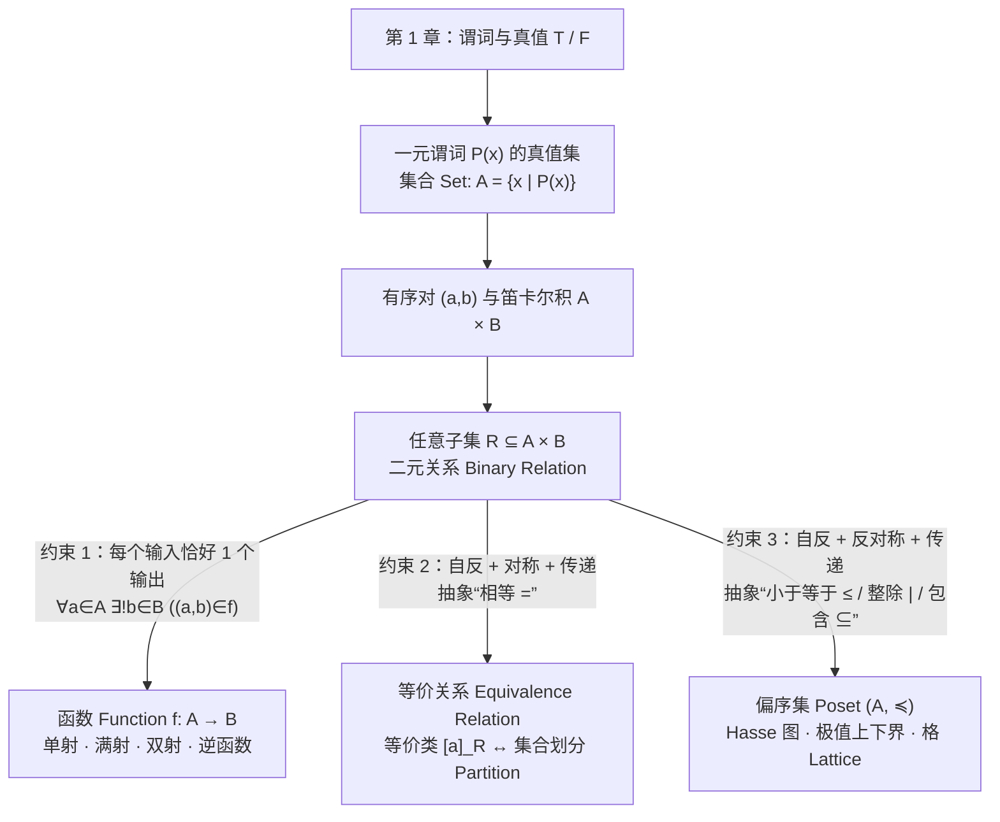
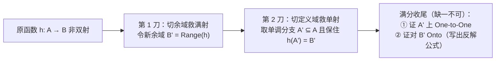
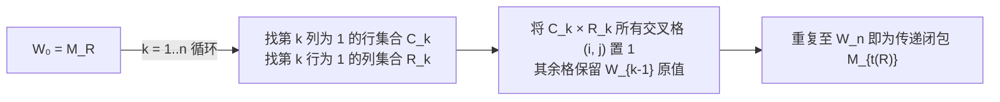
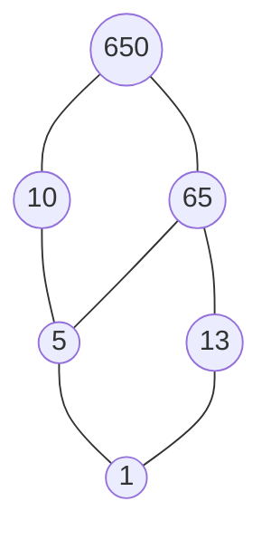
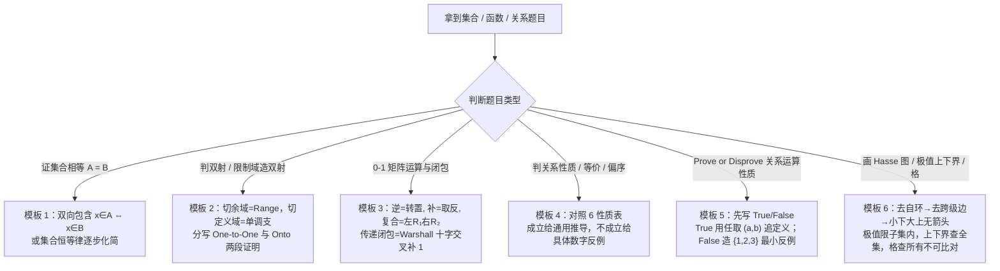

# Midterm Test 02 & 全章体系复习指南 —— Sets, Functions & Relations（Ch2.1–2.3, Ch9.1–9.3, Ch9.5–9.6）

> 配套材料：`Midterm-Test-02.md`、`Slides-2in1/` 三份课件（Ch2.1–2.3、Ch9.1–9.3、Ch9.5–9.6）、`Tutorials/`（Tutorial 04–06 答案）。
> 本指南为 `/Relation/` 网页的纯 Markdown 离线同步版，分为六部分：**第一性原理总纲 → 集合与函数 → 二元关系与闭包 → 等价关系与偏序/格 → Midterm Test 02 逐题精讲 → 通用解法模板与通关自测**。

---

# 第 0 部分：第一性原理总纲

## 0.1 整章只有一个底层事实：集合与关系只是“谓词的真值表”

如果把第 1 章（Logic and Proof）和本章放在一起看，你会发现 **Sets、Functions、Relations、Equivalence、Posets 根本不是五章零散的定义，而是同一个东西不断加约束长出来的五棵枝干**：

- **第 1 章的一元谓词 $P(x)$** $\Longleftrightarrow$ **第 2 章的集合 $A = \{x \in U \mid P(x)\}$**：所谓 $x \in A$，不过是 "$P(x)$ 的**真值**算出来是 $\mathbf{T}$"。因此集合的 $\cup,\ \cap,\ \overline{A},\ \subseteq$ 与逻辑的 $\lor,\ \land,\ \neg,\ \to$ 一字不差！
- **第 1 章的二元谓词 $R(a,b)$** $\Longleftrightarrow$ **第 9 章的二元关系 $R \subseteq A \times B$**：所谓 $(a,b) \in R$，不过是 "$R(a,b)$ 的真值算出来是 $\mathbf{T}$"。当集合有限时，把所有 $(a_i, b_j)$ 的 $\mathbf{T}/\mathbf{F}$（写成 $1/0$）排成一张方格表，就是 **0-1 关系矩阵 $M_R$**；把 $1$ 画成箭头，就是 **有向图（Directed Graph）**。

## 0.2 四大核心结构的一页纸判别总表

考场上看到任何对象，先问自己它在下面哪一行，证明套路和反例套路立刻自动浮现：

| 结构 | 本质直觉 | 充要条件（怎么证成立） | 怎么举反例推翻（Disprove） |
|---|---|---|---|
| **集合相等** $A = B$ | 两盒装的元素完全相同 | 互含：$A \subseteq B$ **且** $B \subseteq A$（任取 $x\in A$ 推 $x\in B$，反之亦然） | 找**一个元素** $x$ 属于一边但不属于另一边 |
| **函数** $f: A \to B$ | 每个输入**有且仅有** 1 个输出 | ① 全定义（每行至少一个 1）② 单值（每行至多一个 1） | 找 $a\in A$ 没像（如 $1/0$），或找 $a\in A$ 有两个像（如 Test 02 Q3a 的 $3\to 1,2$） |
| **双射** Bijection | 左右两边元素一根绳拴一个，不重不漏 | ① **One-to-One**：设 $f(a)=f(b)$ 推出 $a=b$；② **Onto**：任取 $y\in B$ 解出 $x\in A$ 使 $f(x)=y$ | 非单射：举 $a\neq b$ 但 $f(a)=f(b)$；非满射：举 $b\in B$ 无原像 |
| **等价关系** | 把元素按“同一属性”分班抱团 | **自反 + 对称 + 传递**（矩阵重排后是主对角线上的全 $1$ 方块） | 缺哪条举哪条的具体元素反例 |
| **偏序关系** | 给元素排“辈分/上下级”（允许平级不可比） | **自反 + 反对称 + 传递**（有向图抹掉自环后绝无有向环，可画 Hasse 图） | 找异点双向边 $a\neq b$ 但 $aRb \land bRa$（破反对称），或两步可达一步不可达（破传递） |
| **格** Lattice | 任意两元素往上必汇于唯一最小上界、往下必聚于唯一最大下界 | 对 $A$ 中**每一对** $\{a,b\}$，$\text{lub}\{a,b\}$ 与 $\text{glb}\{a,b\}$ 均存在 | 找**一对** $\{a,b\}$ 无公共上/下界，或有多个极小上界/极大下界（蝴蝶结结构） |

## 0.3 教材与老师课件章节号对照说明（防迷路必看）

老师分发页 `bd.htm` 与考试大纲采用 **Rosen《Discrete Mathematics and Its Applications》第 7/8 版**章节号（`Ch9.1–9.6`），而老师三份 PDF 课件内页页脚保留了 **Rosen 第 5 版**旧章节号（`Ch5.1–5.6`），且内含部分超标题延伸小节。本站完整对齐如下：

| 考试大纲标号（Image 1 / `bd.htm`） | 老师 PDF 内页标号 | 配套练习 | 核心必考模块 vs 课件延伸概念 |
|---|---|---|---|
| **Ch2.1, 2.2, 2.3**: Sets and Functions | `Ch 2.1, 2.2, 2.3`（41 页） | `Tutorial 04` | **必考**：$\in$ 与 $\subseteq$、幂集、笛卡尔积、集合运算、函数单/满/双射与逆、复合、限制域造双射；**概念速览**：三集合容斥、位串表示 |
| **Ch9.1, 9.2, 9.3**: Relations and Properties | `Ch 5.1, 5.2, 5.3, 5.4`（48 页） | `Tutorial 05` | **必考**：关系有向图与 0-1 矩阵、6 大性质、关系计数、逆/补/异或/复合、三种闭包与 **Warshall 算法**；**概念速览**：$n$ 元关系与数据库 |
| **Ch9.5, 9.6**: Equivalence and Partial Orderings | `Ch 5.5, 5.6`（35 页） | `Tutorial 06` | **必考**：等价关系、同余、等价类与划分、偏序与对偶、全序、Hasse 图、极值与上下界、**格 Lattice**；**概念速览**：字典序、良序集、有界格与有补格 |

#### 【重点提示】考前最值钱的三句保命提醒（来自课件与 Test 02 深度排雷）

1. **复合矩阵左右顺序大坑（Slide 45）**：$(a,c)\in R_2\circ R_1$ 意思是**先走 $R_1$、再走 $R_2$**！虽然老师 PPT 把矩阵写成了符号 $M_{R_2}\circ M_{R_1}$，但按下标公式 $(i,j)=\bigvee_k ((M_{R_1})_{ik}\land (M_{R_2})_{kj})$，**手算矩阵乘法时左边必须放 $M_{R_1}$、右边放 $M_{R_2}$**！放反直接丢光整小问分数。
2. **极值看子集内部，上下界看全集外部（Test 02 Q5）**：求子集 $B$ 的 minimal / maximal / least / greatest，候选人**只能在 $B$ 里面挑**；求 $B$ 的 upper / lower bounds、LUB、GLB，候选人在**整个偏序集 $A$ 里挑**！且在非全整数子集上求整除 LUB/GLB **绝不能盲套数论 $\operatorname{lcm}/\gcd$**（见第 5 题 g 的 $\{10,13\}$ 神坑）。
3. **论域决定生死（Test 02 Q3c & Tutorial 04 Q13）**：$x^2 \ge y$ 在**整数集 $\mathbb{Z}$** 上是自反的（整数没有 $(0,1)$ 之间的小数！），换到实数集 $\mathbb{R}$ 上就不自反（$0.5^2 < 0.5$）；$\lceil n/2\rceil$ 在 $\mathbb{Z}\to\mathbb{Z}$ 上是满射，函数性质永远先圈出 domain 与 codomain！

---

# 第 1 部分：集合与函数（Ch2.1–2.3）

## 1.1 集合基础：元素 $\in$ 与子集 $\subseteq$ 的盒子模型【高频必考】

- **定义（Slides 2.1 p3–p8）**：集合（set）是对象的无序聚集（unordered collection）。
  - **无序且互异**：$\{1, 3, 3, 5, 5\} = \{5, 3, 1\}$（Tutorial 04 Q3a）。
  - **常用数集记号（Slides p4）**：自然数 $\mathbb{N}=\{0,1,2,\dots\}$、整数 $\mathbb{Z}$、正整数 $\mathbb{Z}^+=\{1,2,3,\dots\}$、有理数 $\mathbb{Q}$、实数 $\mathbb{R}$、正实数 $\mathbb{R}^+$。
  - **真值集（Truth Set，Slides p17）**：给定 domain $D$，谓词 $P(x)$ 的真值集为 $\{x \in D \mid P(x)\}$。例如在 $\mathbb{Z}$ 上 $|x|=1$ 的真值集是 $\{-1, 1\}$。

### 考场第一易错点：$\in$（属于）vs $\subseteq$（包含于）与空集 $\varnothing$

把集合想象成**带外包装的快递盒**：
- **$x \in A$（属于）**：把最外层盒子 $A$ 打开，**往里只看一层**，能直接摸到一模一样的物品 $x$。
- **$B \subseteq A$（子集）**：$\forall x\,(x\in B \to x\in A)$ —— 把盒子 $B$ 打开倒出里面每一件物品，每一件都能在盒子 $A$ 里找到。
- **集合相等 $A = B$**：$A \subseteq B \land B \subseteq A \iff \forall x\,(x\in A \leftrightarrow x\in B)$。

#### 【重点提示】Tutorial 04 Q3–Q5 经典陷阱：∅ vs {∅} vs {∅, {∅}}

- **空集 $\varnothing = \{\}$**：一个空空如也的盒子，基数 $|\varnothing| = 0$。对任何集合 $S$，永远有 $\varnothing \subseteq S$（因为 $x\in\varnothing$ 恒为 $\mathbf{F}$，蕴含式 $\forall x\,(x\in\varnothing \to x\in S)$ **空真 vacuously true**！）。
- **单元素集 $\{\varnothing\}$**：一个大盒子里装着**一个空盒子**！它**不是空集**，基数 $|\{\varnothing\}| = 1$，它唯一的成员是 $\varnothing$。
- 逐条秒杀 Tutorial 04 Q5：
  - $\varnothing \in \{\varnothing\}$ —— **True**（打开外盒就是 $\varnothing$）
  - $\varnothing \in \{\varnothing, \{\varnothing\}\}$ —— **True**
  - $\{\varnothing\} \in \{\varnothing\}$ —— **False**（打开外盒只有 $\varnothing$，没有带壳的 $\{\varnothing\}$）
  - $\{\varnothing\} \in \{\{\varnothing\}\}$ —— **True**
  - $\{\varnothing\} \subset \{\varnothing, \{\varnothing\}\}$ —— **True**（左盒元素 $\varnothing$ 在右盒中，且右盒多了 $\{\varnothing\}$，是真子集 proper subset）
  - $\{\{\varnothing\}\} \subset \{\{\varnothing\}, \{\varnothing\}\}$ —— **False**！右边重复写两次等于 $\{\{\varnothing\}\}$，左右相等，不是**真**子集（$\subset$ 要求 $\subseteq$ 且 $\neq$）！
- **手写卷面常见记法错误（Test 02 Q1c 实录）**：想表达“正实数与 $0$ 并起来”，**绝不能写** $\{\mathbb{R}^+, 0\}$！因为 $\{\mathbb{R}^+, 0\}$ 表示一个只含 2 个元素（一个是集合 $\mathbb{R}^+$ 本身、一个是数字 $0$）的二元集。正确写法是 $[0, +\infty)$、$\mathbb{R}^+ \cup \{0\}$ 或 $\{y \in \mathbb{R} \mid y \ge 0\}$。

---

## 1.2 幂集 Power Set 与笛卡尔积 Cartesian Product【高频必考】

### A. 幂集 $\mathcal{P}(S)$（Slides 2.1 p10）
- **定义**：集合 $S$ 的所有子集组成的集合，记作 $\mathcal{P}(S) = \{X \mid X \subseteq S\}$。
- **基数公式**：若 $|S| = n$，则每个元素有“选 / 不选” 2 种状态，故：

$$
|\mathcal{P}(S)| = 2^n
$$

- 特例：$\mathcal{P}(\varnothing) = \{\varnothing\}$（含 $2^0=1$ 个元素）；$\mathcal{P}(\{\varnothing\}) = \{\varnothing, \{\varnothing\}\}$（含 $2^1=2$ 个元素）。

### B. 有序 $n$ 元组与笛卡尔积（Slides 2.1 p11–p15，Tutorial 04 Q6–Q7）
- **有序对（Ordered Pair）**：$(a,b) = (c,d) \iff a=c \land b=d$。当 $a\neq b$ 时 $(a,b)\neq (b,a)$。
- **笛卡尔积（Cartesian Product）**：

$$
A \times B = \{(a,b) \mid a \in A \land b \in B\}, \qquad |A \times B| = |A| \cdot |B|
$$

- **不满足交换律，也不满足结合律（Tutorial 04 Q7 必考简答）**：
  - 当 $A, B$ 非空且 $A \neq B$ 时，$A \times B \neq B \times A$；但若其中有一个是 $\varnothing$，则 $A \times \varnothing = \varnothing \times A = \varnothing$。
  - **为什么 $A \times B \times C \neq (A \times B) \times C$？（标准英文答法）**：
    Assume $(a,b,c) \in A \times B \times C$, which is an **ordered 3-tuple**; whereas $((a,b), c) \in (A \times B) \times C$ is an **ordered 2-tuple** whose first entry is a 2-tuple. Therefore, their elements have different structures and the two sets are not equal (assuming $A, B, C$ are nonempty).

---

## 1.3 集合运算、恒等式与三种标准证法【高频必考】

### A. 五种集合运算与逻辑联结词的一一对应（Slides 2.2 p18–p22）

| 集合运算 | 集合构造定义 | 对应的第 1 章逻辑式 | Tutorial 04 Q10 典型充要结论 |
|---|---|---|---|
| 并集 Union $A \cup B$ | $\{x \mid x\in A \lor x\in B\}$ | $P(x) \lor Q(x)$ | $A \cup B = A \iff B \subseteq A$ |
| 交集 Intersection $A \cap B$ | $\{x \mid x\in A \land x\in B\}$ | $P(x) \land Q(x)$ | $A \cap B = A \iff A \subseteq B$；不相交 Disjoint $\iff A\cap B=\varnothing$ |
| 差集 Difference $A - B$ | $\{x \mid x\in A \land x\notin B\} = A \cap \overline{B}$ | $P(x) \land \neg Q(x)$ | $A - B = A \iff A \cap B = \varnothing$；$A - B = B - A \iff A = B$ |
| 补集 Complement $\overline{A}$ | $\{x \in U \mid x\notin A\} = U - A$ | $\neg P(x)$ | $\overline{\overline{A}} = A$；De Morgan: $\overline{A\cup B}=\overline{A}\cap\overline{B},\ \overline{A\cap B}=\overline{A}\cup\overline{B}$ |
| 对称差 Symmetric Diff $A \oplus B$ | $(A - B) \cup (B - A) = (A\cup B)-(A\cap B)$ | $P(x) \oplus Q(x)$ | $A \oplus A = \varnothing$；$A \oplus \varnothing = A$ |

### B. 集合恒等式全部十律（直接把第 1 章逻辑等价律的 $\land,\lor,\neg,\mathbf{F},\mathbf{T}$ 换成 $\cap,\cup,\overline{\phantom{A}},\varnothing,U$！）
- 同一律：$A \cup \varnothing = A$，$A \cap U = A$；支配律：$A \cup U = U$，$A \cap \varnothing = \varnothing$；
- 幂等律、双重补律、交换律、结合律、分配律 $A \cap (B \cup C) = (A\cap B) \cup (A\cap C)$、吸收律 $A \cup (A\cap B) = A$、补律 $A \cup \overline{A} = U,\ A \cap \overline{A} = \varnothing$、De Morgan 律。

### C. 证明集合恒等式的三种正规武器
1. **双向包含元素追逐法（Element Argument）**：证 $L = R$，先任取 $x\in L$ 展开为逻辑式推至 $x\in R$（得 $L\subseteq R$），再反推 $R\subseteq L$（若每步都是 $\iff$ 可合并写）。
2. **集合代数定律法（Set Identities）**：从左式每步套用集合恒等律化为右式并标律名（与逻辑无真值表证明完全同构）。
3. **成员表法（Membership Table）**：列 $x$ 属于/不属于 $A,B,C$ 的 $2^k$ 种 $1/0$ 组合，核对两列完全一致。

---

## 1.4 容斥原理与计算机位串表示 Set Representation【概念速览】

- **容斥原理 Principle of Inclusion-Exclusion（Slides 2.2 p23）**：

$$
|A \cup B| = |A| + |B| - |A \cap B|
$$

$$
|A \cup B \cup C| = |A| + |B| + |C| - |A\cap B| - |A\cap C| - |B\cap C| + |A\cap B\cap C|
$$

- **位串表示集合 Computer Representation via Bit Strings（Slides 2.2 p24–p25）**：
  固定全集元素顺序 $U = \{u_1, u_2, \dots, u_n\}$，子集 $A \subseteq U$ 对应长度为 $n$ 的 Bit String $b_1 b_2 \cdots b_n$（若 $u_i \in A$ 则 $b_i = 1$，否则为 $0$）。
  - $\overline{A}$ = 按位取反 `NOT`；$A \cup B$ = 按位 `OR`；$A \cap B$ = 按位 `AND`；$A \oplus B$ = 按位 `XOR`！

---

## 1.5 函数 Functions：定义、三禁区、单射/满射/双射与逆【高频必考】

### A. 函数的严格定义与“何时不是函数”（Slides 2.3 p26–p30，Tutorial 04 Q11）
设 $A, B$ 为非空集合。从 $A$ 到 $B$ 的函数 $f: A \to B$ 是给 $A$ 中**每一个**元素 $a$ 指派 $B$ 中**恰好一个（exactly one）**元素 $b$ 的规则，记作 $f(a)=b$。
- $A$ 叫 **Domain（定义域）**，$B$ 叫 **Codomain（余域）**；
- 真正被射中的元素集合 $\operatorname{Range}(f) = \{f(a) \mid a \in A\} \subseteq B$ 叫 **Range（值域 / Image of $A$）**。
- 若 $f(a)=b$，则 $b$ 是 $a$ 的 **image（像）**，$a$ 是 $b$ 的 **preimage（原像，课件有时称 coimage）**。

#### 【重点提示】Tutorial 04 Q11：判断“不是函数 (Not a Function)”的三大禁区

问：为什么下列规则**不是**从 $\mathbb{R}$ 到 $\mathbb{R}$ 的函数？
1. $f(x) = 1/x$ —— **漏定义**：$f(0)$ 未定义（$0 \in \mathbb{R}$ 没有输出像）！
2. $f(x) = \sqrt{x}$ —— **定义域越界**：对 $x < 0$ 在实数余域 $\mathbb{R}$ 中没有实数值！
3. $f(x) = \pm\sqrt{x^2+1}$ —— **一源多值**：每个 $x$ 被赋予了两个不同的值！
- **放在 0-1 关系矩阵 / 有向图里看（Test 02 Q3 第 vi 问必考！）**：
  关系 $R \subseteq A \times A$ 是函数 $\iff$ **矩阵每一行的元素之和都恰好等于 $1$**（每个顶点出度恒为 $1$）。只要有一行全是 $0$（漏定义）或有两个及以上的 $1$（如 Test 02 Q3a 中 $(3,1)\in R$ 且 $(3,2)\in R$），立刻判定 **Not a function**！

### B. 单射、满射、双射与反函数总表（Slides 2.3 p31–p38，Tutorial 04 Q13–Q14）

| 性质 | 形式逻辑定义 | 直观图像 / 矩阵判据 | 标准证明写法 | 标准否证（反例）写法 |
|---|---|---|---|---|
| **单射 One-to-One** (Injective) | $\forall a,b\in A\,(f(a)=f(b) \to a=b)$  等价逆否：$a\neq b \to f(a)\neq f(b)$ | 每个 $b\in B$ 入度 $\le 1$；连续图像通过水平线测试 | Assume $f(a)=f(b)$, 代入化简推出 $a=b$（或说明函数严格递增/递减） | 举具体 $a \neq b$ 算出 $f(a)=f(b)$（如 $f(x)=x^2$ 在 $\mathbb{Z}$ 上 $f(-1)=f(1)=1$） |
| **满射 Onto** (Surjective) | $\forall b\in B\,\exists a\in A\,(f(a)=b)$  即 $\operatorname{Range}(f) = B$ | 每个 $b\in B$ 入度 $\ge 1$；值域铺满整个余域 | Take any $y\in B$, 反解出 $x = \dots$，**必须验证 $x \in A$** 且 $f(x)=y$！ | 举具体 $b_0 \in B$，说明方程 $f(x)=b_0$ 在**定义域 $A$ 内**无解 |
| **双射 One-to-One Correspondence** (Bijection) | 既 **One-to-One** 又 **Onto** | 每个 $b\in B$ 入度 $= 1$；左右元素一一配对（有限集必有 $|A|=|B|$） | 分两段完整写出：(1) One-to-one; (2) Onto | 只要破坏单射或满射其一即非双射 |
| **可逆 Invertible** 与 $f^{-1}$ | 存在 $f^{-1}: B \to A$ 使 $f^{-1}(b)=a \iff f(a)=b$ | **$f$ 可逆 $\iff f$ 是双射！** | 先证 $f$ 是双射，再由 $y=f(x)$ 解出 $x=f^{-1}(y)$ | 指出 $f$ 不是 one-to-one 或不是 onto，故 not invertible |

> **Tutorial 04 Q13 经典对照（同样在 $\mathbb{Z} \to \mathbb{Z}$ 上）**：
> - $f(n) = n - 1$：One-to-one ✓，Onto ✓（双射，$f^{-1}(m)=m+1$）
> - $f(n) = n^2 + 1$：One-to-one ✗（$f(1)=f(-1)=2$），Onto ✗（$0$ 无原像）
> - $f(n) = n^3$：One-to-one ✓（严格递增），Onto ✗（$2 \in \mathbb{Z}$ 没有**整数**立方根！注意若换成 $\mathbb{R}\to\mathbb{R}$ 则是双射！）
> - $f(n) = \lceil n/2 \rceil$：One-to-one ✗（$f(1)=f(2)=1$），Onto ✓（对任意 $k\in\mathbb{Z}$，取 $n=2k\in\mathbb{Z}$ 即有 $\lceil 2k/2\rceil = k$）

---

## 1.6 函数运算、复合与“限制定义域/余域构造双射”【Test 02 Q1 压轴考点】

### A. 实值函数的加积与复合（Slides 2.3 p39–p41，Tutorial 04 Q15，Test 02 Q1a/b）
- **逐点加/乘**：设 $f_1, f_2: A \to \mathbb{R}$，则 $(f_1 + f_2)(x) = f_1(x) + f_2(x)$，$(f_1 f_2)(x) = f_1(x) f_2(x)$。
- **函数复合 Composition**：设 $g: A \to B$，$f: B \to C$（必须满足 $\operatorname{Range}(g) \subseteq \operatorname{Domain}(f)$），则 $f \circ g: A \to C$ 定义为：

$$
(f \circ g)(x) = f(g(x))
$$

- **记准方向**：靠近自变量 $x$ 的右边函数 $g$ **先算**，外层左边函数 $f$ **后算**！一般 $f \circ g \neq g \circ f$（不交换），但满足结合律 $h \circ (g \circ f) = (h \circ g) \circ f$。

### B. 限制定义域与余域使函数变成双射（Slides p38，Tutorial 04 Q14，Test 02 Q1d）

当原函数 $h: A \to B$ 不是双射时，标准改造手术只有两刀：
1. **切 Codomain 救 Onto**：把余域 $B$ 直接缩小为函数的真实值域 $B' = \operatorname{Range}(h)$，消去所有没有原像的闲置目标点。
2. **切 Domain 救 One-to-One**：沿着图像的对称轴/极值点切开定义域 $A$，只保留一个**单调分支** $A'$，并且必须确认缩小后的 $A'$ 仍然能射满刚才的 $B'$（即 $h(A') = B'$）！

---

# 第 2 部分：二元关系、性质、矩阵与闭包（Ch9.1–9.3 / Slides 5.1–5.4）

## 2.1 二元关系及其三种等价表示【高频必考】

- **定义（Slides 5.1 p3–p8）**：
  - 从集合 $A$ 到集合 $B$ 的**二元关系（binary relation）**是笛卡尔积的任意子集 $R \subseteq A \times B$。$(a,b)\in R$ 记作 $aRb$。
  - **集合 $A$ 上的关系（relation on a set $A$）**：特指 $A$ 到自身的关系 $R \subseteq A \times A$。
  - **函数是关系的特例（Slides p2）**：函数 $f: A \to B$ 就是满足“每个 $a\in A$ 恰与一个 $b\in B$ 配对”的特殊二元关系。

### 三种表示法的互译（Tutorial 05 Q1–Q2）
1. **有序对集合**：直接列出所有满足条件的 $(a,b)$，或用描述法 $\{(x,y) \mid \dots\}$。
2. **有向图 Directed Graph（Digraph，Slides p5–p6）**：顶点画 $A$ 的元素；若 $(a,b)\in R$ 画有向边 $a \to b$；若 $(a,a)\in R$ 画**自环（loop）**。
3. **0-1 关系矩阵 Zero-One Matrix $M_R = [m_{ij}]$（Slides p7）**：固定元素顺序 $A=\{a_1,\dots,a_m\},\ B=\{b_1,\dots,b_n\}$，则 $m \times n$ 矩阵定义为：

$$
m_{ij} = \begin{cases} 1, & \text{if } (a_i, b_j) \in R \\ 0, & \text{if } (a_i, b_j) \notin R \end{cases}
$$

---

## 2.2 集合 $A$ 上关系的六大性质全对比表【每卷必考】

设 $R$ 是**非空集合 $A$** 上的关系（$|A|=n$）。考场遇到性质判定题（如 Test 02 Q3、Tutorial 05 Q7），直接对照下表从“逻辑定义 / 有向图 / 0-1 矩阵”三重视角秒判：

| 性质 | 形式逻辑定义（Slides 5.1 p10–p13） | 有向图特征 | 0-1 矩阵 $M_R$ 特征 | 长度为 $n$ 集合上的关系个数 |
|---|---|---|---|---|
| **自反 Reflexive** | $\forall a\in A\,((a,a)\in R)$ | **每个**顶点都有自环 | 主对角线**全为 $1$** | $2^{n(n-1)}$ |
| **反自反 Irreflexive** | $\forall a\in A\,((a,a)\notin R)$ | **任何**顶点都无自环 | 主对角线**全为 $0$** | $2^{n(n-1)}$ |
| **对称 Symmetric** | $\forall a,b\in A\,((a,b)\in R \to (b,a)\in R)$ | 异点间每条边必成对双向（自环任意） | $M_R = M_R^T$（沿主对角线对称） | $2^{n(n+1)/2}$ |
| **反对称 Antisymmetric** | $\forall a,b\in A\,(((a,b)\in R \land (b,a)\in R) \to a=b)$  等价：$a\neq b \land (a,b)\in R \to (b,a)\notin R$ | **异点之间绝无双向边**（自环可有可无！） | $i\neq j$ 时 $m_{ij}$ 与 $m_{ji}$ **不同时为 $1$**（只许 $(0,0),(1,0),(0,1)$ 3 种） | $2^n \cdot 3^{n(n-1)/2}$ |
| **非对称 Asymmetric** | $\forall a,b\in A\,((a,b)\in R \to (b,a)\notin R)$ | **既无双向边，也绝无自环**（= 反自反 + 反对称） | 主对角线全 $0$，且对称位置不同时为 $1$ | $3^{n(n-1)/2}$ |
| **传递 Transitive** | $\forall a,b,c\in A\,(((a,b)\in R \land (b,c)\in R) \to (a,c)\in R)$ | 凡有两步路径 $a\to b\to c$，必有直达捷径 $a\to c$ | $M_R^{[2]} \le M_R$（平方里为 $1$ 的位置原矩阵必为 $1$） | 无封闭初等公式 |

### 计数公式推导速记 + Tutorial 05 勘误

- **任意二元关系总数**：$A \times A$ 有 $n^2$ 个格子，每格填 $0/1$，共 **$2^{n^2}$** 个。
  - **【Tutorial 05 Q4a 答案勘误】**：当 $|A|=4$ 时，关系总数为 $2^{4^2} = 2^{16} = \mathbf{65536}$（Tutorial 答案误印成了 $2^{16}-1 = 65535$，考试务必写 $2^{16} = 65536$！）。
- **对称 / 反对称 / 非对称怎么数不混**：把 $n\times n$ 矩阵拆成 **$n$ 个主对角线格** + **$\frac{n(n-1)}{2}$ 对上下对称格 $\{m_{ij}, m_{ji}\}$**：
  - **Symmetric**：对角线 $n$ 格随便填（$2^n$），每对对称格捆绑同填 $00$ 或 $11$（$2$ 种）$\Rightarrow 2^n \cdot 2^{n(n-1)/2} = 2^{n(n+1)/2}$。
  - **Antisymmetric**：对角线 $n$ 格随便填（$2^n$），每对对称格禁填 $11$，只剩 $00, 10, 01$（**$3$ 种**）$\Rightarrow 2^n \cdot 3^{n(n-1)/2}$。
  - **Asymmetric**：对角线 $n$ 格强制全填 $0$（$1$ 种），每对对称格仍有 $00, 10, 01$（$3$ 种）$\Rightarrow 3^{n(n-1)/2}$。

#### 【重点提示】考场必背四大性质认知陷阱（含 Tutorial 05 Q7g 答案勘误！）

1. **“不自反” $\neq$ “反自反”**：对角线只要既有 $1$ 又有 $0$（例如 $A=\{1,2\},\ R=\{(1,1)\}$），它**既不是 reflexive，也不是 irreflexive**！
2. **“对称”与“反对称”既不互斥也不互补**：
   - 对角线子集（如恒等关系 $I_A = \{(1,1),(2,2),(3,3),(4,4)\}$，Tutorial 05 Q7c）**既是 symmetric 又是 antisymmetric**（因为根本没有 $a\neq b$ 的边，反对称前件空真！）；
   - 而 $R=\{(1,2),(2,3),(3,2)\}$ **既不是 symmetric（缺 $(2,1)$），也不是 antisymmetric（有 $(2,3),(3,2)$ 双向边）**！
3. **空真（Vacuously True）传递性**：若关系里根本找不到首尾相接的 $(a,b)\in R$ 与 $(b,c)\in R$（例如 $R=\{(1,3),(2,3)\}$），则传递性前件恒假，**自动是 transitive**！但注意双向边 $\{(2,4),(4,2)\}$（Tutorial 05 Q7b）**不传递**！因为 $(2,4)\in R$ 且 $(4,2)\in R$ 拼出了 $(2,2) \notin R$！
4. **【Tutorial 05 Q7g 重要勘误】实数集 $\mathbb{R}$ 上的 $R = \{(x,y) \mid xy \ge 0\}$ 到底传不传递？**
   - Tutorial 答案误写成了 `symmetric, transitive, reflexive`，但实际上它在 $\mathbb{R}$ 上**绝对不传递（NOT transitive）**！
   - **铁证反例**：取 $x = -1,\ y = 0,\ z = 2$。因为 $(-1)\cdot 0 = 0 \ge 0 \Rightarrow (-1,0)\in R$，且 $0\cdot 2 = 0 \ge 0 \Rightarrow (0,2)\in R$；但 $(-1)\cdot 2 = -2 < 0 \Rightarrow (-1,2)\notin R$！元素 $0$ 充当了连接负数与正数的“桥梁”，直接击穿传递性！（注：若把定义域改为 $\mathbb{R}-\{0\}$，它才是等价关系。）

---

## 2.3 关系的组合、复合与矩阵布尔运算【Test 02 Q2 核心 24 分】

因为关系 $R_1, R_2 \subseteq A \times B$ 本身就是集合，所有集合运算均可直接套用，并在 0-1 矩阵上变成逐位布尔运算（Slides 5.1 p14–p29）：

| 关系运算 | 集合/元素定义 | 0-1 矩阵算子 | 考场心算口诀 |
|---|---|---|---|
| 并 $R_1 \cup R_2$ | $(a,b)\in R_1 \lor (a,b)\in R_2$ | $M_{R_1} \lor M_{R_2}$（Join） | 同位置有 $1$ 就写 $1$ |
| 交 $R_1 \cap R_2$ | $(a,b)\in R_1 \land (a,b)\in R_2$ | $M_{R_1} \land M_{R_2}$（Meet） | 同位置两个都是 $1$ 才写 $1$ |
| 补 $\overline{R}$ | $(a,b) \notin R$ | $\overline{M_R}$ | 矩阵里所有 **$0 \leftrightarrow 1$ 互换** |
| 差 $R_1 - R_2$ | $(a,b)\in R_1 \land (a,b)\notin R_2$ | $M_{R_1} \land \overline{M_{R_2}}$ | 把 $M_{R_1}$ 里与 $M_{R_2}$ 重叠的 $1$ 抹成 $0$ |
| 对称差 $R_1 \oplus R_2$ | 恰属于 $R_1, R_2$ 之一 | $M_{R_1} \oplus M_{R_2}$ | 同位置**不同写 $1$，相同写 $0$** |
| 逆关系 $R^{-1}$ | $\{(b,a) \mid (a,b)\in R\}$ | $M_R^T$（矩阵转置） | 第 $i$ 行变第 $i$ 列（沿主对角线翻折） |
| 复合 $R_2 \circ R_1$ | $\{(a,c) \mid \exists b\,((a,b)\in R_1 \land (b,c)\in R_2)\}$ | **$M_{R_1} \odot M_{R_2}$**（布尔积） | **先走右边 $R_1$，再走左边 $R_2$！左放 $M_{R_1}$ 乘右放 $M_{R_2}$** |
| 关系幂 $R^n$ | $R^1=R,\ R^{n+1}=R^n \circ R$ | $M_R^{[n]}$（布尔幂） | $(a,b)\in R^n \iff$ 有向图中存在从 $a$ 到 $b$ **长度为 $n$ 的有向路径**（Slides p25–p26 定理） |

#### 【重点提示】最高优先级排雷：老师 PPT Slide 45 的复合矩阵符号顺序！

在《Ch9.1–9.3》课件第 45 页（Slide 45），老师把 $R_2 \circ R_1$ 的矩阵记成了一个反序符号 "$M_{R_2} \circ M_{R_1}$"，**紧接着在下一行给出了它的元素级真实定义**：

$$
(M_{R_2 \circ R_1})_{ij} = \bigvee_{k=1}^{n} \Big[(M_{R_1})_{ik} \land (M_{R_2})_{kj}\Big]
$$

看清下标：**取第 $i$ 行的矩阵是 $M_{R_1}$，取第 $j$ 列的矩阵是 $M_{R_2}$**！
也就是说，当你用线性代数熟悉的“左矩阵第 $i$ 行 $\times$ 右矩阵第 $j$ 列”手算布尔乘法（把乘法换 $\land$、加法换 $\lor$）时：
- 求 **$R_2 \circ R_1$** $\Longrightarrow$ 草稿纸上**左边必须写 $M_{R_1}$、右边必须写 $M_{R_2}$**（即标准 Rosen 教材记法 $M_{R_2 \circ R_1} = M_{R_1} \odot M_{R_2}$）！
- 如果你按字面顺序把 $M_{R_2}$ 摆左边乘 $M_{R_1}$，你算出来的其实是 $R_1 \circ R_2$，整道小题全错！

### 重要性质保持定理（Slides p16–p17, p27–p29 & Test 02 Q4）
- **传递性充要判据（Slides p27）**：集合 $A$ 上的关系 $R$ 是传递的 $\iff$ 对一切正整数 $n \ge 1$，都有 **$R^n \subseteq R$**（其实只需验证 $R^2 \subseteq R$）。
- **哪些运算保性质（Prove or Disprove 高频题库）**：
  - 若 $R_1, R_2$ 自反：则 $R_1\cup R_2,\ R_1\cap R_2,\ R_1^{-1},\ R_2\circ R_1$ **全自反**；而 $R_1 - R_2,\ R_1 \oplus R_2$ **必反自反**（Tutorial 05 Q6）！
  - 若 $R_1, R_2$ 对称：则 $R_1\cup R_2,\ R_1\cap R_2$（**Test 02 Q4 原题**）、$R_1 - R_2,\ R_1\oplus R_2,\ \overline{R_1},\ R_1^{-1},\ R_1^n$ **全对称**！但 **$R_2 \circ R_1$ 未必对称**（反例：$R_1=\{(1,2),(2,1)\},\ R_2=\{(2,3),(3,2)\}$，则 $R_2\circ R_1=\{(1,3)\}$ 不对称）。
  - 若 $R_1, R_2$ 传递：$R_1 \cap R_2$ **必传递**；但 **$R_1 \cup R_2$ 未必传递**（Slides p17 反例：$R_1=\{(1,2)\},\ R_2=\{(2,3)\}$，并集缺 $(1,3)$）！

---

## 2.4 关系的闭包 Closures 与 Warshall 算法【Test 02 Q2e/f 必考】

**闭包定义（Slides 5.4 p32–p36）**：给定性质 $P$，关系 $R$ 关于性质 $P$ 的闭包是**包含 $R$（$R \subseteq S$）且具有性质 $P$ 的最小关系 $S$**（往 $R$ 里补最少的边使之满足 $P$）。

| 闭包类型 | 集合公式（$\Delta = \{(a,a)\mid a\in A\}$） | 0-1 矩阵做法 | 有向图做法 |
|---|---|---|---|
| **自反闭包 $r(R)$** | $r(R) = R \cup \Delta$ | 把主对角线所有 $0$ 改成 **$1$**（$M_R \lor I_n$） | 给没自环的顶点全部画上自环 |
| **对称闭包 $s(R)$** | $s(R) = R \cup R^{-1}$ | **$M_R \lor M_R^T$**（若 $m_{ij}=1$ 则把 $m_{ji}$ 也置 $1$） | 把所有单向箭头补成双向箭头 |
| **传递闭包 $t(R)$** | $t(R) = R^* = \bigcup_{k=1}^{n} R^k$（$|A|=n$） | $M_R \lor M_R^{[2]} \lor \cdots \lor M_R^{[n]}$ 或 **Warshall 算法** | 只要从 $a$ 到 $b$ 存在长度 $\ge 1$ 的有向路径，就补边 $a\to b$ |

### Warshall 算法手算标准流程（Slides p43–p44，Tutorial 05 Q8）

直接算 $M_R^{[2]}, \dots, M_R^{[n]}$ 需要 $O(n^4)$ 次位运算；**Warshall 算法**只需 $O(n^3)$，构造矩阵序列 $W_0, W_1, \dots, W_n$（其中 $W_0 = M_R$，$W_n = M_{t(R)}$），递推式为：

$$
w_{ij}^{[k]} = w_{ij}^{[k-1]} \lor \Big(w_{ik}^{[k-1]} \land w_{kj}^{[k-1]}\Big)
$$

**考场 10 秒“十字交叉补 1 法”（绝不出错）**：
从 $W_{k-1}$ 推 $W_k$（允许使用第 $k$ 个顶点作中转站）：
1. 把 $W_{k-1}$ 照抄一遍（原来是 $1$ 的永远保持 $1$）；
2. 扫一眼**第 $k$ 列**，记下哪些行号 $i$ 的位置是 $1$（记作集合 $C_k = \{i \mid w_{ik}^{[k-1]}=1\}$）；
3. 扫一眼**第 $k$ 行**，记下哪些列号 $j$ 的位置是 $1$（记作集合 $R_k = \{j \mid w_{kj}^{[k-1]}=1\}$）；
4. 把所有交叉坐标 **$(i, j) \in C_k \times R_k$** 全部填成 **$1$**，即得 $W_k$！

### 复合闭包顺序定理（Slides p46–p48，Ch9.5 p14–p15，Tutorial 05 Q10–Q12）
- 若 $R$ 自反，则 $s(R)$ 与 $t(R)$ 仍自反（Tutorial 05 Q11）；若 $R$ 对称，则 $r(R)$ 与 $t(R)$ 仍对称（Tutorial 05 Q12）。
- **但若 $R$ 传递，$s(R)$ 未必传递！** 例如 $R=\{(1,3),(2,3)\}$ 传递，其对称闭包 $s(R)=\{(1,3),(3,1),(2,3),(3,2)\}$ 缺 $(1,2)$ 不传递！
- 因此求同时满足多种性质的最小闭包时，**传递闭包 $t(\cdot)$ 必须放在最外层最后做**：
  - 最小自反传递关系（预序闭包）= $t(r(R))$；
  - 最小对称传递关系 = $t(s(R))$（注意若某顶点孤立无任何边，$t(s(R))$ 不会给它加自环！）；
  - **最小等价关系（等价闭包）** = **$t(s(r(R)))$**（先补对角线 $r$，再补对称边 $s$，最后连通分量内全打通 $t$）。

---

## 2.5 n-ary Relations（$n$ 元关系）与关系型数据库【概念速览】

- **定义（Slides 5.2 p30–p31）**：设 $A_1, A_2, \dots, A_n$ 为集合，子集 $R \subseteq A_1 \times A_2 \times \cdots \times A_n$ 称为 **$n$-ary relation**，$A_i$ 称为各域（domains），$n$ 称为度（degree）。
- **关系数据库模型（Relational Data Model）**：
  - 一张数据库表 = 一个 $n$ 元关系；每一列（字段 Attribute）对应一个域；每一行记录（Record）是一个 $n$ 元组（$n$-tuple）。
  - **主键 Primary Key**：值在所有记录中互不重复、能唯一确定一条 $n$ 元组的属性域（例如学号 `Student_ID`；若单个属性不够，可用复合主键 Composite Key）。
  - 三大基本关系运算：选择 Selection（按条件筛行）、投影 Projection（抽出指定列组成更低度关系并去重）、连接 Join（按公共属性值拼接两张表）。

---

# 第 3 部分：等价关系、偏序集、Hasse 图与格（Ch9.5–9.6 / Slides 5.5–5.6）

## 3.1 等价关系 Equivalence Relations：对“相等”的抽象【高频必考】

- **定义（Slides 5.5 p2–p3）**：集合 $A$ 上的关系 $R$ 称为**等价关系（equivalence relation）**，当且仅当 $R$ 同时满足：
  1. **自反 Reflexive**：$\forall a\in A,\ (a,a)\in R$
  2. **对称 Symmetric**：$\forall a,b\in A,\ (a,b)\in R \to (b,a)\in R$
  3. **传递 Transitive**：$\forall a,b,c\in A,\ (a,b)\in R \land (b,c)\in R \to (a,c)\in R$

### 三大黄金模型（看到这种结构直接秒判是等价关系！）
1. **函数等值核模型 $a R b \iff f(a) = f(b)$（Slides p6，Tutorial 06 Q2/Q3/Q5，Test 02 Q3b）**：
   只要关系能翻译成“两个对象的**某个确定属性 $f(\cdot)$ 完全相等**”——例如：
   - 字符串长度相同 $g(a)=g(b)$；比特串前 3 位相同（Tutorial 06 Q3）；
   - 两人拥有完全相同的父母（Tutorial 06 Q1d）或**完全相同的朋友集合 $F(a)=F(b)$（Test 02 Q3b 原题！）**；
   - 它**必然是等价关系**！其等价类就是原像集 $f^{-1}(y)$（Tutorial 06 Q5b）。
   - 反面对照："$a$ 与 $b$ 认识 / 见过面（have met）"（Tutorial 06 Q1e）或 "有公共朋友 $F(a)\cap F(b)\neq\varnothing$" **不是**等价关系，因为**不传递**！
2. **模 $m$ 同余 Congruence Modulo $m$（Slides p4, p8, p12）**：
   设 $m$ 为正整数，整数集 $\mathbb{Z}$ 上定义 $a \equiv b \pmod m \iff m \mid (a - b) \iff \exists k\in\mathbb{Z}\,(a - b = km)$。
   这是等价关系，把全体整数切分成恰好 **$m$ 个同余等价类**：$[0]_m, [1]_m, \dots, [m-1]_m$。
3. **矩阵分块判别法（Tutorial 06 Q1f–i）**：
   在有向图上，等价关系的每一个连通块都是**带全自环的完全子图（团 Clique）**；适当重排顶点顺序后，0-1 矩阵必呈**主对角线上的全 $1$ 方块阵（Block-Diagonal of All-1s）**！

---

## 3.2 等价类 Equivalence Classes 与集合划分 Partition【高频必考】

- **等价类定义（Slides 5.5 p7）**：设 $R$ 是 $A$ 上的等价关系，$a\in A$ 的等价类为：

$$
[a]_R = \{s \in A \mid (a, s) \in R\}
$$

其中任何 $b \in [a]_R$ 都可称为该等价类的**代表元（representative）**。

### 等价类三大等价定理（Slides p9–p13，证明与大题核心）

设 $R$ 是非空集合 $A$ 上的等价关系，则对任意 $a, b \in A$，以下三条**互相等价**：

$$
(i)\ (a,b) \in R \quad\Longleftrightarrow\quad (ii)\ [a]_R = [b]_R \quad\Longleftrightarrow\quad (iii)\ [a]_R \cap [b]_R \neq \varnothing
$$

> **核心推论**：两个等价类**要么一模一样（$[a]_R=[b]_R$），要么老死不相往来（$[a]_R\cap [b]_R=\varnothing$）**，绝不可能“只重叠一部分”！

### 等价关系 $\longleftrightarrow$ 集合划分（Partition）双向一一对应
集合族 $\{A_1, A_2, \dots, A_k\}$ 称为集合 $A$ 的一个**划分（Partition，Tutorial 06 Q4）**，当且仅当同时满足三件事：
1. **每块非空**：$\forall i,\ A_i \neq \varnothing$；
2. **两两不相交（Pairwise Disjoint）**：$i \neq j \implies A_i \cap A_j = \varnothing$；
3. **并集铺满全集**：$\bigcup_i A_i = A$。

- **正向（$R \Rightarrow$ 划分）**：等价关系 $R$ 的所有不同等价类自动构成 $A$ 的一个划分。
- **反向（划分 $\Rightarrow R$，Slides p13）**：给定划分 $\{A_1, \dots, A_k\}$，定义 "$a R b \iff a, b$ 在同一个分块 $A_i$ 中"，则：

$$
R = (A_1 \times A_1) \cup (A_2 \times A_2) \cup \cdots \cup (A_k \times A_k)
$$

例如 $A_1=\{1,2,3\},\ A_2=\{4,5\}$ 诱导的等价关系共有 $3^2 + 2^2 = 9 + 4 = 13$ 个有序对！

---

## 3.3 偏序关系 Partial Orderings、全序、字典序与良序【高频必考 + 概念速览】

- **偏序定义（Slides 5.6 p17）**：集合 $S$ 上的关系 $R$（常记作 $\preceq$）称为**偏序（partial ordering / reflexive partial order）**，当且仅当满足：
  1. **自反 Reflexive**：$a \preceq a$
  2. **反对称 Antisymmetric**：$(a \preceq b \land b \preceq a) \to a = b$
  3. **传递 Transitive**：$(a \preceq b \land b \preceq c) \to a \preceq c$
  配对 $(S, \preceq)$ 称为**偏序集（poset）**。记严格小于 $a \prec b \iff (a \preceq b \land a \neq b)$。

### 三大标准偏序模型与常见伪偏序陷阱（Tutorial 06 Q6–Q8）
- **真偏序三巨头**：① 实数/整数上的 $(\mathbb{Z}, \le)$ 与 $(\mathbb{Z}, \ge)$；② 正整数上的**整除 $(\mathbb{Z}^+, \mid)$**；③ 幂集上的**包含 $(\mathcal{P}(S), \subseteq)$**；外加特例：相等关系 $(S, =)$ 既是等价关系也是偏序关系！
- **对偶偏序集 Dual Poset（Tutorial 06 Q7–Q8）**：若 $(S, R)$ 是偏序集，则逆关系 **$(S, R^{-1})$ 必也是偏序集**（例如 $(\mathbb{Z}, \ge)$ 的对偶是 $(\mathbb{Z}, \le)$；Hasse 图直接上下倒置）。
- **伪偏序反例**：
  - "$a$ 比 $b$ 高（taller than）" 或 "$<$" —— **不自反**（是严格偏序，不是本课定义的自反偏序）；
  - **全体整数 $\mathbb{Z}$** 上的整除 $|$ —— **不反对称**！因为 $2 \mid -2$ 且 $-2 \mid 2$，但 $2 \neq -2$！（正整数 $\mathbb{Z}^+$ 上才是偏序！）

### 可比性、全序、字典序与良序集

| 概念 | 考频 | 精确定义与判据（Slides 5.6 p19–p24, p29） |
|---|---|---|
| **可比 Comparable** | **高频必考** | $a \preceq b$ 或 $b \preceq a$ 至少成立一个；若都不成立（如整除中 $5\nmid 13$ 且 $13\nmid 5$），称 **不可比 Incomparable** |
| **全序 Total / Linear Order (Chain)** | **高频必考** | 偏序集中**任意两个元素都可比**：$\forall a,b\in S\,(a\preceq b \lor b\preceq a)$。Hasse 图是一条无分叉竖直单链！ |
| **字典序 Lexicographic Order** | 概念速览 | 在 $(A_1,\preceq_1)\times(A_2,\preceq_2)$ 上：$(a_1,a_2) \prec (b_1,b_2) \iff a_1 \prec_1 b_1$ 或 $(a_1=b_1 \land a_2 \prec_2 b_2)$。字符串若前缀相同，短词更小（如 `open < opened < opener < opera < operand`，Tutorial 06 Q10） |
| **良序集 Well-Ordered Set** | 概念速览 | $(S, \preceq)$ 是**全序集**，且 $S$ 的**每一个非空子集都有最小元（least element）**。 例：$(\mathbb{Z}^+, \le)$ 与 $(\mathbb{N}, \le)$ 是良序集；$(\mathbb{Z}, \le)$ 是全序但**非良序**（负整数集无最小元）；$([0,1], \le)$ **非良序**（开区间 $(0,1]$ 无最小元） |

---

## 3.4 哈斯图 Hasse Diagram 与极值 / 上下界四组辨析【Test 02 Q5 20 分核心】

### A. 画 Hasse 图的标准三步脱衣法（Slides 5.6 p25–p27，Tutorial 06 Q11）
给定有限偏序集 $(A, \preceq)$：
1. **脱自环**：因偏序必自反，擦掉所有顶点上的自环 $(a,a)$；
2. **脱跨级传递边（只留覆盖关系 Covering Relation）**：若存在中间元素 $z$ 使 $x \prec z \prec y$，则擦掉直连边 $(x,y)$。留下的边全是 **$y$ covers $x$**（紧挨着的直接上下级）；
3. **脱箭头定高低**：把所有满足 $x \prec y$ 的 $y$ 画在 $x$ 的**上方**，擦掉向上的箭头，只留无向线段！

> **从 Hasse 图反读偏序关系**：在 Hasse 图中 $a \preceq b \iff a = b$，或者能从 $a$ 出发**一路顺着连线只往上爬**到达 $b$！

### B. 极小/最小/极大/最大元 vs 上界/LUB/下界/GLB 终极对照表

设 $(A, \preceq)$ 是偏序集，**$B \subseteq A$ 是题目指定的子集**（当题目没写子集时默认 $B = A$）：

| 概念对 | 候选人必须在哪个范围找？ | 精确定义与 Hasse 图读法 | 个数规律 |
|---|---|---|---|
| **极小元 Minimal** of $B$ | **必须在子集 $B$ 内部** ($m \in B$) | $B$ 中没有元素排在 $m$ 下方（$\neg\exists x\in B,\ x \prec m$） | 有限非空 $B$ **至少 1 个，可有多个** |
| **最小元 Least** of $B$ | **必须在子集 $B$ 内部** ($l \in B$) | $l$ 排在 $B$ 中**所有**元素下方（$\forall x\in B,\ l \preceq x$） | **至多 1 个**！若有 $\ge 2$ 个极小元，则最小元 **None（不存在）** |
| **极大元 Maximal** of $B$ | **必须在子集 $B$ 内部** ($m \in B$) | $B$ 中没有元素排在 $m$ 上方（$\neg\exists x\in B,\ m \prec x$） | 有限非空 $B$ **至少 1 个，可有多个** |
| **最大元 Greatest** of $B$ | **必须在子集 $B$ 内部** ($g \in B$) | $g$ 排在 $B$ 中**所有**元素上方（$\forall x\in B,\ x \preceq g$） | **至多 1 个**！若有 $\ge 2$ 个极大元，则最大元 **None（不存在）** |
| **上界 Upper Bounds** of $B$ | **在全集 $A$ 中找** ($u \in A$，可不在 $B$ 内！) | 在 Hasse 图上，能从 $B$ 的**每一个**元素往上爬到的公共汇合点 $u$ | 可有 0 个、1 个或多个 |
| **最小上界 LUB** ($\sup B$) | 上界集合 $U(B)$ 内部 | 所有上界 $U(B)$ 当中的 **Least element**（最矮但统领其余所有上界的那个） | **至多 1 个**（即唯一上确界） |
| **下界 Lower Bounds** of $B$ | **在全集 $A$ 中找** ($l \in A$，可不在 $B$ 内！) | 在 Hasse 图上，往上爬能到达 $B$ 的**每一个**元素的公共源头 $l$ | 可有 0 个、1 个或多个 |
| **最大下界 GLB** ($\inf B$) | 下界集合 $L(B)$ 内部 | 所有下界 $L(B)$ 当中的 **Greatest element**（最高且在其余下界之上的那个） | **至多 1 个**（即唯一下确界） |

#### 【重点提示】Test 02 Q5c & Q5g 两大夺命陷阱（90% 同学在这两处丢分！）

1. **陷阱一（Q5c）：把“全集里的上界”误当成“子集的最大元 Greatest”！**
   - 题问：在 $A=\{1,5,10,13,65,650\}$ 上，求子集 $B=\{5, 10, 65\}$ 的 **greatest element**。
   - 错误脑回路：看到 $650$ 能被 $5, 10, 65$ 整除就填 $650$ —— **0 分**！因为 $650 \notin \{5,10,65\}$！Greatest element 必须是子集 $B$ 自己的成员！而在 $B$ 内部，$10 \nmid 65$ 且 $65 \nmid 10$（有两个极大元 $10, 65$），所以答案是 **Does not exist (None)**！
2. **陷阱二（Q5g 神坑）：在有限子集整除偏序里盲套数论 $\operatorname{lcm}$ 误判不是 Lattice！**
   - 在全体正整数 $(\mathbb{Z}^+, \mid)$ 上，确实有 $\text{lub}\{a,b\} = \operatorname{lcm}(a,b)$、$\text{glb}\{a,b\} = \gcd(a,b)$。
   - 但在**残缺的有限子集** $A=\{1,5,10,13,65,650\}$ 上，考察元素对 $\{10, 13\}$：数论最小公倍数是 $\operatorname{lcm}(10,13) = 130$，而 **$130$ 根本不在集合 $A$ 里**！
   - 那 $\{10, 13\}$ 在 $A$ 里还有没有 LUB？**有！！** 按定义在 $A$ 里找同时是 $10$ 和 $13$ 倍数的上界，只有唯一一个元素 **$650$**！上界集合 $\{650\}$ 的最小元当然就是 **$650$**！所以 $\text{lub}_A\{10,13\} = 650$ 完全存在！整张偏序集 **依然是一个 Lattice（格）**！永远按 Hasse 图找公共上界，绝不盲背 $\operatorname{lcm}$！

---

## 3.5 格 Lattice、有界格与有补格【Test 02 Q5g 压轴 + 概念速览】

### A. 格 Lattice 的定义与反例判别法（Slides 5.6 p31–p33）【高频必考】
- **定义**：若偏序集 $(L, \preceq)$ 中**每一对元素** $a, b \in L$ 都**同时拥有**最小上界 $\text{lub}\{a,b\}$（记作并运算 $a \lor b$）和最大下界 $\text{glb}\{a,b\}$（记作交运算 $a \land b$），则称 $(L, \preceq)$ 是一个**格（lattice）**。
- **考场如何快速判断一张有限 Hasse 图是不是格？**
  1. **一票否决 1（缺顶或缺底）**：若整张有限图有 $\ge 2$ 个极大元（没有全集最大元，如 Tutorial 06 Q12 的 $24$ 和 $45$）或有 $\ge 2$ 个极小元（没有全集最小元，如 Q12 的 $3$ 和 $5$），立刻断定 **NOT a lattice**（直接拿那两个极大元做反例：它们没有公共上界！）。
  2. **一票否决 2（蝴蝶结 Bowtie 结构）**：虽然有全集最大元和最小元，但存在底部两点 $\{a,b\}$ 同时连向中部两个互不可比的点 $\{c,d\}$ —— 此时 $\{a,b\}$ 的上界包含 $c, d$，但 $c, d$ 谁也不比谁小，导致**上界集合无最小元（无唯一 LUB）** $\Rightarrow$ **NOT a lattice**！
  3. 若所有**不可比元素对**逐一核查都既有唯一 LUB 又有唯一 GLB（可比对 $a\preceq b$ 自动有 $\text{glb}=a,\ \text{lub}=b$ 不用查！），则 **IS a lattice**！

### B. 格的代数性质、有界格与有补格（Slides 5.6 p32–p35）【概念速览】
- **格的四组代数定律（定理，Slides p32）**：在任意格 $(L, \lor, \land)$ 中，$\lor$（lub）与 $\land$（glb）满足：
  1. **幂等律 Idempotent**：$a \lor a = a,\quad a \land a = a$
  2. **交换律 Commutative**：$a \lor b = b \lor a,\quad a \land b = b \land a$
  3. **结合律 Associative**：$(a\lor b)\lor c = a\lor(b\lor c),\quad (a\land b)\land c = a\land(b\land c)$
  4. **吸收律 Absorption**：$a \lor (a \land b) = a,\quad a \land (a \lor b) = a$
- **有界格 Bounded Lattice（Slides p34）**：存在全集最小元 $0$（bottom，$\forall x,\ 0\preceq x$）和全集最大元 $1$（top，$\forall x,\ x\preceq 1$）的格。**定理：任何有限格必是有界格**。
- **有补格 Complemented Lattice（Slides p35）**：在有界格中，若对**每一个**元素 $x \in L$，都存在至少一个补元 $y \in L$ 使得：

$$
x \lor y = 1 \qquad\text{且}\qquad x \land y = 0
$$

则称为有补格。
  - 典型例子：幂集格 $(\mathcal{P}(S), \subseteq)$ 是有界有补格（$0=\varnothing,\ 1=S$，$X$ 的补元就是集合补 $\overline{X} = S - X$，满足 $X \cup \overline{X} = S$ 且 $X \cap \overline{X} = \varnothing$）；
  - 反例：全序链 $(\{1, 2, 3\}, \le)$ 是有界格（$0=1,\ 1=3$），但**不是有补格**，因为中间元素 $2$ 找不到 $y$ 同时满足 $\max(2,y)=3$ 且 $\min(2,y)=1$！

---

# 第 4 部分：Midterm Test 02（76 分）逐题精讲与满分示范

## Question 1（12 marks）：函数复合、和函数、值域与限制域构造双射

### 题目回顾

Given $f(x)=x^2+5$, $g(x)=3x^2+5$ and $h(x)=|x/2|$ are functions from $\mathbb{R}$ to $\mathbb{R}$.
- a) Find $g\circ f$ (2 marks)　b) Find $f+g$ (2 marks)　c) Range of $h(x)$ (2 marks)
- d) Discuss the restricted domain and codomain in which $h(x)$ is one-to-one correspondence. Discuss in detail. (6 marks)

---

### 1a）求复合函数 $g \circ f$（2 分）

- **核心公式（Slides 2.3 p40）**：$(g \circ f)(x) = g(f(x))$ —— **右边的 $f$ 先作用，把 $f(x)$ 整体填进 $g(\square)$ 的框里**！
- **计算过程**：

$$
(g \circ f)(x) = g(f(x)) = g(x^2 + 5) = 3(x^2 + 5)^2 + 5 = 3(x^4 + 10x^2 + 25) + 5 = 3x^4 + 30x^2 + 80
$$

- **常见失误**：算反成 $(f \circ g)(x) = (3x^2+5)^2 + 5 = 9x^4 + 30x^2 + 30$（直接 0 分！）。

---

### 1b）求和函数 $f + g$（2 分）

- **核心公式（Slides 2.3 p39）**：$(f + g)(x) = f(x) + g(x)$（定义域仍为 $\mathbb{R} \to \mathbb{R}$）。

$$
(f + g)(x) = (x^2 + 5) + (3x^2 + 5) = 4x^2 + 10
$$

---

### 1c）求 $h(x) = |x/2|$ 的值域 Range（2 分）

- **分析**：
  1. 对任意 $x \in \mathbb{R}$，绝对值非负：$|x/2| \ge 0$，故 $\operatorname{Range}(h) \subseteq [0, +\infty)$；
  2. 反过来，对任意非负实数 $y \ge 0$，取 $x = 2y \in \mathbb{R}$，都有 $h(2y) = |2y/2| = |y| = y$，说明每一个非负实数都能被取到。
- **标准答案写法（任选一种规范记法）**：

$$
\operatorname{Range}(h) = [0, +\infty) = \{y \in \mathbb{R} \mid y \ge 0\} = \mathbb{R}^+ \cup \{0\}
$$

#### 【重点提示】卷面手写附注纠偏：为什么不要写 {ℝ⁺, 0}？

原卷手写附注写成了 $\{\mathbb{R}^+, 0\}$。在严格集合论里（Tutorial 04 Q3/Q4 专门考过！），花括号 $\{A, b\}$ 表示**由两个元素组成的二元集合**——第一个元素是“集合 $\mathbb{R}^+$ 这个整体”，第二个元素是数字 $0$（所以 $3 \notin \{\mathbb{R}^+, 0\}$！）。
想把正实数集与单点 $0$ 合并，务必使用**并集符号** $\mathbb{R}^+ \cup \{0\}$ 或区间记号 $[0, +\infty)$！

---

### 1d）讨论使 $h(x)$ 成为双射（One-to-One Correspondence）的限制定义域与限制余域（6 分）

**阅卷给分点拆解（6 分大题写出“四段式”稳拿满分）**：
1. **说明原函数为何不是双射（1.5 分）**：用反例指出既不 one-to-one 也不 onto；
2. **明确给出限制后的 Domain 与 Codomain（1.5 分）**：给出两种对称方案 $[0,+\infty)\to[0,+\infty)$ 或 $(-\infty,0]\to[0,+\infty)$；
3. **严格证明限制后是 One-to-One（1.5 分）**；
4. **严格证明限制后是 Onto（1.5 分）**。

#### 【标准证明 / 作答示范】

**Model Answer（考场满分英文模板）：**

On the original domain $\mathbb{R}$ and codomain $\mathbb{R}$, $h(x) = |x/2|$ is **neither one-to-one nor onto**:
- **Not one-to-one:** $h(2) = |2/2| = 1$ and $h(-2) = |-2/2| = 1$, where $2 \neq -2$.
- **Not onto:** Since $|x/2| \ge 0$ for all $x \in \mathbb{R}$, negative numbers such as $-1 \in \mathbb{R}$ have no preimage.

To make $h(x)$ a **one-to-one correspondence (bijection)**:
1. **Restrict the codomain** to its range $B' = [0, +\infty)$ so that every element in the codomain is hit.
2. **Restrict the domain** to a single monotonic branch: **Case 1:** $A_1 = [0, +\infty)$, or **Case 2:** $A_2 = (-\infty, 0]$.

**Verification for Case 1: $h: [0, +\infty) \to [0, +\infty)$, where $h(x) = |x/2| = x/2$:**
- **One-to-one:** Assume $h(x_1) = h(x_2)$ for $x_1, x_2 \in [0, +\infty)$. Then $x_1 / 2 = x_2 / 2$, which implies $x_1 = x_2$. Hence $h$ is one-to-one.
- **Onto:** For any $y \in [0, +\infty)$, choose $x = 2y$. Since $y \ge 0$, we have $x = 2y \in [0, +\infty)$, and $h(x) = |2y / 2| = y$. Hence $h$ is onto.

*(Similarly, for Case 2: $h: (-\infty, 0] \to [0, +\infty)$, $h(x) = -x/2$. If $h(x_1)=h(x_2)$, then $-x_1/2=-x_2/2 \Rightarrow x_1=x_2$ (one-to-one); for any $y\in[0,+\infty)$, choosing $x=-2y\in(-\infty,0]$ gives $h(-2y)=|-y|=y$ (onto).)*

Therefore, $h$ is a one-to-one correspondence from $[0, +\infty)$ to $[0, +\infty)$ (or from $(-\infty, 0]$ to $[0, +\infty)$), with inverse $h^{-1}(y) = 2y$ (or $h^{-1}(y) = -2y$, respectively). ∎

> **拓展思考**：除了 $[0,+\infty)$ 和 $(-\infty,0]$，其实把每个非零绝对值配对 $\{a, -a\}$ 任选其一（如 $[0,1)\cup(-\infty,-1]$）也能造出双射，但考场上永远优先写**连续单调区间** $[0,+\infty)$ 与 $(-\infty,0]$，最直观且最好证！

---

## Question 2（24 marks）：0-1 关系矩阵运算、复合顺序与闭包

### 题目回顾

$$
M_{R_1}=
\begin{bmatrix}
0 & 1 & 1\\
1 & 0 & 0\\
0 & 1 & 1
\end{bmatrix}
,\qquad
M_{R_2}=
\begin{bmatrix}
1 & 0 & 1\\
1 & 0 & 0\\
0 & 1 & 1
\end{bmatrix}
$$

求表示下列 6 个关系的 0-1 矩阵：a) $R_1^{-1}$　b) $\overline{R_1}$　c) $R_1\oplus R_2$　d) $R_2\circ R_1$　e) transitive closure of $R_1$　f) symmetric closure of $R_2$。

---

### 2a）逆关系 $R_1^{-1}$（4 分）

- **公式**：$M_{R_1^{-1}} = M_{R_1}^T$（矩阵转置：第 $i$ 行变第 $i$ 列）。
  - $M_{R_1}$ 第 1 行 $[0\ 1\ 1]$ 竖着写成第 1 列；第 2 行 $[1\ 0\ 0]$ 写成第 2 列；第 3 行 $[0\ 1\ 1]$ 写成第 3 列：

$$
M_{R_1^{-1}} = M_{R_1}^T =
\begin{bmatrix}
0 & 1 & 0\\
1 & 0 & 1\\
1 & 0 & 1
\end{bmatrix}
$$

---

### 2b）补关系 $\overline{R_1}$（4 分）

- **公式**：$M_{\overline{R_1}} = \overline{M_{R_1}}$（所有 $0 \to 1$，$1 \to 0$）：

$$
M_{\overline{R_1}} =
\begin{bmatrix}
1 & 0 & 0\\
0 & 1 & 1\\
1 & 0 & 0
\end{bmatrix}
$$

---

### 2c）异或（对称差）$R_1 \oplus R_2$（4 分）

- **公式**：$(M_{R_1 \oplus R_2})_{ij} = (M_{R_1})_{ij} \oplus (M_{R_2})_{ij}$（对应位置**不同为 $1$，相同为 $0$**）。
- 对比 $M_{R_1}$ 与 $M_{R_2}$：第 2 行同为 $[1\ 0\ 0]$，第 3 行同为 $[0\ 1\ 1]$，全抵消为 $0$！只有第 1 行 $[0\ 1\ 1] \oplus [1\ 0\ 1] = [1\ 1\ 0]$：

$$
M_{R_1 \oplus R_2} =
\begin{bmatrix}
1 & 1 & 0\\
0 & 0 & 0\\
0 & 0 & 0
\end{bmatrix}
$$

---

### 2d）复合关系 $R_2 \circ R_1$（4 分 · 最大易错点！）

#### 【重点提示】先核对矩阵顺序：R₂ ∘ R₁ 是先走 R₁、后走 R₂！

根据定义 $(a,c)\in R_2\circ R_1 \iff \exists b\,((a,b)\in R_1 \land (b,c)\in R_2)$，以及课件 Slide 45 公式 $(M_{R_2\circ R_1})_{ij} = \bigvee_{k=1}^3 ((M_{R_1})_{ik} \land (M_{R_2})_{kj})$：
**左矩阵放 $M_{R_1}$（取行），右矩阵放 $M_{R_2}$（取列）！**

$$
M_{R_2 \circ R_1} = M_{R_1} \odot M_{R_2} =
\begin{bmatrix}
0 & 1 & 1\\
1 & 0 & 0\\
0 & 1 & 1
\end{bmatrix}
\odot
\begin{bmatrix}
1 & 0 & 1\\
1 & 0 & 0\\
0 & 1 & 1
\end{bmatrix}
$$

**超快“按行选行相或”心算法**（如果左矩阵第 $i$ 行在第 $k$ 列有 $1$，就把右矩阵的第 $k$ 行抓出来求并 $\lor$！）：
- **第 1 行** $[0\ 1\ 1]$：抓 $M_{R_2}$ 的**第 2 行 $\lor$ 第 3 行** $= [1\ 0\ 0] \lor [0\ 1\ 1] = [1\ 1\ 1]$；
- **第 2 行** $[1\ 0\ 0]$：只抓 $M_{R_2}$ 的**第 1 行** $= [1\ 0\ 1]$；
- **第 3 行** $[0\ 1\ 1]$：抓 $M_{R_2}$ 的**第 2 行 $\lor$ 第 3 行** $= [1\ 0\ 0] \lor [0\ 1\ 1] = [1\ 1\ 1]$。

$$
M_{R_2 \circ R_1} =
\begin{bmatrix}
1 & 1 & 1\\
1 & 0 & 1\\
1 & 1 & 1
\end{bmatrix}
$$

> **反面警示**：若误把 $M_{R_2}$ 放左边乘 $M_{R_1}$，会算出 $\begin{bmatrix}0&1&1\\0&1&1\\1&1&1\end{bmatrix}$（那是 $M_{R_1 \circ R_2}$！）。

---

### 2e）$R_1$ 的传递闭包 Transitive Closure $t(R_1)$（4 分）

**方法一：标准 Warshall 算法（推荐写在卷面上，步骤最清晰）**

令 $W_0 = M_{R_1}$：

$$
W_0 =
\begin{bmatrix}
0 & 1 & 1\\
1 & 0 & 0\\
0 & 1 & 1
\end{bmatrix}
$$

- **$k = 1$（以顶点 1 作中转）**：第 1 列为 $1$ 的行 $C_1 = \{2\}$；第 1 行为 $1$ 的列 $R_1 = \{2, 3\}$。将交叉位置 $(2,2), (2,3)$ 置 $1$：

$$
W_1 =
\begin{bmatrix}
0 & 1 & 1\\
1 & \mathbf{1} & \mathbf{1}\\
0 & 1 & 1
\end{bmatrix}
$$

- **$k = 2$（以顶点 2 作中转）**：在 $W_1$ 中，第 2 列为 $1$ 的行 $C_2 = \{1, 2, 3\}$（全列是 $1$！）；第 2 行为 $1$ 的列 $R_2 = \{1, 2, 3\}$（全行是 $1$！）。交叉集合 $C_2 \times R_2$ 覆盖全部 $9$ 个格子！

$$
W_2 =
\begin{bmatrix}
1 & 1 & 1\\
1 & 1 & 1\\
1 & 1 & 1
\end{bmatrix}
\implies
M_{t(R_1)} = W_3 =
\begin{bmatrix}
1 & 1 & 1\\
1 & 1 & 1\\
1 & 1 & 1
\end{bmatrix}
$$

**方法二：有向图秒验（草稿纸 3 秒验证）**：
$R_1$ 的边有 $1 \to 2,\ 1 \to 3,\ 2 \to 1,\ 3 \to 2,\ 3 \to 3$。形成大双向连通环 $3 \to 2 \leftrightarrow 1 \to 3$，任何顶点出发都能走到任意顶点（包括走回自己），故全矩阵必为全 $1$！（与卷面手写附注完全一致 ✓）

---

### 2f）$R_2$ 的对称闭包 Symmetric Closure $s(R_2)$（4 分）

- **公式**：$M_{s(R_2)} = M_{R_2} \lor M_{R_2}^T$（只要 $(i,j)$ 或 $(j,i)$ 有一个是 $1$，对称两边都填 $1$）：

$$
M_{s(R_2)} =
\begin{bmatrix}
1 & 0 & 1\\
1 & 0 & 0\\
0 & 1 & 1
\end{bmatrix}
\lor
\begin{bmatrix}
1 & 1 & 0\\
0 & 0 & 1\\
1 & 0 & 1
\end{bmatrix}
=
\begin{bmatrix}
1 & 1 & 1\\
1 & 0 & 1\\
1 & 1 & 1
\end{bmatrix}
$$

> 检查细节：$(2,2)$ 原来是 $0$，转置后仍是 $0$，对称闭包**绝不乱补对角线**，中间一格保持 $0$！（与卷面手写附注完全一致 ✓）

---

## Question 3（12 marks）：三道典型关系的 8 项性质全判定

### 题目回顾

判断下列三个关系 $R$ 是否满足：
- i) symmetric　ii) antisymmetric　iii) transitive　iv) irreflexive　v) reflexive　vi) a function　vii) an equivalence relation　viii) a reflexive partial order relation。

> **卷面手写附注黄金捆绑公式**：
> - **vii) Equivalence relation** $\iff$ **i) symmetric + iii) transitive + v) reflexive**（三者全 Yes 才 Yes，缺一即 No！）
> - **viii) Reflexive partial order** $\iff$ **ii) antisymmetric + iii) transitive + v) reflexive**（三者全 Yes 才 Yes，缺一即 No！）

---

### 三道题 24 项结论速览总表（考卷上这样画表最受改卷老师欢迎！）

| 待判性质 | **a)** $\{(1,2),(3,1),(5,4),(2,3),(3,2),(4,5)\}$ on $\{1..5\}$ | **b)** “$a$ and $b$ have the same friends” on all persons | **c)** $\{(x,y)\mid x^2\ge y\}$ on **integers $\mathbb{Z}$** |
|---|---|---|---|
| **i) Symmetric** | **No** | ****Yes**** | **No** |
| **ii) Antisymmetric** | **No** | **No** | **No** |
| **iii) Transitive** | **No** | ****Yes**** | **No** |
| **iv) Irreflexive** | ****Yes**** | **No** | **No** |
| **v) Reflexive** | **No** | ****Yes**** | ****Yes****（注意整数域！） |
| **vi) A function** | **No** | **No** | **No** |
| **vii) Equivalence** | **No** | ****Yes**** | **No** |
| **viii) Reflexive partial order** | **No** | **No** | **No** |

---

### 3a）有限集合 $\{1,2,3,4,5\}$ 上的显式有序对集合（4 分）

先把有序对按起点分组看清结构：$1\to 2$；$2\to 3$；$3\to 1,\ 3\to 2$；$4\leftrightarrow 5$（互指）。没有任何形如 $(a,a)$ 的对角线元素。

- **i) Symmetric — No**：$(1,2)\in R$，但 $(2,1)\notin R$。
- **ii) Antisymmetric — No**：$(2,3)\in R$ 且 $(3,2)\in R$，但 $2\neq 3$（同理 $(4,5),(5,4)$ 也是反例）。
- **iii) Transitive — No**：$(1,2)\in R$ 且 $(2,3)\in R$，但 $(1,3)\notin R$（或用双向边必杀技：$(4,5)\in R$ 且 $(5,4)\in R$，但 $(4,4)\notin R$！）。
- **iv) Irreflexive — Yes**：对所有 $a\in\{1,2,3,4,5\}$，均有 $(a,a)\notin R$。
- **v) Reflexive — No**：$(1,1)\notin R$。
- **vi) A function — No**：输入 $3$ 同时对应了两个不同输出 $(3,1)\in R$ 与 $(3,2)\in R$，违反单值性！（细心观察：$1,2,4,5$ 其实都各自只有一个输出，唯独 $3$ 藏了两个输出专门考你！）
- **vii) Equivalence relation — No**（不自反、不对称、不传递）。
- **viii) Reflexive partial order — No**（不自反、不反对称、不传递）。

---

### 3b）所有人集合上：“Person $a$ and Person $b$ have the same friends”（4 分）

**第一性原理建模**：设 $F(x)$ 表示人 $x$ 的朋友集合，则题干精确翻译为函数等值核：

$$
(a, b) \in R \iff F(a) = F(b)
$$

一旦写成 $F(a) = F(b)$，所有性质迎刃而解：
- **i) Symmetric — Yes**：若 $F(a)=F(b)$，则必有 $F(b)=F(a)$。
- **ii) Antisymmetric — No**：两个不同的人 $a \neq b$ 完全可以拥有相同的朋友集合（例如 $a, b$ 都是刚入学、暂时没有朋友的新生，此时 $F(a)=F(b)=\varnothing$，$(a,b)\in R \land (b,a)\in R$ 但 $a\neq b$）。
- **iii) Transitive — Yes**：若 $F(a)=F(b)$ 且 $F(b)=F(c)$，由集合相等的传递性必有 $F(a)=F(c)$。（注意不要跟“$a$ 是 $b$ 的朋友”混了！“是朋友”不传递，但“拥有完全相同的朋友圈”严格传递！）
- **iv) Irreflexive — No**：对任何人 $a$，$F(a)=F(a)$ 恒成立，即 $(a,a)\in R$。
- **v) Reflexive — Yes**：每个人与自己的朋友集合当然完全相同，$\forall a,\ F(a)=F(a)$。
- **vi) A function — No**：首先每个人至少与自己相关 $(a,a)\in R$；只要存在两个不同的人朋友集合相同，一人就会对应多个元素，故不是函数。
- **vii) Equivalence relation — Yes**（满足 v 自反 + i 对称 + iii 传递）。
- **viii) Reflexive partial order — No**（不满足反对称）。

---

### 3c）整数集 $\mathbb{Z}$ 上的 $R = \{(x,y) \mid x^2 \ge y\}$（4 分 · 含全卷最隐蔽论域坑！）

#### 【重点提示】先看 v) Reflexive：为什么在整数集 ℤ 上是 Yes？！

自反性问的是：**对所有整数 $x \in \mathbb{Z}$，是否有 $x^2 \ge x$？**
把全体整数分成两半检查：
- 若 $x \le 0$（负整数或 $0$）：$x^2 \ge 0 \ge x$ 恒成立！
- 若 $x \ge 1$（正整数 $1, 2, 3, \dots$）：两边乘正数 $x$，由 $x \ge 1$ 得 $x^2 \ge x$ 恒成立！
因为整数集 $\mathbb{Z}$ 里**根本没有 $(0, 1)$ 之间的小数**（如 $0.5$），所以 $\forall x\in\mathbb{Z},\ x^2 \ge x$ **百分之百为真**！这就是原卷手写附注特意圈出“**整数**”二字的原因！

逐项验证其余性质（教你在考场上如何系统解不等式找反例）：
- **i) Symmetric — No**：要找整数 $x, y$ 使得 $x^2 \ge y$ 但 $y^2 < x$。只需挑 $y=1, x=2$：
  - $(2, 1) \in R$，因为 $2^2 = 4 \ge 1$；
  - $(1, 2) \notin R$，因为 $1^2 = 1 < 2$。
- **ii) Antisymmetric — No**：要找 $x \neq y$ 使得 $x^2 \ge y$ **且** $y^2 \ge x$。随便挑两个大于 $1$ 且差距不大的整数，如 $x=2, y=3$：
  - $(2, 3) \in R$（因 $2^2 = 4 \ge 3$）且 $(3, 2) \in R$（因 $3^2 = 9 \ge 2$），但 $2 \neq 3$！
- **iii) Transitive — No**：顺着平方放大的趋势挑三元链 $x=2,\ y=4,\ z=10$：
  - $(2, 4) \in R$（因 $2^2 = 4 \ge 4$），且 $(4, 10) \in R$（因 $4^2 = 16 \ge 10$）；
  - 但 $(2, 10) \notin R$（因 $2^2 = 4 < 10$）！
- **iv) Irreflexive — No**：例如 $(1,1) \in R$（因 $1^2 \ge 1$）。
- **v) Reflexive — Yes**（见上方证明：$\forall x\in\mathbb{Z},\ x^2-x = x(x-1) \ge 0$）。
- **vi) A function — No**：对 $x=0$，所有满足 $y \le 0$ 的整数（如 $(0,0), (0,-1), (0,-2),\dots$）都在 $R$ 中，一个输入对应无穷多个输出。
- **vii) Equivalence relation — No**（不对称、不传递）。
- **viii) Reflexive partial order — No**（不反对称、不传递）。

---

## Question 4（8 marks）：对称关系交集仍对称的证明与同类题汇总

### 题目回顾

Suppose that $R$ and $S$ are symmetric relations on a set $A$. Prove or disprove $S \cap R$ is symmetric. **(8 marks)**

---

### 第一步：先定真假，再定骨架

- **直觉判断**：对称 = “每条边有去必有回”。如果一条边既在 $S$ 里（在 $S$ 里有回程票），又在 $R$ 里（在 $R$ 里也有回程票），那它的回程票当然同时在 $S$ 和 $R$ 里！所以结论必为 **True（成立）**。
- **证明题满分四步曲（Element-Chasing 模板）**：
  1. **下结论**：先写明确判定 "$S \cap R$ is symmetric."
  2. **任取前件**：设任意 $a, b \in A$，假设 $(a,b) \in S \cap R$（目标：推出 $(b,a) \in S \cap R$）。
  3. **拆集合定义 + 用已知性质**：按 $\cap$ 定义拆成两个命题，分别套用 $S$ 和 $R$ 的 symmetric 定义。
  4. **合回集合定义收尾**：合并得 $(b,a) \in S \cap R$，引用定义宣布证毕。

#### 【标准证明 / 作答示范】

**Model Answer（考场满分英文标准答案）：**

**Claim:** The statement is **true**; $S \cap R$ is symmetric.

**Proof:**
Let $a, b \in A$ be arbitrary elements, and assume that $(a, b) \in S \cap R$.
By the definition of set intersection, we have $(a, b) \in S$ and $(a, b) \in R$.
Since $S$ is a symmetric relation on $A$ and $(a, b) \in S$, it follows by the definition of symmetry that $(b, a) \in S$.
Similarly, since $R$ is a symmetric relation on $A$ and $(a, b) \in R$, we also have $(b, a) \in R$.
Therefore, $(b, a) \in S$ and $(b, a) \in R$, which by the definition of intersection means $(b, a) \in S \cap R$.
Since $\forall a, b \in A\,((a, b) \in S \cap R \to (b, a) \in S \cap R)$ holds, $S \cap R$ is symmetric. ∎

> **第二种超简洁证法（逆关系代数法，Slides 5.1 p16 风格）**：
> 定理：$T$ 对称 $\iff T = T^{-1}$。已知 $S = S^{-1}$ 且 $R = R^{-1}$。
> 因为 $(S \cap R)^{-1} = S^{-1} \cap R^{-1} = S \cap R$，故 $S \cap R$ 对称！（考场上推荐写上面的元素法，完全不依赖额外引理，改卷绝不扣步骤分。）

---

### 同类题举一反三（期末必背：把“对称 + 交”换成别的组合还成立吗？）

期末极爱把这道 8 分题微调一个符号（比如改成 $R \cup S$ 传递？$S \circ R$ 对称？$R - S$ 对称？）。背熟下面这张表，考到任何变体都是送分题：

| 前提（$R, S$ 均满足） | 待证运算结果 | 成立吗？ | 一句话证明思路 / 最小反例（$A=\{1,2,3\}$） |
|---|---|---|---|
| $R, S$ **symmetric** | $R \cap S$ symmetric | ****True**** | 本题原题：$(a,b)\in R\land S \Rightarrow (b,a)\in R\land S$ |
| $R, S$ **symmetric** | $R \cup S$ symmetric | ****True**** | 分情况：若 $(a,b)\in R$ 则 $(b,a)\in R\subseteq R\cup S$；在 $S$ 同理 |
| $R, S$ **symmetric** | $R - S$ symmetric | ****True**** | $(a,b)\in R \land (a,b)\notin S \Rightarrow (b,a)\in R$ 且 $(b,a)\notin S$（否则由 $S$ 对称推出 $(a,b)\in S$ 矛盾！） |
| $R, S$ **symmetric** | $S \circ R$ symmetric | **False ✗** | 反例：$R=\{(1,2),(2,1)\},\ S=\{(2,3),(3,2)\}$，则 $S\circ R=\{(1,3)\}$，但 $(3,1)\notin S\circ R$！（注：充要条件是 $S\circ R = R\circ S$） |
| $R, S$ **transitive** | $R \cap S$ transitive | ****True**** | $(a,b),(b,c)\in R\cap S \Rightarrow$ 在 $R$ 中得 $(a,c)\in R$，在 $S$ 中得 $(a,c)\in S$ |
| $R, S$ **transitive** | $R \cup S$ transitive | **False ✗** | 反例（Slides 5.1 p17）：$R=\{(1,2)\},\ S=\{(2,3)\}$ 各自空真传递，但 $R\cup S=\{(1,2),(2,3)\}$ 缺 $(1,3)$！ |
| $R, S$ **equivalence** | $R \cap S$ equivalence | ****True**** | 自反、对称、传递对 $\cap$ 全部封闭！ |
| $R, S$ **equivalence** | $R \cup S$ equivalence | **False ✗** | 自反、对称保住，但**传递性破裂**（取 $R$ 合并 $\{1,2\}$，$S$ 合并 $\{2,3\}$） |

---

## Question 5（20 marks）：整除偏序 Hasse 图、极值上下界、全序与格（Lattice）判定

### 题目回顾

Given a relation $R$ “divisibility” ($a \mid b$) on the set $A = \{1, 5, 10, 13, 65, 650\}$.
- a) Draw the Hasse diagram **(6 marks)**
- b) Find the minimal elements of $\{5, 10, 13\}$ **(2 marks)**
- c) Find the greatest elements of $\{5, 10, 65\}$ **(2 marks)**
- d) Find the upper bounds of $\{13, 65\}$ **(2 marks)**
- e) Find the greatest lower bound of $\{10, 65\}$ **(2 marks)**
- f) Is $R$ a total order? Explain why. **(3 marks)**
- g) Is $R$ a lattice? Explain why. **(3 marks)**

---

### 5a）画出 Hasse 图（6 分）

**第一步：质因数分解看清整除层级（考场防漏边绝招！）**
把每个元素写成质因数乘积，总指数（质因子个数和）自动给出层级高度：
- 第 0 层（底）：$1$
- 第 1 层（素数）：$5$，$13$
- 第 2 层（两个素数积）：$10 = 2 \times 5$，$65 = 5 \times 13$
- 第 3 层（顶）：$650 = 2 \times 5^2 \times 13 = 10 \times 65$

**第二步：只连紧邻的覆盖边（Covering Edges，共 7 条无向边，底小顶大、无自环、无箭头）**：
- 从 $1$ 往上：$1 \mid 5$，$1 \mid 13$（注意 $1\mid 10$ 因中间隔了 $5$ **不画**！$1\mid 65$ 因隔了 $5, 13$ **不画**！）
- 从 $5$ 往上：$5 \mid 10$，$5 \mid 65$（$5\mid 650$ 隔了 $10, 65$ **不画**！）
- 从 $13$ 往上：$13 \mid 65$（注意 **$13 \nmid 10$**！且 $13\mid 650$ 隔了 $65$ **不画**！）
- 从第 2 层往上：$10 \mid 650$，$65 \mid 650$（注意 $10 \nmid 65$ 且 $65 \nmid 10$！）

> 考卷手绘提醒：务必把 `650` 画在最顶层、`10` 和 `65` 画在中间层、`5` 和 `13` 画在次底层、`1` 画在最底层，用**不带箭头的直线段**连接上述 7 对顶点即可拿满 6 分！（可切换到本页下方的交互式 Hasse 沙盘直接查看标准几何图并点击子集验证。）

---

### 5b–5e）极值与上下界四连问（每问 2 分，共 8 分）

- **5b）Minimal elements of $B_1 = \{5, 10, 13\}$**：
  - 候选人只能在 $\{5, 10, 13\}$ 里选！
  - 检查谁底下没有 $B_1$ 的其他元素：$5 \mid 10$（故 $10$ 在 $5$ 上方，排除 $10$）；$5$ 与 $13$ 互不整除，底下都没有 $B_1$ 的元素。
  - **标准答案**：**$5$ and $13$**。（顺带一提：若问 least element 则是 None！）

- **5c）Greatest element of $B_2 = \{5, 10, 65\}$**：
  - 候选人**必须在子集 $\{5, 10, 65\}$ 内部**！全集顶部的 $650 \notin B_2$，绝对没有参赛资格！
  - 在 $B_2$ 内部：$5 \mid 10$ 且 $5 \mid 65$，但 **$10 \nmid 65$ 且 $65 \nmid 10$**（$10$ 和 $65$ 都是 maximal elements，谁也统领不了谁）。
  - **标准答案**：**None / Does not exist**（不存在，因为 $10$ 与 $65$ 在 $\{5,10,65\}$ 内不可比，无唯一最大元）。

- **5d）Upper bounds of $B_3 = \{13, 65\}$**：
  - 上界在**全集 $A = \{1, 5, 10, 13, 65, 650\}$** 中找满足 $13 \mid u$ **且** $65 \mid u$ 的所有 $u \in A$。
  - 逐个核对：$65$（$13\mid 65$ 且 $65\mid 65$ ✓），$650$（$13\mid 650$ 且 $65\mid 650$ ✓）。（千万别漏掉 $65$ 自己！因为偏序是自反的，$65 \mid 65$！）
  - **标准答案**：**$65$ and $650$**（或写作 $\{65, 650\}$；若追问 LUB 则是 $65$）。

- **5e）Greatest lower bound (GLB) of $B_4 = \{10, 65\}$**：
  - 第一步先找全集 $A$ 中的所有公共下界（同时整除 $10$ 和 $65$ 的元素）：$1$（$1\mid 10, 1\mid 65$）与 $5$（$5\mid 10, 5\mid 65$），即下界集合为 $\{1, 5\}$。
  - 第二步在下界集合 $\{1, 5\}$ 中找 greatest element：因为 $1 \mid 5$，最大者为 **$5$**。
  - **标准答案**：**$5$**。

---

### 5f）Is $R$ a total order? Explain why.（3 分）

#### 【标准证明 / 作答示范】

**Model Answer：**
**No**, $(A, \mid)$ is **not a total order**.
A poset is a total order if and only if every pair of elements in $A$ is comparable. Here, $5, 13 \in A$, but $5 \nmid 13$ and $13 \nmid 5$ (similarly, $10 \nmid 65$ and $65 \nmid 10$). Since there exist incomparable elements, $R$ is not a total order. ∎

---

### 5g）Is $R$ a lattice? Explain why.（3 分 · 全卷最精彩压轴题！）

#### 【重点提示】千万别掉进 lcm(10, 13) = 130 ∉ A 的假反例陷阱！

很多同学背了“整除关系下 $\text{lub}(a,b)=\operatorname{lcm}(a,b)$”，一算 $\operatorname{lcm}(10,13)=130 \notin A$，就草率写“No, not a lattice”——**这是错的！**
回到 Lattice 的第一性原理定义：我们只在给定集合 $A=\{1,5,10,13,65,650\}$ 里找上界！
在 $A$ 里同时被 $10$ 和 $13$ 整除的元素集合是 $\{650\}$，它的最小元（LUB）就是 **$650$**！

**严谨核查方法**：在 6 元偏序集中，任何**可比元素对** $a \mid b$ 自动满足 $\text{glb}\{a,b\}=a,\ \text{lub}\{a,b\}=b$。因此只需逐一检查图中全部 **3 对不可比元素**：

| 不可比元素对 | 在 $A$ 中的公共下界集合 | **GLB** | 在 $A$ 中的公共上界集合 | **LUB** |
|---|---|---|---|---|
| $\{5, 13\}$ | $\{1\}$ | **$1$** | $\{65, 650\}$（且 $65\mid 650$） | **$65$** |
| $\{10, 13\}$ | $\{1\}$ | **$1$** | $\{650\}$ | **$650$** |
| $\{10, 65\}$ | $\{1, 5\}$（且 $1\mid 5$） | **$5$** | $\{650\}$ | **$650$** |

三对不可比元素全都同时拥有唯一的 LUB 和唯一的 GLB！

#### 【标准证明 / 作答示范】

**Model Answer（考场满分英文答案）：**
**Yes**, $(A, \mid)$ **is a lattice**.
A poset is a lattice if every pair of elements has both a least upper bound (LUB) and a greatest lower bound (GLB) in $A$:
- For any comparable pair $a, b \in A$ with $a \mid b$, $\operatorname{glb}\{a, b\} = a$ and $\operatorname{lub}\{a, b\} = b$.
- For the three incomparable pairs in $A$:
  - $\{5, 13\}$: lower bounds $= \{1\} \Rightarrow \operatorname{glb} = 1$; upper bounds $= \{65, 650\} \Rightarrow \operatorname{lub} = 65$ (since $65 \mid 650$).
  - $\{10, 13\}$: lower bounds $= \{1\} \Rightarrow \operatorname{glb} = 1$; upper bounds $= \{650\} \Rightarrow \operatorname{lub} = 650$.
  - $\{10, 65\}$: lower bounds $= \{1, 5\} \Rightarrow \operatorname{glb} = 5$ (since $1 \mid 5$); upper bounds $= \{650\} \Rightarrow \operatorname{lub} = 650$.

Since every pair of elements in $A$ has both a unique LUB and a unique GLB, $(A, \mid)$ is a lattice. ∎

---

# 第 5 部分：题型通用答题模板、易错勘误表与期末自测

## 6.1 八大必考题型通用英文答题模板（直接背上考场）

期末考试关于集合、函数与关系的大题，几乎 100% 落在这八套标准 SOP 中。请像填空一样使用下面的英文句式：

### 模板 1：证明集合恒等式 $A = B$（Element Argument）
> **Proof:** To show $A = B$, we show $A \subseteq B$ and $B \subseteq A$.  
> ($\subseteq$) Let $x \in A$ be arbitrary. By definition of …, …, so $x \in B$.  
> ($\supseteq$) Conversely, let $x \in B$ be arbitrary. …, so $x \in A$.  
> Therefore, $A = B$. $\square$

### 模板 2：证明（或限制定义域后证明）函数 $f: A \to B$ 是双射（Bijection）
> - **One-to-one:** Assume $f(x_1) = f(x_2)$ for $x_1, x_2 \in A$. Then [代入化简] $\implies x_1 = x_2$. Hence $f$ is one-to-one.  
> - **Onto:** Let $y \in B$ be arbitrary. Choose $x = \text{[用 } y \text{ 解出的表达式]}$. Since $y \in B$, we have $x \in A$ [务必验明 $x$ 落在定义域内！], and $f(x) = \dots = y$. Hence $f$ is onto.  
> Since $f$ is both one-to-one and onto, $f$ is a one-to-one correspondence (invertible). $\square$

### 模板 3：复合矩阵 $M_{R_2 \circ R_1}$ 与 Warshall 传递闭包
- 写 $M_{R_2 \circ R_1}$ 前先默念：**右边先走放左边** $\implies M_{R_2 \circ R_1} = M_{R_1} \odot M_{R_2}$。
- 写 Warshall 传递闭包：先令 $W_0 = M_R$，每步标出第 $k$ 列为 $1$ 的行 $C_k$ 与第 $k$ 行为 $1$ 的列 $R_k$，将 $C_k \times R_k$ 置 $1$，依次写出 $W_1, W_2, \dots, W_n$。

### 模板 4：证明 $R$ 是等价关系（并求等价类）
> - **Reflexive:** For every $a \in A$, [验证 $(a,a)\in R$], so $R$ is reflexive.  
> - **Symmetric:** For all $a, b \in A$, assume $(a,b) \in R$. Then …, so $(b,a) \in R$.  
> - **Transitive:** For all $a, b, c \in A$, assume $(a,b) \in R$ and $(b,c) \in R$. Then …, so $(a,c) \in R$.  
> Thus $R$ is an equivalence relation. The equivalence class of $a$ is $[a]_R = \{x \in A \mid (a,x) \in R\} = \dots$

### 模板 5：证明 $R$ 是偏序关系（Poset）
> 同上分三段写 **Reflexive**、**Antisymmetric**（Assume $(a,b)\in R$ and $(b,a)\in R \implies \dots \implies a = b$）、**Transitive**。

### 模板 6：否证（Disprove）关系性质的满分反例句式
- **Not reflexive**: "Since $1 \in A$ and $(1,1) \notin R$, $R$ is not reflexive."
- **Not symmetric**: "Since $(1,2) \in R$ but $(2,1) \notin R$, $R$ is not symmetric."
- **Not antisymmetric**: "Since $(2,3) \in R$ and $(3,2) \in R$ with $2 \neq 3$, $R$ is not antisymmetric."
- **Not transitive**: "Since $(2,4) \in R$ and $(4,10) \in R$, but $(2,10) \notin R$, $R$ is not transitive."

### 模板 7：Hasse 图极值与上下界防错检查单
1. 圈出题目问的是哪个子集 $B$；
2. 问 **minimal / maximal / least / greatest** $\to$ 先把不属于 $B$ 的点全部遮住！有 $\ge 2$ 个 minimal 则 least 必写 `None`；有 $\ge 2$ 个 maximal 则 greatest 必写 `None`；
3. 问 **upper / lower bounds / LUB / GLB** $\to$ 在全集 $A$ 里找能包住整个 $B$ 的公共上/下界，别漏掉 $B$ 自己的边界元素（因自反性 $65\mid 65$）！

### 模板 8：判断偏序集是否为全序（Total Order）与格（Lattice）
- **Total order**: 找一对不可比元素 $a,b\in A$（$a\npreceq b \land b\npreceq a$）即可证 **No**；若成单链则 **Yes**。
- **Lattice**: 只查图中所有**不可比元素对** $\{a,b\}$：若每一对在全集 $A$ 中都有唯一 LUB 和唯一 GLB 则 **Yes**；只要抓出一对无公共上/下界，或上界无最小元（蝴蝶结），立即举该对证 **No**。

---

## 6.2 高频易错点与勘误汇总表（考前最后 5 分钟扫视）

| 易错重灾区 | 错误直觉 / 常见废案 | 正确结论与防坑铁律 |
|---|---|---|
| 空集与套壳空集 | 以为 $\{\varnothing\}$ 是空集，或 $\{\varnothing\}\notin\{\{\varnothing\}\}$ | $|\varnothing|=0$，而 $|\{\varnothing\}|=1$（装了一个空盒的盒子） |
| 集合并集记号 | 把非负实数写成 $\{\mathbb{R}^+, 0\}$（Test 02 Q1c 手写瑕疵） | 写 $[0,+\infty)$ 或 $\mathbb{R}^+\cup\{0\}$；花括号里放集合名会变成“集合的集合” |
| 函数满射与论域 | 以为 $f(n)=n^3$ 在 $\mathbb{Z}\to\mathbb{Z}$ 上像实数一样是双射 | 在 $\mathbb{Z}\to\mathbb{Z}$ 上 $2$ 没有整数立方根，**不是 onto**！ |
| 复合矩阵左右顺序 | 算 $M_{R_2\circ R_1}$ 时左放 $M_{R_2}$ 乘右放 $M_{R_1}$ | **先作用的 $R_1$ 必须在左边**：$M_{R_2\circ R_1} = M_{R_1} \odot M_{R_2}$ |
| 关系计数笔误 | 照抄 Tutorial 05 Q4a 误印的 $2^{16}=65535$ | $2^{16} = \mathbf{65536}$；反对称是 $2^n\cdot 3^{n(n-1)/2}$，非对称是 $3^{n(n-1)/2}$ |
| 实数上 $xy\ge 0$ | 照抄 Tutorial 05 Q7g 误判为传递 | **不传递**！$(-1,0)\in R$ 且 $(0,2)\in R$，但 $(-1,2)\notin R$（$0$ 搭桥破传递） |
| 整数上 $x^2\ge y$ | 受 $0.5^2 < 0.5$ 误导判为不自反 | 题干限定 **integers $\mathbb{Z}$**，对一切整数 $x^2\ge x$ 恒真，**是自反的**！ |
| 子集最大元越界 | 求 $\{5,10,65\}$ 的 greatest element 填了 $650$ | Greatest 必须属于该子集！$650\notin\{5,10,65\}$，应填 **None** |
| 有限整除偏序判格 | 见 $\operatorname{lcm}(10,13)=130\notin A$ 就判不是 Lattice | 在 $A$ 内 $\{10,13\}$ 的上界为 $\{650\}$，故 $\text{lub}_A\{10,13\}=650$ 存在，**是 Lattice**！ |

---

## 6.3 期末通关自测 10 题（先独立作答，再核对下方答案）

1. 判断真假并说明理由：(a) $\varnothing \subseteq \{\varnothing\}$；(b) $\varnothing \in \varnothing$；(c) $\{\varnothing\} \subseteq \{\varnothing, \{\varnothing\}\}$；(d) $|\mathcal{P}(\mathcal{P}(\varnothing))| = 4$。
2. 解释为什么 $A \times B \times C$ 与 $(A \times B) \times C$（$A,B,C\neq\varnothing$）不相等。
3. 设 $f: \mathbb{Z} \to \mathbb{Z},\ f(n) = \lceil n/2 \rceil$；$g: \mathbb{Z} \to \mathbb{Z},\ g(n) = 2n + 1$。分别判断 $f, g$ 是否为 one-to-one、onto、invertible；并求 $(f \circ g)(n)$ 与 $(g \circ f)(n)$。
4. 设 $f(x) = e^x$ 是从 $\mathbb{R}$ 到 $\mathbb{R}$ 的函数。说明为何 $f$ 不可逆，并给出使 $f$ 可逆的限制定义域/余域及反函数 $f^{-1}$（Tutorial 04 Q14）。
5. 设 $|A| = 3$。求 $A$ 上：(a) 二元关系总数；(b) 自反关系数；(c) 对称关系数；(d) 反对称关系数；(e) 非对称关系数；(f) 既是自反又是反对称的关系数。
6. 设 $R$ 在 $\{0,1,2,3\}$ 上由有序对 $\{(0,1),(1,1),(1,2),(2,0),(2,2),(3,0)\}$ 给出。用 Warshall 算法写出 $W_0, W_1, W_2, W_3, W_4$ 求传递闭包（Tutorial 05 Q8c）。
7. **Prove or disprove**：若 $R_1, R_2$ 是集合 $A$ 上的传递关系，则 $R_1 \cup R_2$ 也是传递关系。
8. 设 $A$ 为非空集合，$f: A \to B$ 为任意函数，在 $A$ 上定义 $(x,y)\in R \iff f(x)=f(y)$。证明 $R$ 是等价关系，并写出其等价类集合构成的划分（Tutorial 06 Q5）。
9. 证明：若 $(S, R)$ 是偏序集，则其对偶 $(S, R^{-1})$ 也是偏序集（Tutorial 06 Q7）。
10. 对偏序集 $(\{3, 5, 9, 15, 24, 45\}, \mid)$（Tutorial 06 Q12）：求全集的极小元、极大元、最小元、最大元；求 $\{3,5\}$ 的 LUB、$\{15,45\}$ 的 GLB；并判断它是否为格（Lattice）。

#### 【重点提示】自测 1–10 标准参考答案（核对得分点）

1. **(a) True**（空集是任何集合的子集）；**(b) False**（空集无元素）；**(c) True**（元素 $\varnothing$ 在右集合中）；**(d) False**！因为 $|\mathcal{P}(\varnothing)| = |\mathcal{P}_0| = 2^0 = 1$（即 $\{\varnothing\}$），再套一层 $|\mathcal{P}(\{\varnothing\})| = 2^1 = \mathbf{2}$（即 $\{\varnothing, \{\varnothing\}\}$），套三层 $|\mathcal{P}(\mathcal{P}(\mathcal{P}(\varnothing)))| = 2^2 = 4$！
2. $A\times B\times C$ 的元素是有序三元组 $(a,b,c)$，而 $(A\times B)\times C$ 的元素是第一分量为二元组的有序二元组 $((a,b),c)$，元素结构不同故不相等。
3. $f(n)=\lceil n/2\rceil$：**非单射**（$f(1)=f(2)=1$）、**满射**（对任意 $k\in\mathbb{Z}$ 取 $n=2k$）、不可逆；$g(n)=2n+1$：**单射**（$2n_1+1=2n_2+1\Rightarrow n_1=n_2$）、**非满射**（偶数 $0$ 无整数原像）、不可逆。复合：$(f\circ g)(n) = \lceil (2n+1)/2 \rceil = \lceil n + 0.5 \rceil = n + 1$（居然是双射！）；$(g\circ f)(n) = 2\lceil n/2 \rceil + 1$。
4. 因对一切 $x\in\mathbb{R}$ 有 $e^x > 0$，负数与 $0$ 无原像，故 $\mathbb{R}\to\mathbb{R}$ 非满射不可逆。保持定义域 $\mathbb{R}$ 不变（$e^x$ 严格递增故已是单射），将余域限制为 $\mathbb{R}^+ = (0, +\infty)$，即成为双射，反函数为 $f^{-1}(y) = \ln y\ (y > 0)$。
5. $n=3$ 时：(a) $2^9 = 512$；(b) $2^{3\times 2} = 64$；(c) $2^{3\times 4/2} = 64$；(d) $2^3 \cdot 3^3 = 8 \times 27 = 216$；(e) $3^3 = 27$；(f) 对角线强制全 $1$（$1$ 种），3 对异点各 $3$ 种 $\Rightarrow 3^3 = 27$。
6. 行列按 $0,1,2,3$ 编号：$W_0 = W_1$（因第 1 列仅行 $2,3$ 为 $1$，第 1 行仅列 $1$ 为 $1$，补出 $(2,1),(3,1)$ 得 $W_1$）；$W_2$ 经顶点 $1$ 补出 $(0,2),(2,2),(3,2)$；$W_3$ 经顶点 $2$ 补出 $(0,0),(1,0)$，最终 $W_4 = \begin{bmatrix}1&1&1&0\\1&1&1&0\\1&1&1&0\\1&1&1&0\end{bmatrix}$（可在第 2 节交互沙盘一键加载 `Tutorial 05 Q8` 逐步播放！）。
7. **Disprove (False)**：在 $A=\{1,2,3\}$ 上取 $R_1=\{(1,2)\}$，$R_2=\{(2,3)\}$，两者均空真传递；但 $R_1\cup R_2=\{(1,2),(2,3)\}$ 含 $(1,2),(2,3)$ 却不含 $(1,3)$，不传递。
8. 自反：$f(x)=f(x)$；对称：$f(x)=f(y)\Rightarrow f(y)=f(x)$；传递：$f(x)=f(y)\land f(y)=f(z)\Rightarrow f(x)=f(z)$。等价类划分即 $\{f^{-1}(\{b\}) \mid b \in \operatorname{Range}(f)\}$。
9. 自反：$(a,a)\in R \Rightarrow (a,a)\in R^{-1}$；反对称：$(a,b)\in R^{-1}\land (b,a)\in R^{-1} \Rightarrow (b,a)\in R \land (a,b)\in R \Rightarrow a=b$；传递：$(a,b)\in R^{-1}\land (b,c)\in R^{-1} \Rightarrow (c,b)\in R \land (b,a)\in R \Rightarrow (c,a)\in R \Rightarrow (a,c)\in R^{-1}$。
10. 极小元：$3, 5$；极大元：$24, 45$；最小元：None；最大元：None；$\operatorname{lub}\{3,5\} = 15$（上界 $\{15,45\}$）；$\operatorname{glb}\{15,45\} = 15$（下界 $\{3,5,15\}$）；**不是格（Not a lattice）**，例如 $\{24, 45\}$ 在集合中无公共上界，$\{3, 5\}$ 在集合中也无公共下界！
