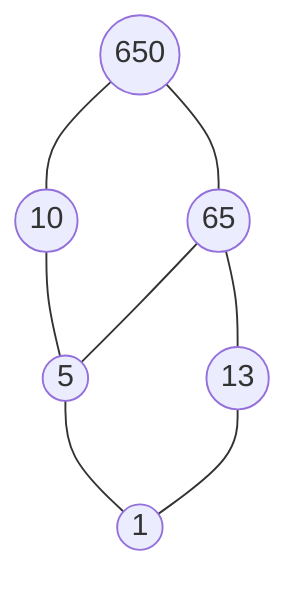

上一节我们看到，“自反 + **对称** + 传递”是在模仿等号 $=$，用来把同类元素抱成一团。如果把中间的“对称”换成截然相反的“**反对称**”——也就是**自反 + 反对称 + 传递**——又是在模仿什么呢？

看看我们最熟悉的三个例子：数字的“小于等于 $\le$”、集合的“包含于 $\subseteq$”、以及正整数之间的 **整除（divisibility，$a \mid b$ 表示 $b$ 是 $a$ 的整数倍）**。在正整数里，每个数都能整除自己（自反）；如果 $a \mid b$ 同时 $b \mid a$，那只可能是 $a = b$（反对称，绝不允许两个不同的正整数互相整除绕成圈！）；如果 $a \mid b$ 且 $b \mid c$，那自然 $a \mid c$（传递）。

像这样用来排“先后辈分”（同时允许有些同辈分的人互不隶属）的关系，就叫 **偏序关系（partial ordering，试卷上也写 reflexive partial order relation）**，配上那个集合 $(A, \preceq)$ 就叫 **偏序集（poset）**。

这就把我们直接带到了整张考卷的压轴大题 **Question 5（20 分）** 的第一问 **5a)（6 分）**：

> 在集合 $A = \{1, 5, 10, 13, 65, 650\}$ 上给定整除关系 $R$（即 $a \mid b$）。**a) Draw the Hasse diagram（画出它的哈斯图）。**

假如你把这 6 个数之间所有的整除关系老老实实画成第 04 节的有向图，会发生什么？每个点头顶都顶着一个自环（6 条），$1$ 要向其余 5 个数全拉上箭头，$5$ 要连向 $10, 65, 650$……整张图足足有 **19 条带箭头的线**，乱得像一团蜘蛛网！

德国数学家 Hasse 想出了一个极简的“三步脱衣法”——既然大家都心知肚明这是一个偏序集，那**凡是能靠偏序规矩自动脑补出来的线，一根都别画！**

1. **第一步脱自环**：既然偏序必定自反，每个点当然整除自己，把 6 个自环全擦掉！
2. **第二步脱跨级捷径（只留紧邻上下级）**：既然偏序必定传递，只要画出了 $1$ 连 $5$、$5$ 连 $10$，傻子也看得出来 $1$ 能整除 $10$！所以那根跨过 $5$ 直接从 $1$ 飞向 $10$ 的长线（同理还有 $1 \to 65$、$1 \to 650$、$5 \to 650$、$13 \to 650$）统统擦掉！留下的每一根线 $(x, y)$，都满足“$x \prec y$ 且在集合 $A$ 里再也塞不进第三个中间人 $z$ 使 $x \prec z \prec y$”——这叫 **覆盖关系（covering relation，$y$ covers $x$）**。
3. **第三步脱箭头定高低**：约定小的数画在底下、它的倍数画在头顶上方，所有线默认都是“一路往上爬”，于是连向上的箭头尖也省掉了，只剩干净利落的直线段！这样画出来的极简骨架图，就是 **哈斯图（Hasse diagram）**。

考场上怎么保证画 $\{1, 5, 10, 13, 65, 650\}$ 时既不漏线、也不多画冤枉线？先把每个数拆成质因数乘积排排坐（质因子总个数越多的数肯定只能往高处站，个数相同的两个数绝对不可能互相整除！）：
- 最底层（底）：$1$
- 第二层（单个素数）：$5$ 和 $13$ —— 从 $1$ 往上拉两条线连向 **$5$** 和 **$13$**；
- 第三层（两个素数相乘）：$10 = 2 \times 5$ 和 $65 = 5 \times 13$ —— 检查第二层的谁能整除它们：$5$ 既整除 $10$ 又整除 $65$（拉两条线 **$5 - 10$**、**$5 - 65$**）；$13$ 只整除 $65$、**不整除 $10$**（拉一条线 **$13 - 65$**）；
- 最顶层：$650 = 2 \times 5^2 \times 13 = 10 \times 65$ —— 第三层的 $10$ 和 $65$ 都能整除 $650$（拉最后两条线 **$10 - 650$**、**$65 - 650$**）。

一共只有清清爽爽 **7 条无向线段**（手绘在答卷上时，一定记得把 `650` 摆在最上面、`1` 摆在最底下，千万别加箭头和自环），6 分稳稳到手！
