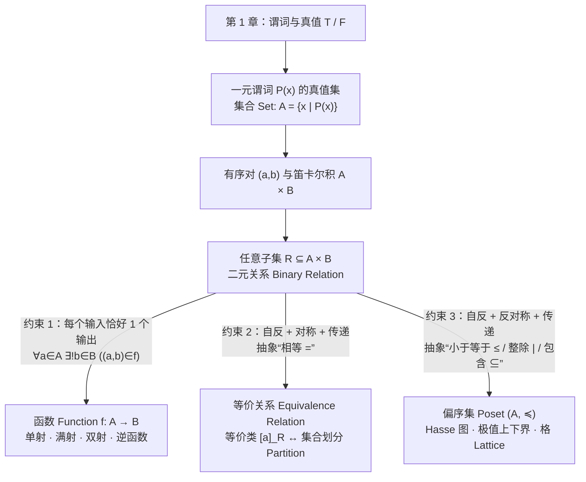

## 0.1 整章只有一个底层事实：集合与关系只是“谓词的真值表”

如果把第 1 章（Logic and Proof）和本章放在一起看，你会发现 **Sets、Functions、Relations、Equivalence、Posets 根本不是五章零散的定义，而是同一个东西不断加约束长出来的五棵枝干**：

- **第 1 章的一元谓词 $P(x)$** $\Longleftrightarrow$ **第 2 章的集合 $A = \{x \in U \mid P(x)\}$**：所谓 $x \in A$，不过是 "$P(x)$ 的==真值==算出来是 $\mathbf{T}$"。因此集合的 $\cup,\ \cap,\ \overline{A},\ \subseteq$ 与逻辑的 $\lor,\ \land,\ \neg,\ \to$ 一字不差！
- **第 1 章的二元谓词 $R(a,b)$** $\Longleftrightarrow$ **第 9 章的二元关系 $R \subseteq A \times B$**：所谓 $(a,b) \in R$，不过是 "$R(a,b)$ 的真值算出来是 $\mathbf{T}$"。当集合有限时，把所有 $(a_i, b_j)$ 的 $\mathbf{T}/\mathbf{F}$（写成 $1/0$）排成一张方格表，就是 **0-1 关系矩阵 $M_R$**；把 $1$ 画成箭头，就是 **有向图（Directed Graph）**。

## 0.2 四大核心结构的一页纸判别总表

考场上看到任何对象，先问自己它在下面哪一行，证明套路和反例套路立刻自动浮现：

| 结构 | 本质直觉 | 充要条件（怎么证成立） | 怎么举反例推翻（Disprove） |
|---|---|---|---|
| ==集合相等== $A = B$ | 两盒装的元素完全相同 | 互含：$A \subseteq B$ **且** $B \subseteq A$（任取 $x\in A$ 推 $x\in B$，反之亦然） | 找**一个元素** $x$ 属于一边但不属于另一边 |
| ==函数== $f: A \to B$ | 每个输入**有且仅有** 1 个输出 | ① 全定义（每行至少一个 1）② 单值（每行至多一个 1） | 找 $a\in A$ 没像（如 $1/0$），或找 $a\in A$ 有两个像（如 Test 02 Q3a 的 $3\to 1,2$） |
| ==双射== Bijection | 左右两边元素一根绳拴一个，不重不漏 | ① **One-to-One**：设 $f(a)=f(b)$ 推出 $a=b$；② **Onto**：任取 $y\in B$ 解出 $x\in A$ 使 $f(x)=y$ | 非单射：举 $a\neq b$ 但 $f(a)=f(b)$；非满射：举 $b\in B$ 无原像 |
| ==等价关系== | 把元素按“同一属性”分班抱团 | **自反 + 对称 + 传递**（矩阵重排后是主对角线上的全 $1$ 方块） | 缺哪条举哪条的具体元素反例 |
| ==偏序关系== | 给元素排“辈分/上下级”（允许平级不可比） | **自反 + 反对称 + 传递**（有向图抹掉自环后绝无有向环，可画 Hasse 图） | 找异点双向边 $a\neq b$ 但 $aRb \land bRa$（破反对称），或两步可达一步不可达（破传递） |
| ==格== Lattice | 任意两元素往上必汇于唯一最小上界、往下必聚于唯一最大下界 | 对 $A$ 中**每一对** $\{a,b\}$，$\text{lub}\{a,b\}$ 与 $\text{glb}\{a,b\}$ 均存在 | 找**一对** $\{a,b\}$ 无公共上/下界，或有多个极小上界/极大下界（蝴蝶结结构） |

## 0.3 教材与老师课件章节号对照说明（防迷路必看）

老师分发页 `bd.htm` 与考试大纲采用 **Rosen《Discrete Mathematics and Its Applications》第 7/8 版**章节号（`Ch9.1–9.6`），而老师三份 PDF 课件内页页脚保留了 **Rosen 第 5 版**旧章节号（`Ch5.1–5.6`），且内含部分超标题延伸小节。本站完整对齐如下：

| 考试大纲标号（Image 1 / `bd.htm`） | 老师 PDF 内页标号 | 配套练习 | 核心必考模块 vs 课件延伸概念 |
|---|---|---|---|
| **Ch2.1, 2.2, 2.3**: Sets and Functions | `Ch 2.1, 2.2, 2.3`（41 页） | `Tutorial 04` | **必考**：$\in$ 与 $\subseteq$、幂集、笛卡尔积、集合运算、函数单/满/双射与逆、复合、限制域造双射；**概念速览**：三集合容斥、位串表示 |
| **Ch9.1, 9.2, 9.3**: Relations and Properties | `Ch 5.1, 5.2, 5.3, 5.4`（48 页） | `Tutorial 05` | **必考**：关系有向图与 0-1 矩阵、6 大性质、关系计数、逆/补/异或/复合、三种闭包与 **Warshall 算法**；**概念速览**：$n$ 元关系与数据库 |
| **Ch9.5, 9.6**: Equivalence and Partial Orderings | `Ch 5.5, 5.6`（35 页） | `Tutorial 06` | **必考**：等价关系、同余、等价类与划分、偏序与对偶、全序、Hasse 图、极值与上下界、**格 Lattice**；**概念速览**：字典序、良序集、有界格与有补格 |

考前最值钱的三句保命提醒（来自课件与 Test 02 深度排雷）

1. **复合矩阵左右顺序大坑（Slide 45）**：$(a,c)\in R_2\circ R_1$ 意思是**先走 $R_1$、再走 $R_2$**！虽然老师 PPT 把矩阵写成了符号 $M_{R_2}\circ M_{R_1}$，但按下标公式 $(i,j)=\bigvee_k ((M_{R_1})_{ik}\land (M_{R_2})_{kj})$，**手算矩阵乘法时左边必须放 $M_{R_1}$、右边放 $M_{R_2}$**！放反直接丢光整小问分数。
2. **极值看子集内部，上下界看全集外部（Test 02 Q5）**：求子集 $B$ 的 minimal / maximal / least / greatest，候选人**只能在 $B$ 里面挑**；求 $B$ 的 upper / lower bounds、LUB、GLB，候选人在**整个偏序集 $A$ 里挑**！且在非全整数子集上求整除 LUB/GLB **绝不能盲套数论 $\operatorname{lcm}/\gcd$**（见第 5 题 g 的 $\{10,13\}$ 神坑）。
3. **论域决定生死（Test 02 Q3c & Tutorial 04 Q13）**：$x^2 \ge y$ 在**整数集 $\mathbb{Z}$** 上是自反的（整数没有 $(0,1)$ 之间的小数！），换到实数集 $\mathbb{R}$ 上就不自反（$0.5^2 < 0.5$）；$\lceil n/2\rceil$ 在 $\mathbb{Z}\to\mathbb{Z}$ 上是满射，函数性质永远先圈出 domain 与 codomain！

