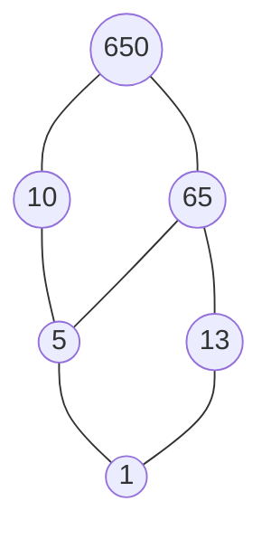

### 题目回顾

Given a relation $R$ “divisibility” ($a \mid b$) on the set $A = \{1, 5, 10, 13, 65, 650\}$.
- a) Draw the Hasse diagram **(6 marks)**
- b) Find the minimal elements of $\{5, 10, 13\}$ **(2 marks)**
- c) Find the greatest elements of $\{5, 10, 65\}$ **(2 marks)**
- d) Find the upper bounds of $\{13, 65\}$ **(2 marks)**
- e) Find the greatest lower bound of $\{10, 65\}$ **(2 marks)**
- f) Is $R$ a total order? Explain why. **(3 marks)**
- g) Is $R$ a lattice? Explain why. **(3 marks)**

---

### 5a）画出 Hasse 图（6 分）

**第一步：质因数分解 + 集合内最长整除链定层（考场防漏边绝招！）**
先把每个元素写成质因数乘积（质因子重数和 $\Omega(n)$ 严格递增：若 $a \mid b$ 且 $a \neq b$，必有 $\Omega(a) < \Omega(b)$，故 $\Omega$ 相同的元素必互不整除！再按集合 $A$ 内部的最长整除链排定 Hasse 层高）：
- 第 0 层（底，$\Omega=0$）：$1$
- 第 1 层（$\Omega=1$，素数）：$5$，$13$
- 第 2 层（$\Omega=2$）：$10 = 2 \times 5$，$65 = 5 \times 13$
- 第 3 层（顶，$\Omega=4$，在 $A$ 内最长链 $1\mid 5\mid 10\mid 650$ 长度为 3）：$650 = 2 \times 5^2 \times 13 = 10 \times 65$

**第二步：只连紧邻的覆盖边（Covering Edges，共 7 条无向边，底小顶大、无自环、无箭头）**：
- 从 $1$ 往上：$1 \mid 5$，$1 \mid 13$（注意 $1\mid 10$ 因中间隔了 $5$ **不画**！$1\mid 65$ 因隔了 $5, 13$ **不画**！）
- 从 $5$ 往上：$5 \mid 10$，$5 \mid 65$（$5\mid 650$ 隔了 $10, 65$ **不画**！）
- 从 $13$ 往上：$13 \mid 65$（注意 **$13 \nmid 10$**！且 $13\mid 650$ 隔了 $65$ **不画**！）
- 从第 2 层往上：$10 \mid 650$，$65 \mid 650$（注意 $10 \nmid 65$ 且 $65 \nmid 10$！）

> 考卷手绘提醒：务必把 `650` 画在最顶层、`10` 和 `65` 画在中间层、`5` 和 `13` 画在次底层、`1` 画在最底层，用**不带箭头的直线段**连接上述 7 对顶点即可拿满 6 分！（可切换到本页下方的交互式 Hasse 沙盘直接查看标准几何图并点击子集验证。）

---

### 5b–5e）极值与上下界四连问（每问 2 分，共 8 分）

- **5b）Minimal elements of $B_1 = \{5, 10, 13\}$**：
  - 候选人只能在 $\{5, 10, 13\}$ 里选！
  - 检查谁底下没有 $B_1$ 的其他元素：$5 \mid 10$（故 $10$ 在 $5$ 上方，排除 $10$）；$5$ 与 $13$ 互不整除，底下都没有 $B_1$ 的元素。
  - **标准答案**：**$5$ and $13$**。（顺带一提：若问 least element 则是 None！）

- **5c）Greatest element of $B_2 = \{5, 10, 65\}$**：
  - 候选人**必须在子集 $\{5, 10, 65\}$ 内部**！全集顶部的 $650 \notin B_2$，绝对没有参赛资格！
  - 在 $B_2$ 内部：$5 \mid 10$ 且 $5 \mid 65$，但 **$10 \nmid 65$ 且 $65 \nmid 10$**（$10$ 和 $65$ 都是 maximal elements，谁也统领不了谁）。
  - **标准答案**：**None / Does not exist**（不存在，因为 $10$ 与 $65$ 在 $\{5,10,65\}$ 内不可比，无唯一最大元）。

- **5d）Upper bounds of $B_3 = \{13, 65\}$**：
  - 上界在**全集 $A = \{1, 5, 10, 13, 65, 650\}$** 中找满足 $13 \mid u$ **且** $65 \mid u$ 的所有 $u \in A$。
  - 逐个核对：$65$（$13\mid 65$ 且 $65\mid 65$ ✓），$650$（$13\mid 650$ 且 $65\mid 650$ ✓）。（千万别漏掉 $65$ 自己！因为偏序是自反的，$65 \mid 65$！）
  - **标准答案**：**$65$ and $650$**（或写作 $\{65, 650\}$；若追问 LUB 则是 $65$）。

- **5e）Greatest lower bound (GLB) of $B_4 = \{10, 65\}$**：
  - 第一步先找全集 $A$ 中的所有公共下界（同时整除 $10$ 和 $65$ 的元素）：$1$（$1\mid 10, 1\mid 65$）与 $5$（$5\mid 10, 5\mid 65$），即下界集合为 $\{1, 5\}$。
  - 第二步在下界集合 $\{1, 5\}$ 中找 greatest element：因为 $1 \mid 5$，最大者为 **$5$**。
  - **标准答案**：**$5$**。

---

### 5f）Is $R$ a total order? Explain why.（3 分）

**Model Answer：**
**No**, $(A, \mid)$ is **not a total order**.
A poset is a total order if and only if every pair of elements in $A$ is comparable. Here, $5, 13 \in A$, but $5 \nmid 13$ and $13 \nmid 5$ (similarly, $10 \nmid 65$ and $65 \nmid 10$). Since there exist incomparable elements, $R$ is not a total order. ∎

---

### 5g）Is $R$ a lattice? Explain why.（3 分 · 全卷最精彩压轴题！）

千万别掉进 lcm(10, 13) = 130 ∉ A 的假反例陷阱！

很多同学背了“整除关系下 $\text{lub}(a,b)=\operatorname{lcm}(a,b)$”，一算 $\operatorname{lcm}(10,13)=130 \notin A$，就草率写“No, not a lattice”——**这是错的！**
回到 Lattice 的第一性原理定义：我们只在给定集合 $A=\{1,5,10,13,65,650\}$ 里找上界！
在 $A$ 里同时被 $10$ 和 $13$ 整除的元素集合是 $\{650\}$，它的最小元（LUB）就是 **$650$**！

**严谨核查方法**：在 6 元偏序集中，任何**可比元素对** $a \mid b$ 自动满足 $\text{glb}\{a,b\}=a,\ \text{lub}\{a,b\}=b$。因此只需逐一检查图中全部 **3 对不可比元素**：

| 不可比元素对 | 在 $A$ 中的公共下界集合 | **GLB** | 在 $A$ 中的公共上界集合 | **LUB** |
|---|---|---|---|---|
| $\{5, 13\}$ | $\{1\}$ | **$1$** | $\{65, 650\}$（且 $65\mid 650$） | **$65$** |
| $\{10, 13\}$ | $\{1\}$ | **$1$** | $\{650\}$ | **$650$** |
| $\{10, 65\}$ | $\{1, 5\}$（且 $1\mid 5$） | **$5$** | $\{650\}$ | **$650$** |

三对不可比元素全都同时拥有唯一的 LUB 和唯一的 GLB！

**Model Answer（考场满分英文答案）：**
**Yes**, $(A, \mid)$ **is a lattice**.
A poset is a lattice if every pair of elements has both a least upper bound (LUB) and a greatest lower bound (GLB) in $A$:
- For any comparable pair $a, b \in A$ with $a \mid b$, $\operatorname{glb}\{a, b\} = a$ and $\operatorname{lub}\{a, b\} = b$.
- For the three incomparable pairs in $A$:
  - $\{5, 13\}$: lower bounds $= \{1\} \Rightarrow \operatorname{glb} = 1$; upper bounds $= \{65, 650\} \Rightarrow \operatorname{lub} = 65$ (since $65 \mid 650$).
  - $\{10, 13\}$: lower bounds $= \{1\} \Rightarrow \operatorname{glb} = 1$; upper bounds $= \{650\} \Rightarrow \operatorname{lub} = 650$.
  - $\{10, 65\}$: lower bounds $= \{1, 5\} \Rightarrow \operatorname{glb} = 5$ (since $1 \mid 5$); upper bounds $= \{650\} \Rightarrow \operatorname{lub} = 650$.

Since every pair of elements in $A$ has both a unique LUB and a unique GLB, $(A, \mid)$ is a lattice. ∎

