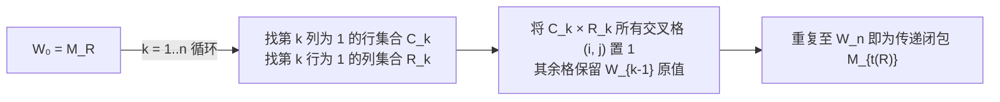

## 2.1 二元关系及其三种等价表示【高频必考】

- **定义（Slides 5.1 p3–p8）**：
  - 从集合 $A$ 到集合 $B$ 的 ==二元关系==（binary relation）是笛卡尔积的任意子集 $R \subseteq A \times B$。$(a,b)\in R$ 记作 $aRb$。
  - **集合 $A$ 上的关系（relation on a set $A$）**：特指 $A$ 到自身的关系 $R \subseteq A \times A$。
  - **函数是关系的特例（Slides p2）**：函数 $f: A \to B$ 就是满足“每个 $a\in A$ 恰与一个 $b\in B$ 配对”的特殊二元关系。

### 三种表示法的互译（Tutorial 05 Q1–Q2）
1. **有序对集合**：直接列出所有满足条件的 $(a,b)$，或用描述法 $\{(x,y) \mid \dots\}$。
2. **有向图 Directed Graph（Digraph，Slides p5–p6）**：顶点画 $A$ 的元素；若 $(a,b)\in R$ 画有向边 $a \to b$；若 $(a,a)\in R$ 画**自环（loop）**。
3. **0-1 关系矩阵 Zero-One Matrix $M_R = [m_{ij}]$（Slides p7）**：固定元素顺序 $A=\{a_1,\dots,a_m\},\ B=\{b_1,\dots,b_n\}$，则 $m \times n$ 矩阵定义为：

$$
m_{ij} = \begin{cases} 1, & \text{if } (a_i, b_j) \in R \\ 0, & \text{if } (a_i, b_j) \notin R \end{cases}
$$

---

## 2.2 集合 $A$ 上关系的六大性质全对比表【每卷必考】

设 $R$ 是**非空集合 $A$** 上的关系（$|A|=n$）。考场遇到性质判定题（如 Test 02 Q3、Tutorial 05 Q7），直接对照下表从“逻辑定义 / 有向图 / 0-1 矩阵”三重视角秒判：

| 性质 | 形式逻辑定义（Slides 5.1 p10–p13） | 有向图特征 | 0-1 矩阵 $M_R$ 特征 | 长度为 $n$ 集合上的关系个数 |
|---|---|---|---|---|
| **自反 Reflexive** | $\forall a\in A\,((a,a)\in R)$ | **每个**顶点都有自环 | 主对角线**全为 $1$** | $2^{n(n-1)}$ |
| **反自反 Irreflexive** | $\forall a\in A\,((a,a)\notin R)$ | **任何**顶点都无自环 | 主对角线**全为 $0$** | $2^{n(n-1)}$ |
| **对称 Symmetric** | $\forall a,b\in A\,((a,b)\in R \to (b,a)\in R)$ | 异点间每条边必成对双向（自环任意） | $M_R = M_R^T$（沿主对角线对称） | $2^{n(n+1)/2}$ |
| **反对称 Antisymmetric** | $\forall a,b\in A\,(((a,b)\in R \land (b,a)\in R) \to a=b)$  等价：$a\neq b \land (a,b)\in R \to (b,a)\notin R$ | **异点之间绝无双向边**（自环可有可无！） | $i\neq j$ 时 $m_{ij}$ 与 $m_{ji}$ **不同时为 $1$**（只许 $(0,0),(1,0),(0,1)$ 3 种） | $2^n \cdot 3^{n(n-1)/2}$ |
| **非对称 Asymmetric** | $\forall a,b\in A\,((a,b)\in R \to (b,a)\notin R)$ | **既无双向边，也绝无自环**（= 反自反 + 反对称） | 主对角线全 $0$，且对称位置不同时为 $1$ | $3^{n(n-1)/2}$ |
| **传递 Transitive** | $\forall a,b,c\in A\,(((a,b)\in R \land (b,c)\in R) \to (a,c)\in R)$ | 凡有两步路径 $a\to b\to c$，必有直达捷径 $a\to c$ | $M_R^{[2]} \le M_R$（平方里为 $1$ 的位置原矩阵必为 $1$） | 无封闭初等公式 |

### 计数公式推导速记 + Tutorial 05 勘误

- **任意二元关系总数**：$A \times A$ 有 $n^2$ 个格子，每格填 $0/1$，共 **$2^{n^2}$** 个。
  - **【Tutorial 05 Q4a 答案勘误】**：当 $|A|=4$ 时，关系总数为 $2^{4^2} = 2^{16} = \mathbf{65536}$（Tutorial 答案误印成了 $2^{16}-1 = 65535$，考试务必写 $2^{16} = 65536$！）。
- **对称 / 反对称 / 非对称怎么数不混**：把 $n\times n$ 矩阵拆成 **$n$ 个主对角线格** + **$\frac{n(n-1)}{2}$ 对上下对称格 $\{m_{ij}, m_{ji}\}$**：
  - **Symmetric**：对角线 $n$ 格随便填（$2^n$），每对对称格捆绑同填 $00$ 或 $11$（$2$ 种）$\Rightarrow 2^n \cdot 2^{n(n-1)/2} = 2^{n(n+1)/2}$。
  - **Antisymmetric**：对角线 $n$ 格随便填（$2^n$），每对对称格禁填 $11$，只剩 $00, 10, 01$（**$3$ 种**）$\Rightarrow 2^n \cdot 3^{n(n-1)/2}$。
  - **Asymmetric**：对角线 $n$ 格强制全填 $0$（$1$ 种），每对对称格仍有 $00, 10, 01$（$3$ 种）$\Rightarrow 3^{n(n-1)/2}$。

考场必背四大性质认知陷阱（含 Tutorial 05 Q7g 答案勘误！）

1. **“不自反” $\neq$ “反自反”**：对角线只要既有 $1$ 又有 $0$（例如 $A=\{1,2\},\ R=\{(1,1)\}$），它**既不是 reflexive，也不是 irreflexive**！
2. **“对称”与“反对称”既不互斥也不互补**：
   - 对角线子集（如恒等关系 $I_A = \{(1,1),(2,2),(3,3),(4,4)\}$，Tutorial 05 Q7c）**既是 symmetric 又是 antisymmetric**（因为根本没有 $a\neq b$ 的边，反对称前件空真！）；
   - 而 $R=\{(1,2),(2,3),(3,2)\}$ **既不是 symmetric（缺 $(2,1)$），也不是 antisymmetric（有 $(2,3),(3,2)$ 双向边）**！
3. **空真（Vacuously True）传递性**：若关系里根本找不到首尾相接的 $(a,b)\in R$ 与 $(b,c)\in R$（例如 $R=\{(1,3),(2,3)\}$），则传递性前件恒假，**自动是 transitive**！但注意双向边 $\{(2,4),(4,2)\}$（Tutorial 05 Q7b）**不传递**！因为 $(2,4)\in R$ 且 $(4,2)\in R$ 拼出了 $(2,2) \notin R$！
4. **【Tutorial 05 Q7g 重要勘误】实数集 $\mathbb{R}$ 上的 $R = \{(x,y) \mid xy \ge 0\}$ 到底传不传递？**
   - Tutorial 答案误写成了 `symmetric, transitive, reflexive`，但实际上它在 $\mathbb{R}$ 上**绝对不传递（NOT transitive）**！
   - **铁证反例**：取 $x = -1,\ y = 0,\ z = 2$。因为 $(-1)\cdot 0 = 0 \ge 0 \Rightarrow (-1,0)\in R$，且 $0\cdot 2 = 0 \ge 0 \Rightarrow (0,2)\in R$；但 $(-1)\cdot 2 = -2 < 0 \Rightarrow (-1,2)\notin R$！元素 $0$ 充当了连接负数与正数的“桥梁”，直接击穿传递性！（注：若把定义域改为 $\mathbb{R}-\{0\}$，它才是等价关系。）

---

## 2.3 关系的组合、复合与矩阵布尔运算【Test 02 Q2 核心 24 分】

因为关系 $R_1, R_2 \subseteq A \times B$ 本身就是集合，所有集合运算均可直接套用，并在 0-1 矩阵上变成逐位布尔运算（Slides 5.1 p14–p29）：

| 关系运算 | 集合/元素定义 | 0-1 矩阵算子 | 考场心算口诀 |
|---|---|---|---|
| 并 $R_1 \cup R_2$ | $(a,b)\in R_1 \lor (a,b)\in R_2$ | $M_{R_1} \lor M_{R_2}$（Join） | 同位置有 $1$ 就写 $1$ |
| 交 $R_1 \cap R_2$ | $(a,b)\in R_1 \land (a,b)\in R_2$ | $M_{R_1} \land M_{R_2}$（Meet） | 同位置两个都是 $1$ 才写 $1$ |
| 补 $\overline{R}$ | $(a,b) \notin R$ | $\overline{M_R}$ | 矩阵里所有 **$0 \leftrightarrow 1$ 互换** |
| 差 $R_1 - R_2$ | $(a,b)\in R_1 \land (a,b)\notin R_2$ | $M_{R_1} \land \overline{M_{R_2}}$ | 把 $M_{R_1}$ 里与 $M_{R_2}$ 重叠的 $1$ 抹成 $0$ |
| 对称差 $R_1 \oplus R_2$ | 恰属于 $R_1, R_2$ 之一 | $M_{R_1} \oplus M_{R_2}$ | 同位置**不同写 $1$，相同写 $0$** |
| 逆关系 $R^{-1}$ | $\{(b,a) \mid (a,b)\in R\}$ | $M_R^T$（矩阵转置） | 第 $i$ 行变第 $i$ 列（沿主对角线翻折） |
| 复合 $R_2 \circ R_1$ | $\{(a,c) \mid \exists b\,((a,b)\in R_1 \land (b,c)\in R_2)\}$ | **$M_{R_1} \odot M_{R_2}$**（布尔积） | **先走右边 $R_1$，再走左边 $R_2$！左放 $M_{R_1}$ 乘右放 $M_{R_2}$** |
| 关系幂 $R^n$ | $R^1=R,\ R^{n+1}=R^n \circ R$ | $M_R^{[n]}$（布尔幂） | $(a,b)\in R^n \iff$ 有向图中存在从 $a$ 到 $b$ **长度为 $n$ 的有向路径**（Slides p25–p26 定理） |

最高优先级排雷：老师 PPT Slide 45 的复合矩阵符号顺序！

在《Ch9.1–9.3》课件第 45 页（Slide 45），老师把 $R_2 \circ R_1$ 的矩阵记成了一个反序符号 "$M_{R_2} \circ M_{R_1}$"，**紧接着在下一行给出了它的元素级真实定义**：

$$
(M_{R_2 \circ R_1})_{ij} = \bigvee_{k=1}^{n} \Big[(M_{R_1})_{ik} \land (M_{R_2})_{kj}\Big]
$$

看清下标：**取第 $i$ 行的矩阵是 $M_{R_1}$，取第 $j$ 列的矩阵是 $M_{R_2}$**！
也就是说，当你用线性代数熟悉的“左矩阵第 $i$ 行 $\times$ 右矩阵第 $j$ 列”手算布尔乘法（把乘法换 $\land$、加法换 $\lor$）时：
- 求 **$R_2 \circ R_1$** $\Longrightarrow$ 草稿纸上**左边必须写 $M_{R_1}$、右边必须写 $M_{R_2}$**（即标准 Rosen 教材记法 $M_{R_2 \circ R_1} = M_{R_1} \odot M_{R_2}$）！
- 如果你按字面顺序把 $M_{R_2}$ 摆左边乘 $M_{R_1}$，你算出来的其实是 $R_1 \circ R_2$，整道小题全错！

### 重要性质保持定理（Slides p16–p17, p27–p29 & Test 02 Q4）
- **传递性充要判据（Slides p27）**：集合 $A$ 上的关系 $R$ 是传递的 $\iff$ 对一切正整数 $n \ge 1$，都有 **$R^n \subseteq R$**（其实只需验证 $R^2 \subseteq R$）。
- **哪些运算保性质（Prove or Disprove 高频题库）**：
  - 若 $R_1, R_2$ 自反：则 $R_1\cup R_2,\ R_1\cap R_2,\ R_1^{-1},\ R_2\circ R_1$ **全自反**；而 $R_1 - R_2,\ R_1 \oplus R_2$ **必反自反**（Tutorial 05 Q6）！
  - 若 $R_1, R_2$ 对称：则 $R_1\cup R_2,\ R_1\cap R_2$（**Test 02 Q4 原题**）、$R_1 - R_2,\ R_1\oplus R_2,\ \overline{R_1},\ R_1^{-1},\ R_1^n$ **全对称**！但 **$R_2 \circ R_1$ 未必对称**（反例：$R_1=\{(1,2),(2,1)\},\ R_2=\{(2,3),(3,2)\}$，则 $R_2\circ R_1=\{(1,3)\}$ 不对称）。
  - 若 $R_1, R_2$ 传递：$R_1 \cap R_2$ **必传递**；但 **$R_1 \cup R_2$ 未必传递**（Slides p17 反例：$R_1=\{(1,2)\},\ R_2=\{(2,3)\}$，并集缺 $(1,3)$）！

---

## 2.4 关系的闭包 Closures 与 Warshall 算法【Test 02 Q2e/f 必考】

**闭包定义（Slides 5.4 p32–p36）**：给定性质 $P$，关系 $R$ 关于性质 $P$ 的闭包是**包含 $R$（$R \subseteq S$）且具有性质 $P$ 的最小关系 $S$**（往 $R$ 里补最少的边使之满足 $P$）。

| 闭包类型 | 集合公式（$\Delta = \{(a,a)\mid a\in A\}$） | 0-1 矩阵做法 | 有向图做法 |
|---|---|---|---|
| **自反闭包 $r(R)$** | $r(R) = R \cup \Delta$ | 把主对角线所有 $0$ 改成 **$1$**（$M_R \lor I_n$） | 给没自环的顶点全部画上自环 |
| **对称闭包 $s(R)$** | $s(R) = R \cup R^{-1}$ | **$M_R \lor M_R^T$**（若 $m_{ij}=1$ 则把 $m_{ji}$ 也置 $1$） | 把所有单向箭头补成双向箭头 |
| **传递闭包 $t(R)$** | $t(R) = R^* = \bigcup_{k=1}^{n} R^k$（$|A|=n$） | $M_R \lor M_R^{[2]} \lor \cdots \lor M_R^{[n]}$ 或 **Warshall 算法** | 只要从 $a$ 到 $b$ 存在长度 $\ge 1$ 的有向路径，就补边 $a\to b$ |

### Warshall 算法手算标准流程（Slides p43–p44，Tutorial 05 Q8）

直接算 $M_R^{[2]}, \dots, M_R^{[n]}$ 需要 $O(n^4)$ 次位运算；**Warshall 算法**只需 $O(n^3)$，构造矩阵序列 $W_0, W_1, \dots, W_n$（其中 $W_0 = M_R$，$W_n = M_{t(R)}$），递推式为：

$$
w_{ij}^{[k]} = w_{ij}^{[k-1]} \lor \Big(w_{ik}^{[k-1]} \land w_{kj}^{[k-1]}\Big)
$$

**考场 10 秒“十字交叉补 1 法”（绝不出错）**：
从 $W_{k-1}$ 推 $W_k$（允许使用第 $k$ 个顶点作中转站）：
1. 把 $W_{k-1}$ 照抄一遍（原来是 $1$ 的永远保持 $1$）；
2. 扫一眼**第 $k$ 列**，记下哪些行号 $i$ 的位置是 $1$（记作集合 $C_k = \{i \mid w_{ik}^{[k-1]}=1\}$）；
3. 扫一眼**第 $k$ 行**，记下哪些列号 $j$ 的位置是 $1$（记作集合 $R_k = \{j \mid w_{kj}^{[k-1]}=1\}$）；
4. 把所有交叉坐标 **$(i, j) \in C_k \times R_k$** 全部填成 **$1$**，即得 $W_k$！

### 复合闭包顺序定理（Slides p46–p48，Ch9.5 p14–p15，Tutorial 05 Q10–Q12）
- 若 $R$ 自反，则 $s(R)$ 与 $t(R)$ 仍自反（Tutorial 05 Q11）；若 $R$ 对称，则 $r(R)$ 与 $t(R)$ 仍对称（Tutorial 05 Q12）。
- **但若 $R$ 传递，$s(R)$ 未必传递！** 例如 $R=\{(1,3),(2,3)\}$ 传递，其对称闭包 $s(R)=\{(1,3),(3,1),(2,3),(3,2)\}$ 缺 $(1,2)$ 不传递！
- 因此求同时满足多种性质的最小闭包时，**传递闭包 $t(\cdot)$ 必须放在最外层最后做**：
  - 最小自反传递关系（预序闭包）= $t(r(R))$；
  - 最小对称传递关系 = $t(s(R))$（注意若某顶点孤立无任何边，$t(s(R))$ 不会给它加自环！）；
  - **最小等价关系（等价闭包）** = **$t(s(r(R)))$**（先补对角线 $r$，再补对称边 $s$，最后连通分量内全打通 $t$）。

---

## 2.5 n-ary Relations（$n$ 元关系）与关系型数据库【概念速览】

- **定义（Slides 5.2 p30–p31）**：设 $A_1, A_2, \dots, A_n$ 为集合，子集 $R \subseteq A_1 \times A_2 \times \cdots \times A_n$ 称为 **$n$-ary relation**，$A_i$ 称为各域（domains），$n$ 称为度（degree）。
- **关系数据库模型（Relational Data Model）**：
  - 一张数据库表 = 一个 $n$ 元关系；每一列（字段 Attribute）对应一个域；每一行记录（Record）是一个 $n$ 元组（$n$-tuple）。
  - **主键 Primary Key**：值在所有记录中互不重复、能唯一确定一条 $n$ 元组的属性域（例如学号 `Student_ID`；若单个属性不够，可用复合主键 Composite Key）。
  - 三大基本关系运算：选择 Selection（按条件筛行）、投影 Projection（抽出指定列组成更低度关系并去重）、连接 Join（按公共属性值拼接两张表）。
