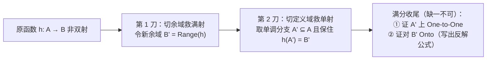

## 1.1 集合基础：元素 $\in$ 与子集 $\subseteq$ 的盒子模型【高频必考】

- **定义（Slides 2.1 p3–p8）**：集合（set）是对象的无序聚集（unordered collection）。
  - **无序且互异**：$\{1, 3, 3, 5, 5\} = \{5, 3, 1\}$（Tutorial 04 Q3a）。
  - **常用数集记号（Slides p4）**：自然数 $\mathbb{N}=\{0,1,2,\dots\}$、整数 $\mathbb{Z}$、正整数 $\mathbb{Z}^+=\{1,2,3,\dots\}$、有理数 $\mathbb{Q}$、实数 $\mathbb{R}$、正实数 $\mathbb{R}^+$。
  - **真值集（Truth Set，Slides p17）**：给定 domain $D$，谓词 $P(x)$ 的真值集为 $\{x \in D \mid P(x)\}$。例如在 $\mathbb{Z}$ 上 $|x|=1$ 的真值集是 $\{-1, 1\}$。

### 考场第一易错点：$\in$（属于）vs $\subseteq$（包含于）与空集 $\varnothing$

把集合想象成**带外包装的快递盒**：
- **$x \in A$（属于）**：把最外层盒子 $A$ 打开，**往里只看一层**，能直接摸到一模一样的物品 $x$。
- **$B \subseteq A$（子集）**：$\forall x\,(x\in B \to x\in A)$ —— 把盒子 $B$ 打开倒出里面每一件物品，每一件都能在盒子 $A$ 里找到。
- **集合相等 $A = B$**：$A \subseteq B \land B \subseteq A \iff \forall x\,(x\in A \leftrightarrow x\in B)$。

Tutorial 04 Q3–Q5 经典陷阱：∅ vs {∅} vs {∅, {∅}}

- **空集 $\varnothing = \{\}$**：一个空空如也的盒子，基数 $|\varnothing| = 0$。对任何集合 $S$，永远有 $\varnothing \subseteq S$（因为 $x\in\varnothing$ 恒为 $\mathbf{F}$，蕴含式 $\forall x\,(x\in\varnothing \to x\in S)$ **空真 vacuously true**！）。
- **单元素集 $\{\varnothing\}$**：一个大盒子里装着**一个空盒子**！它**不是空集**，基数 $|\{\varnothing\}| = 1$，它唯一的成员是 $\varnothing$。
- 逐条秒杀 Tutorial 04 Q5：
  - $\varnothing \in \{\varnothing\}$ —— **True**（打开外盒就是 $\varnothing$）
  - $\varnothing \in \{\varnothing, \{\varnothing\}\}$ —— **True**
  - $\{\varnothing\} \in \{\varnothing\}$ —— **False**（打开外盒只有 $\varnothing$，没有带壳的 $\{\varnothing\}$）
  - $\{\varnothing\} \in \{\{\varnothing\}\}$ —— **True**
  - $\{\varnothing\} \subset \{\varnothing, \{\varnothing\}\}$ —— **True**（左盒元素 $\varnothing$ 在右盒中，且右盒多了 $\{\varnothing\}$，是真子集 proper subset）
  - $\{\{\varnothing\}\} \subset \{\{\varnothing\}, \{\varnothing\}\}$ —— **False**！右边重复写两次等于 $\{\{\varnothing\}\}$，左右相等，不是**真**子集（$\subset$ 要求 $\subseteq$ 且 $\neq$）！
- **手写卷面常见记法错误（Test 02 Q1c 实录）**：想表达“正实数与 $0$ 并起来”，**绝不能写** $\{\mathbb{R}^+, 0\}$！因为 $\{\mathbb{R}^+, 0\}$ 表示一个只含 2 个元素（一个是集合 $\mathbb{R}^+$ 本身、一个是数字 $0$）的二元集。正确写法是 $[0, +\infty)$、$\mathbb{R}^+ \cup \{0\}$ 或 $\{y \in \mathbb{R} \mid y \ge 0\}$。

---

## 1.2 幂集 Power Set 与笛卡尔积 Cartesian Product【高频必考】

### A. 幂集 $\mathcal{P}(S)$（Slides 2.1 p10）
- **定义**：集合 $S$ 的所有子集组成的集合，记作 $\mathcal{P}(S) = \{X \mid X \subseteq S\}$。
- **基数公式**：若 $|S| = n$，则每个元素有“选 / 不选” 2 种状态，故：

$$
|\mathcal{P}(S)| = 2^n
$$

- 特例：$\mathcal{P}(\varnothing) = \{\varnothing\}$（含 $2^0=1$ 个元素）；$\mathcal{P}(\{\varnothing\}) = \{\varnothing, \{\varnothing\}\}$（含 $2^1=2$ 个元素）。

### B. 有序 $n$ 元组与笛卡尔积（Slides 2.1 p11–p15，Tutorial 04 Q6–Q7）
- **有序对（Ordered Pair）**：$(a,b) = (c,d) \iff a=c \land b=d$。当 $a\neq b$ 时 $(a,b)\neq (b,a)$。
- **笛卡尔积（Cartesian Product）**：

$$
A \times B = \{(a,b) \mid a \in A \land b \in B\}, \qquad |A \times B| = |A| \cdot |B|
$$

- **不满足交换律，也不满足结合律（Tutorial 04 Q7 必考简答）**：
  - 当 $A, B$ 非空且 $A \neq B$ 时，$A \times B \neq B \times A$；但若其中有一个是 $\varnothing$，则 $A \times \varnothing = \varnothing \times A = \varnothing$。
  - **为什么 $A \times B \times C \neq (A \times B) \times C$？（标准英文答法）**：
    Assume $(a,b,c) \in A \times B \times C$, which is an **ordered 3-tuple**; whereas $((a,b), c) \in (A \times B) \times C$ is an **ordered 2-tuple** whose first entry is a 2-tuple. Therefore, their elements have different structures and the two sets are not equal (assuming $A, B, C$ are nonempty).

---

## 1.3 集合运算、恒等式与三种标准证法【高频必考】

### A. 五种集合运算与逻辑联结词的一一对应（Slides 2.2 p18–p22）

| 集合运算 | 集合构造定义 | 对应的第 1 章逻辑式 | Tutorial 04 Q10 典型充要结论 |
|---|---|---|---|
| 并集 Union $A \cup B$ | $\{x \mid x\in A \lor x\in B\}$ | $P(x) \lor Q(x)$ | $A \cup B = A \iff B \subseteq A$ |
| 交集 Intersection $A \cap B$ | $\{x \mid x\in A \land x\in B\}$ | $P(x) \land Q(x)$ | $A \cap B = A \iff A \subseteq B$；不相交 Disjoint $\iff A\cap B=\varnothing$ |
| 差集 Difference $A - B$ | $\{x \mid x\in A \land x\notin B\} = A \cap \overline{B}$ | $P(x) \land \neg Q(x)$ | $A - B = A \iff A \cap B = \varnothing$；$A - B = B - A \iff A = B$ |
| 补集 Complement $\overline{A}$ | $\{x \in U \mid x\notin A\} = U - A$ | $\neg P(x)$ | $\overline{\overline{A}} = A$；De Morgan: $\overline{A\cup B}=\overline{A}\cap\overline{B},\ \overline{A\cap B}=\overline{A}\cup\overline{B}$ |
| 对称差 Symmetric Diff $A \oplus B$ | $(A - B) \cup (B - A) = (A\cup B)-(A\cap B)$ | $P(x) \oplus Q(x)$ | $A \oplus A = \varnothing$；$A \oplus \varnothing = A$ |

### B. 集合恒等式全部十律（直接把第 1 章逻辑等价律的 $\land,\lor,\neg,\mathbf{F},\mathbf{T}$ 换成 $\cap,\cup,\overline{\phantom{A}},\varnothing,U$！）
- 同一律：$A \cup \varnothing = A$，$A \cap U = A$；支配律：$A \cup U = U$，$A \cap \varnothing = \varnothing$；
- 幂等律、双重补律、交换律、结合律、分配律 $A \cap (B \cup C) = (A\cap B) \cup (A\cap C)$、吸收律 $A \cup (A\cap B) = A$、补律 $A \cup \overline{A} = U,\ A \cap \overline{A} = \varnothing$、De Morgan 律。

### C. 证明集合恒等式的三种正规武器
1. **双向包含元素追逐法（Element Argument）**：证 $L = R$，先任取 $x\in L$ 展开为逻辑式推至 $x\in R$（得 $L\subseteq R$），再反推 $R\subseteq L$（若每步都是 $\iff$ 可合并写）。
2. **集合代数定律法（Set Identities）**：从左式每步套用集合恒等律化为右式并标律名（与逻辑无真值表证明完全同构）。
3. **成员表法（Membership Table）**：列 $x$ 属于/不属于 $A,B,C$ 的 $2^k$ 种 $1/0$ 组合，核对两列完全一致。

---

## 1.4 容斥原理与计算机位串表示 Set Representation【概念速览】

- **容斥原理 Principle of Inclusion-Exclusion（Slides 2.2 p23）**：

$$
|A \cup B| = |A| + |B| - |A \cap B|
$$

$$
|A \cup B \cup C| = |A| + |B| + |C| - |A\cap B| - |A\cap C| - |B\cap C| + |A\cap B\cap C|
$$

- **位串表示集合 Computer Representation via Bit Strings（Slides 2.2 p24–p25）**：
  固定全集元素顺序 $U = \{u_1, u_2, \dots, u_n\}$，子集 $A \subseteq U$ 对应长度为 $n$ 的 Bit String $b_1 b_2 \cdots b_n$（若 $u_i \in A$ 则 $b_i = 1$，否则为 $0$）。
  - $\overline{A}$ = 按位取反 `NOT`；$A \cup B$ = 按位 `OR`；$A \cap B$ = 按位 `AND`；$A \oplus B$ = 按位 `XOR`！

---

## 1.5 函数 Functions：定义、三禁区、单射/满射/双射与逆【高频必考】

### A. 函数的严格定义与“何时不是函数”（Slides 2.3 p26–p30，Tutorial 04 Q11）
设 $A, B$ 为非空集合。从 $A$ 到 $B$ 的函数 $f: A \to B$ 是给 $A$ 中**每一个**元素 $a$ 指派 $B$ 中**恰好一个（exactly one）**元素 $b$ 的规则，记作 $f(a)=b$。
- $A$ 叫 **Domain（定义域）**，$B$ 叫 **Codomain（余域）**；
- 真正被射中的元素集合 $\operatorname{Range}(f) = \{f(a) \mid a \in A\} \subseteq B$ 叫 **Range（值域 / Image of $A$）**。
- 若 $f(a)=b$，则 $b$ 是 $a$ 的 **image（像）**，$a$ 是 $b$ 的 **preimage（原像，课件有时称 coimage）**。

Tutorial 04 Q11：判断“不是函数 (Not a Function)”的三大禁区

问：为什么下列规则**不是**从 $\mathbb{R}$ 到 $\mathbb{R}$ 的函数？
1. $f(x) = 1/x$ —— **漏定义**：$f(0)$ 未定义（$0 \in \mathbb{R}$ 没有输出像）！
2. $f(x) = \sqrt{x}$ —— **定义域越界**：对 $x < 0$ 在实数余域 $\mathbb{R}$ 中没有实数值！
3. $f(x) = \pm\sqrt{x^2+1}$ —— **一源多值**：每个 $x$ 被赋予了两个不同的值！
- **放在 0-1 关系矩阵 / 有向图里看（Test 02 Q3 第 vi 问必考！）**：
  关系 $R \subseteq A \times A$ 是函数 $\iff$ **矩阵每一行的元素之和都恰好等于 $1$**（每个顶点出度恒为 $1$）。只要有一行全是 $0$（漏定义）或有两个及以上的 $1$（如 Test 02 Q3a 中 $(3,1)\in R$ 且 $(3,2)\in R$），立刻判定 **Not a function**！

### B. 单射、满射、双射与反函数总表（Slides 2.3 p31–p38，Tutorial 04 Q13–Q14）

| 性质 | 形式逻辑定义 | 直观图像 / 矩阵判据 | 标准证明写法 | 标准否证（反例）写法 |
|---|---|---|---|---|
| **单射 One-to-One** (Injective) | $\forall a,b\in A\,(f(a)=f(b) \to a=b)$  等价逆否：$a\neq b \to f(a)\neq f(b)$ | 每个 $b\in B$ 入度 $\le 1$；连续图像通过水平线测试 | Assume $f(a)=f(b)$, 代入化简推出 $a=b$（或说明函数严格递增/递减） | 举具体 $a \neq b$ 算出 $f(a)=f(b)$（如 $f(x)=x^2$ 在 $\mathbb{Z}$ 上 $f(-1)=f(1)=1$） |
| **满射 Onto** (Surjective) | $\forall b\in B\,\exists a\in A\,(f(a)=b)$  即 $\operatorname{Range}(f) = B$ | 每个 $b\in B$ 入度 $\ge 1$；值域铺满整个余域 | Take any $y\in B$, 反解出 $x = \dots$，**必须验证 $x \in A$** 且 $f(x)=y$！ | 举具体 $b_0 \in B$，说明方程 $f(x)=b_0$ 在**定义域 $A$ 内**无解 |
| **双射 One-to-One Correspondence** (Bijection) | 既 **One-to-One** 又 **Onto** | 每个 $b\in B$ 入度 $= 1$；左右元素一一配对（有限集必有 $|A|=|B|$） | 分两段完整写出：(1) One-to-one; (2) Onto | 只要破坏单射或满射其一即非双射 |
| **可逆 Invertible** 与 $f^{-1}$ | 存在 $f^{-1}: B \to A$ 使 $f^{-1}(b)=a \iff f(a)=b$ | **$f$ 可逆 $\iff f$ 是双射！** | 先证 $f$ 是双射，再由 $y=f(x)$ 解出 $x=f^{-1}(y)$ | 指出 $f$ 不是 one-to-one 或不是 onto，故 not invertible |

> **Tutorial 04 Q13 经典对照（同样在 $\mathbb{Z} \to \mathbb{Z}$ 上）**：
> - $f(n) = n - 1$：One-to-one ✓，Onto ✓（双射，$f^{-1}(m)=m+1$）
> - $f(n) = n^2 + 1$：One-to-one ✗（$f(1)=f(-1)=2$），Onto ✗（$0$ 无原像）
> - $f(n) = n^3$：One-to-one ✓（严格递增），Onto ✗（$2 \in \mathbb{Z}$ 没有**整数**立方根！注意若换成 $\mathbb{R}\to\mathbb{R}$ 则是双射！）
> - $f(n) = \lceil n/2 \rceil$：One-to-one ✗（$f(1)=f(2)=1$），Onto ✓（对任意 $k\in\mathbb{Z}$，取 $n=2k\in\mathbb{Z}$ 即有 $\lceil 2k/2\rceil = k$）

---

## 1.6 函数运算、复合与“限制定义域/余域构造双射”【Test 02 Q1 压轴考点】

### A. 实值函数的加积与复合（Slides 2.3 p39–p41，Tutorial 04 Q15，Test 02 Q1a/b）
- **逐点加/乘**：设 $f_1, f_2: A \to \mathbb{R}$，则 $(f_1 + f_2)(x) = f_1(x) + f_2(x)$，$(f_1 f_2)(x) = f_1(x) f_2(x)$。
- **函数复合 Composition**：设 $g: A \to B$，$f: B \to C$（必须满足 $\operatorname{Range}(g) \subseteq \operatorname{Domain}(f)$），则 $f \circ g: A \to C$ 定义为：

$$
(f \circ g)(x) = f(g(x))
$$

- **记准方向**：靠近自变量 $x$ 的右边函数 $g$ **先算**，外层左边函数 $f$ **后算**！一般 $f \circ g \neq g \circ f$（不交换），但满足结合律 $h \circ (g \circ f) = (h \circ g) \circ f$。

### B. 限制定义域与余域使函数变成双射（Slides p38，Tutorial 04 Q14，Test 02 Q1d）

当原函数 $h: A \to B$ 不是双射时，标准改造手术只有两刀：
1. **切 Codomain 救 Onto**：把余域 $B$ 直接缩小为函数的真实值域 $B' = \operatorname{Range}(h)$，消去所有没有原像的闲置目标点。
2. **切 Domain 救 One-to-One**：沿着图像的对称轴/极值点切开定义域 $A$，只保留一个**单调分支** $A'$，并且必须确认缩小后的 $A'$ 仍然能射满刚才的 $B'$（即 $h(A') = B'$）！

