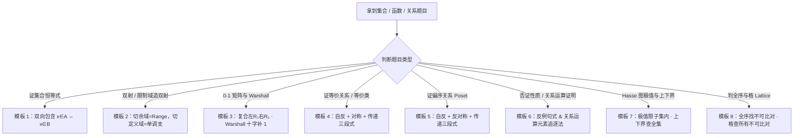

## 6.1 八大必考题型通用英文答题模板（直接背上考场）

期末考试关于集合、函数与关系的大题，几乎 100% 落在这八套标准 SOP 中。请像填空一样使用下面的英文句式：

### 模板 1：证明集合恒等式 $A = B$（Element Argument）
> **Proof:** To show $A = B$, we show $A \subseteq B$ and $B \subseteq A$.  
> ($\subseteq$) Let $x \in A$ be arbitrary. By definition of …, …, so $x \in B$.  
> ($\supseteq$) Conversely, let $x \in B$ be arbitrary. …, so $x \in A$.  
> Therefore, $A = B$. $\square$

### 模板 2：证明（或限制定义域后证明）函数 $f: A \to B$ 是双射（Bijection）
> - **One-to-one:** Assume $f(x_1) = f(x_2)$ for $x_1, x_2 \in A$. Then [代入化简] $\implies x_1 = x_2$. Hence $f$ is one-to-one.  
> - **Onto:** Let $y \in B$ be arbitrary. Choose $x = \text{[用 } y \text{ 解出的表达式]}$. Since $y \in B$, we have $x \in A$ [务必验明 $x$ 落在定义域内！], and $f(x) = \dots = y$. Hence $f$ is onto.  
> Since $f$ is both one-to-one and onto, $f$ is a one-to-one correspondence (invertible). $\square$

### 模板 3：复合矩阵 $M_{R_2 \circ R_1}$ 与 Warshall 传递闭包
- 写 $M_{R_2 \circ R_1}$ 前先默念：**右边先走放左边** $\implies M_{R_2 \circ R_1} = M_{R_1} \odot M_{R_2}$。
- 写 Warshall 传递闭包：先令 $W_0 = M_R$，每步标出第 $k$ 个中转顶点所在列为 $1$ 的行 $C_k$ 与所在行为 $1$ 的列 $R_k$，将 $C_k \times R_k$ 置 $1$，依次写出 $W_1, W_2, \dots, W_n$。

### 模板 4：证明 $R$ 是等价关系（并求等价类）
> - **Reflexive:** For every $a \in A$, [验证 $(a,a)\in R$], so $R$ is reflexive.  
> - **Symmetric:** For all $a, b \in A$, assume $(a,b) \in R$. Then …, so $(b,a) \in R$.  
> - **Transitive:** For all $a, b, c \in A$, assume $(a,b) \in R$ and $(b,c) \in R$. Then …, so $(a,c) \in R$.  
> Thus $R$ is an equivalence relation. The equivalence class of $a$ is $[a]_R = \{x \in A \mid (a,x) \in R\} = \dots$

### 模板 5：证明 $R$ 是偏序关系（Poset）
> 同上分三段写 **Reflexive**、**Antisymmetric**（Assume $(a,b)\in R$ and $(b,a)\in R \implies \dots \implies a = b$）、**Transitive**。

### 模板 6：否证（Disprove）反例句式 & 关系运算性质 Prove/Disprove（如 Test 02 Q4）
- **成立时（Element-Chasing）**：先写 `True.`，再写 `Let a, b ∈ A and assume (a, b) ∈ S ∩ R ...`，拆集合运算定义 $\to$ 分别套用 $R, S$ 的已知性质 $\to$ 合回目标集合定义。
- **不成立时（Counterexample）**：先写 `False.`，再在 $A=\{1,2,3\}$ 上给最小反例并点明缺哪一对：
  - Not reflexive: `"Since 1 ∈ A and (1,1) ∉ R, R is not reflexive."`
  - Not symmetric: `"Since (1,2) ∈ R but (2,1) ∉ R, R is not symmetric."`
  - Not antisymmetric: `"Since (2,3) ∈ R and (3,2) ∈ R with 2 ≠ 3, R is not antisymmetric."`
  - Not transitive: `"Since (2,4) ∈ R and (4,10) ∈ R, but (2,10) ∉ R, R is not transitive."`

### 模板 7：Hasse 图极值与上下界防错检查单
1. 圈出题目问的是哪个子集 $B$；
2. 问 **minimal / maximal / least / greatest** $\to$ 先把不属于 $B$ 的点全部遮住！有 $\ge 2$ 个 minimal 则 least 必写 `None`；有 $\ge 2$ 个 maximal 则 greatest 必写 `None`；
3. 问 **upper / lower bounds / LUB / GLB** $\to$ 在全集 $A$ 里找能包住整个 $B$ 的公共上/下界，别漏掉 $B$ 自己的边界元素（因自反性 $65\mid 65$）！

### 模板 8：判断偏序集是否为全序（Total Order）与格（Lattice）
- **Total order**: 找一对不可比元素 $a,b\in A$（$a\npreceq b \land b\npreceq a$）即可证 **No**；若成单链则 **Yes**。
- **Lattice**: 只查图中所有**不可比元素对** $\{a,b\}$：若每一对在全集 $A$ 中都有唯一 LUB 和唯一 GLB 则 **Yes**；只要抓出一对无公共上/下界，或上界无最小元（蝴蝶结），立即举该对证 **No**。

---

## 6.2 高频易错点与勘误汇总表（考前最后 5 分钟扫视）

| 易错重灾区 | 错误直觉 / 常见废案 | 正确结论与防坑铁律 |
|---|---|---|
| 空集与套壳空集 | 以为 $\{\varnothing\}$ 是空集，或 $\{\varnothing\}\notin\{\{\varnothing\}\}$ | $|\varnothing|=0$，而 $|\{\varnothing\}|=1$（装了一个空盒的盒子） |
| 集合并集记号 | 把非负实数写成 $\{\mathbb{R}^+, 0\}$（Test 02 Q1c 手写瑕疵） | 写 $[0,+\infty)$ 或 $\mathbb{R}^+\cup\{0\}$；花括号里放集合名会变成“集合的集合” |
| 函数满射与论域 | 以为 $f(n)=n^3$ 在 $\mathbb{Z}\to\mathbb{Z}$ 上像实数一样是双射 | 在 $\mathbb{Z}\to\mathbb{Z}$ 上 $2$ 没有整数立方根，**不是 onto**！ |
| 复合矩阵左右顺序 | 算 $M_{R_2\circ R_1}$ 时左放 $M_{R_2}$ 乘右放 $M_{R_1}$ | **先作用的 $R_1$ 必须在左边**：$M_{R_2\circ R_1} = M_{R_1} \odot M_{R_2}$ |
| 关系计数笔误 | 照抄 Tutorial 05 Q4a 误印的 $2^{16}=65535$ | $2^{16} = \mathbf{65536}$；反对称是 $2^n\cdot 3^{n(n-1)/2}$，非对称是 $3^{n(n-1)/2}$ |
| 实数上 $xy\ge 0$ | 照抄 Tutorial 05 Q7g 误判为传递 | **不传递**！$(-1,0)\in R$ 且 $(0,2)\in R$，但 $(-1,2)\notin R$（$0$ 搭桥破传递） |
| 整数上 $x^2\ge y$ | 受 $0.5^2 < 0.5$ 误导判为不自反 | 题干限定 **integers $\mathbb{Z}$**，对一切整数 $x^2\ge x$ 恒真，**是自反的**！ |
| 子集最大元越界 | 求 $\{5,10,65\}$ 的 greatest element 填了 $650$ | Greatest 必须属于该子集！$650\notin\{5,10,65\}$，应填 **None** |
| 有限整除偏序判格 | 见 $\operatorname{lcm}(10,13)=130\notin A$ 就判不是 Lattice | 在 $A$ 内 $\{10,13\}$ 的上界为 $\{650\}$，故 $\text{lub}_A\{10,13\}=650$ 存在，**是 Lattice**！ |

---

## 6.3 期末通关自测 10 题（先独立作答，再点击展开核对答案）

1. 判断真假并说明理由：(a) $\varnothing \subseteq \{\varnothing\}$；(b) $\varnothing \in \varnothing$；(c) $\{\varnothing\} \subseteq \{\varnothing, \{\varnothing\}\}$；(d) $|\mathcal{P}(\mathcal{P}(\varnothing))| = 4$。
2. 解释为什么 $A \times B \times C$ 与 $(A \times B) \times C$（$A,B,C\neq\varnothing$）不相等。
3. 设 $f: \mathbb{Z} \to \mathbb{Z},\ f(n) = \lceil n/2 \rceil$；$g: \mathbb{Z} \to \mathbb{Z},\ g(n) = 2n + 1$。分别判断 $f, g$ 是否为 one-to-one、onto、invertible；并求 $(f \circ g)(n)$ 与 $(g \circ f)(n)$。
4. 设 $f(x) = e^x$ 是从 $\mathbb{R}$ 到 $\mathbb{R}$ 的函数。说明为何 $f$ 不可逆，并给出使 $f$ 可逆的限制定义域/余域及反函数 $f^{-1}$（Tutorial 04 Q14）。
5. 设 $|A| = 3$。求 $A$ 上：(a) 二元关系总数；(b) 自反关系数；(c) 对称关系数；(d) 反对称关系数；(e) 非对称关系数；(f) 既是自反又是反对称的关系数。
6. 设 $R$ 在 $\{0,1,2,3\}$ 上由有序对 $\{(0,1),(1,1),(1,2),(2,0),(2,2),(3,0)\}$ 给出。用 Warshall 算法完整写出 $W_0, W_1, W_2, W_3, W_4$ 求传递闭包（Tutorial 05 Q8c）。
7. **Prove or disprove**：若 $R_1, R_2$ 是集合 $A$ 上的传递关系，则 $R_1 \cup R_2$ 也是传递关系。
8. 设 $A$ 为非空集合，$f: A \to B$ 为任意函数，在 $A$ 上定义 $(x,y)\in R \iff f(x)=f(y)$。证明 $R$ 是等价关系，并写出其等价类集合构成的划分（Tutorial 06 Q5）。
9. 证明：若 $(S, R)$ 是偏序集，则其对偶 $(S, R^{-1})$ 也是偏序集（Tutorial 06 Q7）。
10. 对偏序集 $(\{3, 5, 9, 15, 24, 45\}, \mid)$（Tutorial 06 Q12）：求全集的极小元、极大元、最小元、最大元；求 $\{3,5\}$ 的 LUB、$\{15,45\}$ 的 GLB；并判断它是否为格（Lattice）。

点击展开 / 收起：自测 1–10 标准参考答案与得分点

1. **(a) True**（空集是任何集合的子集）；**(b) False**（空集无元素）；**(c) True**（元素 $\varnothing$ 在右集合中）；**(d) False**！因为 $|\mathcal{P}(\varnothing)| = 2^0 = 1$（即 $\{\varnothing\}$），再套一层 $|\mathcal{P}(\{\varnothing\})| = 2^1 = \mathbf{2}$（即 $\{\varnothing, \{\varnothing\}\}$），套三层 $|\mathcal{P}(\mathcal{P}(\mathcal{P}(\varnothing)))| = 2^2 = 4$！
2. $A\times B\times C$ 的元素是有序三元组 $(a,b,c)$，而 $(A\times B)\times C$ 的元素是第一分量为二元组的有序二元组 $((a,b),c)$，元素结构不同故不相等。
3. $f(n)=\lceil n/2\rceil$：**非单射**（$f(1)=f(2)=1$）、**满射**（对任意 $k\in\mathbb{Z}$ 取 $n=2k$）、不可逆；$g(n)=2n+1$：**单射**（$2n_1+1=2n_2+1\Rightarrow n_1=n_2$）、**非满射**（偶数 $0$ 无整数原像）、不可逆。复合：$(f\circ g)(n) = \lceil (2n+1)/2 \rceil = \lceil n + 0.5 \rceil = n + 1$（是双射！）；$(g\circ f)(n) = 2\lceil n/2 \rceil + 1$。
4. 因对一切 $x\in\mathbb{R}$ 有 $e^x > 0$，负数与 $0$ 无原像，故 $\mathbb{R}\to\mathbb{R}$ 非满射不可逆。保持定义域 $\mathbb{R}$ 不变（$e^x$ 严格递增故已是单射），将余域限制为 $\mathbb{R}^+ = (0, +\infty)$，即成为双射，反函数为 $f^{-1}(y) = \ln y\ (y > 0)$。
5. $n=3$ 时：(a) $2^9 = 512$；(b) $2^{3\times 2} = 64$；(c) $2^{3\times 4/2} = 64$；(d) $2^3 \cdot 3^3 = 8 \times 27 = 216$；(e) $3^3 = 27$；(f) 对角线强制全 $1$（$1$ 种），3 对异点各 $3$ 种 $\Rightarrow 3^3 = 27$。
6. 行列按顶点 $0,1,2,3$ 顺序编号：
   - 初态：$W_0 = \begin{bmatrix}0&1&0&0\\0&1&1&0\\1&0&1&0\\1&0&0&0\end{bmatrix}$；
   - $k=1$（中转顶点 `0`）：顶点 `0` 列为 $1$ 的行 $C_1=\{2,3\}$，顶点 `0` 行为 $1$ 的列 $R_1=\{1\}$，新补 $(2,1),(3,1)$ 得 $W_1 = \begin{bmatrix}0&1&0&0\\0&1&1&0\\1&\mathbf{1}&1&0\\1&\mathbf{1}&0&0\end{bmatrix}$；
   - $k=2$（中转顶点 `1`）：$C_2=\{0,1,2,3\},\ R_2=\{1,2\}$，新补 $(0,2),(3,2)$（其余原本已是 $1$）得 $W_2 = \begin{bmatrix}0&1&\mathbf{1}&0\\0&1&1&0\\1&1&1&0\\1&1&\mathbf{1}&0\end{bmatrix}$；
   - $k=3$（中转顶点 `2`）：$C_3=\{0,1,2,3\},\ R_3=\{0,1,2\}$，新补 $(0,0),(1,0)$ 得 $W_3 = \begin{bmatrix}\mathbf{1}&1&1&0\\\mathbf{1}&1&1&0\\1&1&1&0\\1&1&1&0\end{bmatrix}$；
   - $k=4$（中转顶点 `3`）：顶点 `3` 所在第 4 列全为 $0$（$C_4=\varnothing$），无新增边，故 $W_4 = W_3 = \begin{bmatrix}1&1&1&0\\1&1&1&0\\1&1&1&0\\1&1&1&0\end{bmatrix}$。
7. **Disprove (False)**：在 $A=\{1,2,3\}$ 上取 $R_1=\{(1,2)\}$，$R_2=\{(2,3)\}$，两者均空真传递；但 $R_1\cup R_2=\{(1,2),(2,3)\}$ 含 $(1,2),(2,3)$ 却不含 $(1,3)$，不传递。
8. 自反：$f(x)=f(x)$；对称：$f(x)=f(y)\Rightarrow f(y)=f(x)$；传递：$f(x)=f(y)\land f(y)=f(z)\Rightarrow f(x)=f(z)$。等价类划分即 $\{f^{-1}(\{b\}) \mid b \in \operatorname{Range}(f)\}$。
9. 自反：$(a,a)\in R \Rightarrow (a,a)\in R^{-1}$；反对称：$(a,b)\in R^{-1}\land (b,a)\in R^{-1} \Rightarrow (b,a)\in R \land (a,b)\in R \Rightarrow a=b$；传递：$(a,b)\in R^{-1}\land (b,c)\in R^{-1} \Rightarrow (c,b)\in R \land (b,a)\in R \Rightarrow (c,a)\in R \Rightarrow (a,c)\in R^{-1}$。
10. 极小元：$3, 5$；极大元：$24, 45$；最小元：None；最大元：None；$\operatorname{lub}\{3,5\} = 15$（上界 $\{15,45\}$）；$\operatorname{glb}\{15,45\} = 15$（下界 $\{3,5,15\}$）；**不是格（Not a lattice）**，例如 $\{24, 45\}$ 在集合中无公共上界，$\{3, 5\}$ 在集合中也无公共下界！

